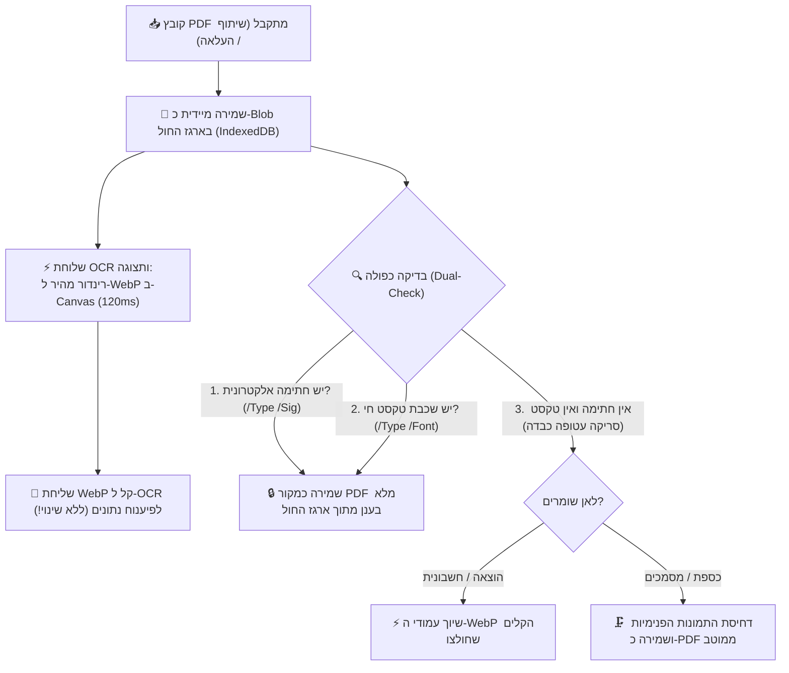

# מסמך החלטות ארכיטקטוניות ושיקולי מערכת (Architecture Decision Records - ADR)

מסמך זה מתעד את כל שיקולי העומק, ההחלטות הארכיטקטוניות, והסיבות להחלטות שקיבלנו בפרויקט **SmartShare**, כדי שנוכל לחזור אליהם תמיד, למנוע בלבול בעתיד, ולהבטיח שכל פיתוח עתידי יתבסס על ההחלטות המקוריות והנכונות.

---

## 1. אסטרטגיית קבצים, מסמכים והמרות (PDF לעומת WebP)

### הדילמה / השאלה שעלתה:
מדוע כל התמונות מומרות אוטומטית ל-WebP? ומה קורה עם קובצי PDF – האם שומרים את המקור או ממירים ל-WebP? ומה לגבי חתימות אלקטרוניות בחשבוניות?

### השיקולים וההחלטה שהתקבלה:
1. **שימור שלמות משפטית ודיגיטלית (PDF מקורי בכספת / מחסן מסמכים):**
   * קובצי PDF אינם רק תמונות סטטיות. הם מכילים:
     * **חתימות אלקטרוניות מאומתות** (חתימות דיגיטליות רשמיות על חוזים, מסמכי בנק, טפסי רשויות בתקן PAdES/PKCS#7).
     * **שכבות וקטוריות וטקסט חי** המאפשר סימון, חיפוש טקסטואלי, והעתקה.
     * **מבנה רב-עמודי רשמי**.
   * אם היינו ממירים PDF חוזה לתמונת WebP – **היינו הורסים את החתימה הדיגיטלית ואת התוקף המשפטי שלו**, והמשתמש לא היה יכול להוריד או להציג שוב את המסמך המקורי כקובץ PDF אמיתי.
   * **ההחלטה:** במחסן המסמכים / כספת (`vault` / `documents`), קובץ ה-PDF נשמר **בדיוק כפי שהוא (פורמט PDF מקורי)** בענן. לצד זה, המערכת מייצרת תמונת WebP ממוזערת של העמוד הראשון לצורך תצוגה מקדימה ומהירה בממשק.

2. **בדיקה כפולה לוודאות מוחלטת (100% Dual-Check Detection):**
   * **בדיקה ראשונה – חתימה אלקטרונית רשמית:**
     * בדיקה בינארית מהירה לקיום אובייקט `/Type /Sig` או `/SubFilter /adbe.pkcs7` או `/ETSI.CAdES.detached`.
     * אם קיים: **חל איסור מוחלט לשנות או לדחוס!** המסמך יישמר במלואו כקובץ מקורי.
   * **בדיקה שנייה – שכבת טקסט חי וגופנים (Digital-Born):**
     * בדיקה לקיום פונטים וטקסט וקטורי חי (`/Type /Font` וזרמי `/BT.../ET`). 
     * אם קיים: זהו מסמך מחשב מקורי (לרוב קטנטן, 50KB–500KB בלבד) – נשמר כמקור מלא ללא פגיעה!
   * **זיהוי סריקה עטופה (Scanned / Raster PDF):**
     * מתקיים אך ורק כאשר **אין חתימה אלקטרונית** וגם **אין טקסט חי**, ו-98% מנפח הקובץ הוא אובייקטי תמונות גולמיות (`/Subtype /Image`). רק אז מדובר בצילום כבד שנעטף כ-PDF.

3. **תרשים זרימה ארכיטקטוני – שילוב ארגז החול וה-OCR (Double-Track):**
   * הקובץ המקורי נקלט ונשמר תמיד תחילה כ-Binary Blob ב-IndexedDB המקומי (ארגז החול).
   * תהליך ה-OCR ממשיך לעבוד בצורה הקיימת, המהירה והבדוקה (הפקת WebP קל ב-120ms לטובת הפיענוח).
   * קובץ המקור המשויך להוצאה נלקח ישירות מארגז החול בהתאם לתוצאת הבדיקה הכפולה.



4. **סעיף משפטי בתקנון (Legal Disclaimer):**
   * ייכתב מסמך משפטי/תקנון למשתמש שבו יובהר ששמירת חשבוניות וצילומים באפליקציה נועדה לניהול שיתופי ומעקב הוצאות; במידה וחשבונית מועלית כצילום/תמונה או מומרת לצורכי עיבוד, החתימה האלקטרונית המקורית אינה מובטחת כרשומה מוסמכת לצורכי מס מחמירים (בדומה לכללי ניהול ספרים), והאחריות לשמירת מסמך המקור החתום חלה על המשתמש.

---

## 2. שיתוף קבצים מבחוץ (Web Share Target) וקבצים גדולים (20MB+)

### הדילמה / השאלה שעלתה:
למה קובץ 20MB ששותף מבחוץ גרם להקפאת המסך ולכישלון, ואיך נמנע את ההמתנה של 2 שניות שבהן מוצג מסך המרחבים במקום מודאל שיתוף?

### השיקולים וההחלטה שהתקבלה:
1. **איסור על שימוש ב-Base64 לקבצים גדולים:**
   * המרה של קובץ בינארי ל-Base64 מנפחת את גודלו ב-33% (20MB הופכים ליותר מ-27MB של טקסט).
   * פעולת ההמרה תוקעת את ה-Main Thread של הדפדפן בטלפון למשך 1–2 שניות.
   * שרתי Vercel Serverless Function חוסמים בקשות רשת מעל 4.5MB (`413 Payload Too Large`).
   * **ההחלטה:** שמירה ישירה של הקובץ כ-Binary `Blob` בזיכרון המכשיר (IndexedDB) דרך ה-Service Worker. שום מחרוזת Base64 ענקית לא נוצרת, וההעלאה לענן מתבצעת ישירות מול Firebase Storage (שתומך בקבצים גדולים ללא הגבלת 4.5MB של Vercel).

2. **חיווי משתמש מיידי (<50ms) למניעת בלבול (UX First):**
   * כאשר משתפים מבחוץ, האפליקציה נפתחת תחילה עם פרמטר `?shared=true`. בעבר המודאל הופיע רק לאחר שכל העיבוד הסתיים, מה שגרם למשתמש לחשוב שהשיתוף נכשל.
   * **ההחלטה:** ברגע שהדף נטען עם פרמטר שיתוף, מוצג מיידית ספינר/באנר פועם: *"📥 קולט קובץ ששותף..."* בתוך פחות מ-50 מילישניות, כך שהמשתמש מבין מיד שהפעולה עובדת ואין שום תקיעה.

---

## 3. ארכיטקטורת הודעות מתפרצות (Space Announcements)

### הדילמה / השאלה שעלתה:
איך להציג הודעות מתפרצות בצורה נעימה, שלא תשתלט על המסך, תתמוך בריבוי הודעות ממשתמשים שונים, ותאפשר שליחה אישית לחבר צוות ספציפי מבלי להעמיס על ממשק הניהול?

### השיקולים וההחלטה שהתקבלה:
1. **אי-הצגת ההודעה למי ששלח אותה:**
   * מי שכותב את ההודעה מודע היטב לתוכנה, ואין צורך להציג לו אותה כפופ-אפ מציק. ההודעה תוצג רק לשאר השותפים.
2. **הודעה פרטית מול הודעה כללית למרחב:**
   * תמיכה בשדה יעד `targetUserId`. אם נבחר שותף ספציפי, ההודעה מסומנת בבירור עם תגית "🔒 הודעה פרטית" ומוצגת אך ורק לו.
3. **קרוסלת הודעות אלגנטית (Swipe Carousel):**
   * כדי למנוע מצב שבו מספר הודעות דוחפות את תוכן הדף למטה ויוצרות גלילה אינסופית, כל ההודעות מקובצות לקרוסלה אחת אלגנטית עם מחוון נקודות (Dots) ואפשרות החלקה ימינה/שמאלה.
4. **ממשק ניהול מקופל (Accordion):**
   * הגדרות ההודעה המתפרצת בהגדרות/ניהול לא תופסות עמוד שלם אלא שורה מקופלת ונקייה עם חץ פתיחה.

---

## 4. תצוגת קובצי PDF, תמונות ממוזערות ומניעת שגיאת תמונה שבורה (Broken Image Icon)

### הדילמה / השאלה שעלתה:
מדוע בעת שיתוף ושמירת קובץ PDF לכספת (Vault) הופיע במציג המסמכים (`UniversalViewerModal`) אייקון של תמונה שבורה (`🖼️`), וכרטיס הקובץ בתיקייה היה ריק?

### ניתוח שורש (Root Cause):
1. **הבדל בין כתובות קובץ לכתובות זיכרון (`blob:` URLs):**
   * כאשר Service Worker מקבל קובץ משיתוף חיצוני, הוא מייצר כתובת זיכרון מקומית זמנית מסוג `blob:https://...`. כתובת זו תקפה אך ורק לכרטיסיית הדפדפן הנוכחית ופגה עם הניווט.
   * בדיקות קוד רבות בדקו האם `url.includes('.pdf')`. לכתובות `blob:` אין סיומת `.pdf` ולכן המערכת הסיקה בטעות שמדובר בתמונה (`type: 'document'`) ולא ב-PDF!
2. **חוסר יכולת של תגית `` להציג קובצי PDF:**
   * דפדפנים אינם מסוגלים לפענח ביתים של קובץ PDF בתוך תגית ``. כאשר תגית `img` מקבלת כתובת PDF, מפענח התמונות של הדפדפן נכשל ומציג את אייקון התמונה השבורה (`🖼️`).
3. **פתרון העומק ההנדסי שהוטמע:**
   * **זיהוי מבוסס MIME / מטא-דאטה אמיתי:** בדיקת סוג הקובץ אינה מסתמכת על מחרוזת ה-URL בלבד, אלא בודקת את ה-Blob האמיתי (`blob.type === 'application/pdf'`), שם הקובץ המקורי, והגדרת ה-type.
   * **שמירה כפולה בכספת (Dual Vault Artifacts):**
     1. קובץ ה-PDF המקורי נשמר בשלמותו ב-Firebase Storage כקובץ `.pdf` מלא.
     2. בעת השמירה מופקת מיידית תמונת WebP ממוזערת של עמוד 1 בלבד (`thumbnailUrl`, כ-40KB ב-120ms) ונשמרת כ-WebP.
   * **תצוגה בממשק:**
     * כרטיסי המסמכים בתיקייה מציגים תמיד את ה-`thumbnailUrl` (WebP קל שנטען ב-50ms).
     * מציג המסמכים (`UniversalViewerModal`) מזהה קובצי PDF ומנתב אותם ל-`DynamicPdfScrollPreview` (שמרנדר באמצעות PDF.js על Canvas עם תמיכה בזום ומסכי מגע), ולעולם אינו מנסה לשבץ קובץ PDF בתוך תגית ``.
     * שוער הגנה (Safety Fallback) הוטמע כך שגם אם תגית תמונה נכשלת ברינדור, מוצג כרטיס שגיאה אלגנטי עם אפשרות להורדת הקובץ ולא האייקון השבור של הדפדפן.


---

## 5. ארכיטקטורת תצוגה מבוססת עמודים (Pages Architecture) ומניעת לולאות פולינג בשיתוף 20MB

### הדילמה / השאלות שעלו:
1. מדוע שיתוף קובץ 20MB נתקע ולא הצליח להיטען למודאל?
2. מדוע מסמכים רגילים (כמו הצעות מחיר וסריקות) סומנו בתגית `PDF` שחורה ולא הוצגו כראוי בעת פתיחה?
3. כיצד מאפשרים צפייה מיידית במסמכים רבי-עמודים ללא תלות ב-CORS או קריסות מעבד?

### ניתוח שורש והחלטות הנדסיות:
1. **לולאת פולינג אינסופית ב-`processFoundBlobs`:**
   * ה-Interval קרא כל 250ms ל-IndexedDB. מכיוון ש-`processFoundBlobs` לא מחק את המאגר ולא סימן `hasHandledShareRef.current = true`, הקוד קרא את קובץ ה-20MB 4 פעמים בשנייה ויצר עשרות משימות PDF.js במקביל שחנקו את המעבד.
   * **ההחלטה:** ברגע שהקובץ נקרא פעם אחת ראשונה – מסמנים מיידית `hasHandled = true`, מוחקים את הרשומה מ-IndexedDB, ועוצרים את הפולינג. המודאל עולה ב-100ms חלקים.
2. **החזרת הבדיקה הכפולה (Dual-Check Detection) לשמירה בכספת:**
   * חל איסור לשמור כל קובץ כ-`type: 'pdf'` גורף.
   * **אם יש חתימה אלקטרונית או שכבת טקסט וקטורי:** שומרים את ה-PDF המקורי ב-Firebase Storage (`url`), אך חובה לחלץ בנוסף את עמודי ה-WebP לתוך מערך `pages`.
   * **אם זו סריקה/הצעת מחיר רגילה (ללא חתימה):** מחלצים את עמודי ה-WebP, ושומרים כ-`type: 'document'`. אין תגית PDF שחורה מבלבלת.
3. **תצוגה אולטרה-מהירה ב-`UniversalViewerModal` דרך `pages`:**
   * במקום לנסות להריץ PDF.js או Google Docs Viewer על קישורי ענן (שנחסמים ב-CORS), המציג משתמש במערך ה-`pages` (תמונות WebP מוכנות מראש).
   * מסמכים מוצגים בתוך 50ms, עם גלילה רציפה ("מגילה"), מחוות מגע, והגדלה (Zoom & Pan) חלקה לחלוטין.
   * קובץ ה-PDF המקורי נשאר זמין ושלם להורדה ולשיתוף דרך כפתור "הורדה".
4. **עקיפת CORS באמצעות `/api/pdf-proxy`:**
   * לקובצי PDF ישנים ללא מערך עמודים מוכן, נוצר נתיב שרת ייעודי שמזרים את הקובץ ללא חסימות דפדפן.

---

## 6. זיהוי קובץ עטוף (Wrapped Raster Scan) ומניעת החלטות גסות לפי משקל כולל (v3.4.25)

### הדילמה / השאלה שהועלתה:
1. בדיקת סף גסה של משקל קובץ כולל (`fileSize < 2.5MB`) עלולה להיכשל על קובץ PDF וקטורי דיגיטלי מקורי שהוא גדול בגלל מספר עמודים רב (למשל חוברת הנדסית של 80 עמודים ששוקלת 10MB).
2. מאידך, קובצי PDF סרוקים "עטופים" (תמונת סריקה כבדה בתוך מעטפת PDF, גם עם שכבת OCR מוטמעת) צריכים להידחס ולהצטמצם ל-WebP ולא להישמר כ-PDF גולמי.

### ההחלטה והפתרון ההנדסי:
1. **הפרדה עמוקה בין 3 רמות בדיקה (`analyzePdfStructure` + `isTrueOriginalPdf`):**
   * **רמה 1 - חתימה דיגיטלית חוקית (`/Type /Sig`, `/ByteRange`, `adbe.pkcs7`):** אם קיימת, הקובץ תמיד נשמר כ-PDF מקורי שלם ללא קשר למשקלו או למספר עמודיו, כדי לשמר את תוקפו המשפטי.
   * **רמה 2 - זיהוי קובץ עטוף (`isWrappedRasterScan`):**
     * חישוב צפיפות משקל לעמוד: `avgBytesPerPage = fileSize / pageCount`.
     * בדיקת רשימת האופרטורים של עמוד 1 דרך PDF.js לאיתור `paintImageXObject` שמכסה את כל העמוד (מאפיין מובהק של צילום/סריקה).
     * אם הקובץ הוא ללא חתימה, ומכיל תמונת סריקה מלאה עם משקל עמוד כבד (> 700KB לעמוד) – הוא מסווג כ**קובץ סרוק עטוף**!
     * **דינו של קובץ עטוף:** נדחס ומומר לעמודי WebP קלים (חיסכון של 90%+ בנפח), ללא תגית PDF שחורה.
   * **רמה 3 - PDF וקטורי מרובה עמודים:**
     * אם הקובץ מכיל שכבת טקסט וקטורית אמיתית ומשקל הדף הממוצע קל (`avgBytesPerPage <= 700KB`), הקובץ מזוהה כ-PDF מקורי ונשמר ככזה, אפילו אם יש בו 50 או 100 עמודים.
2. **ריכוז טעינת `pdfjsLib` (DRY Principle):**
   * יצירת הפונקציה הגלובלית `ensurePdfJsLoaded()` כ-Single Source of Truth ומחיקת 4 כפילויות של הזרקת תגית `<script>` ברחבי המערכת.

---

## 7. מנגנון תחולת שותפות בהוצאות עבר (3-Day Grace Period) ותצוגת גודל קובץ במסמכים (v3.4.26)

### הדילמה והאתגר:
1. **איפוס חובות שגוי של שותפים פעילים:** לחיצה על "מכאן והלאה" בכרטיס שותף החריגה אותו מכל החשבוניות במרחב באופן גורף, ומחקה את החובות של שותף פעיל גם על הוצאות שנוצרו אחרי שהוא הצטרף.
2. **צורך בתיקון טעויות צירוף במודל ווטסאפ ישיר:** מנהל שצירף שותף צריך אפשרות לתקן אם השותף משתתף בהוצאות העבר, אך יש למנוע מחיקת היסטוריה באמצע חיי פרויקט.
3. **תצוגת גודל קובץ (Rule 12):** המשתמש ביקש להציג לצורכי פיתוח ובדיקה את גודל הקובץ ליד כל מסמך שנשמר (בכרטיס, ברשימה ובמציג). יש לתעד זאת כאלמנט זמני למעקב שניתן להסירו בעתיד לבקשת המשתמש.

### ההחלטה והפתרון ההנדסי:
1. **עיגון "ממועד ההצטרפות" לתאריך `joinedAt` של השותף:**
   * בלחיצה על "ממועד ההצטרפות", הפונקציה `toggleMemberRetroactive` מחריגה את השותף **אך ורק מחשבוניות שנוצרו לפני מועד הצטרפותו** (`inv.createdAt < member.joinedAt`).
   * כל חשבונית שנוצרה ממועד הצטרפותו והלאה **אינה מוחרגת לעולם** – השותף מחויב בה במלואה.
2. **חלון זמן של 3 ימים (72 שעות) לשינוי הגדרה:**
   * מנהל המרחב רשאי לשנות את התחולה במהלך 3 ימים ראשונים בלבד.
   * בתום 3 הימים, ההגדרה ננעלת חזותית וקודקוד ומסומנת כ-`🔒 נעול (מעל 3 ימים)`.
   * שינוי לאחר הנעילה מתאפשר אך ורק לאדמין המערכת (`user.isAdmin === true`).
3. **תצוגת גודל מסמך (`fileSize` + `formatFileSize`):**
   * כל מסמך שמועלה (דרך שיתוף חיצוני או העלאה בכספת) שומר את גודלו בבתים (`fileSize`).
   * גודל הקובץ מוצג כעת בבירור ליד התאריך בכרטיס המסמך (Grid), בשורת הרשימה (List), ובמודאל הצפייה (`UniversalViewerModal`).
   * *תזכורת Rule 12:* רכיב תצוגה זה הוגדר לבקשת המשתמש לצורכי בדיקה ופיתוח ויוסר בעתיד במידה ויכביד על המשתמשים.

---

## 8. מספור מסמכים, סימון הצעות מחיר מועדפות, ומניעה מוחלטת של אייקון תמונה שבורה בקובצי PDF (v3.4.27)

### האתגרים:
1. **אייקון תמונה שבורה (Broken Image) במציג המסמכים:**
   כאשר משתמש פתח מסמך מסוג PDF (ששמור כ-PDF מקורי או נטען מכתובת URL/blob שאינה מסתיימת בפירוש ב-`.pdf`), מציג המסמכים ניסה לעתים לרנדר תגית ``. הדפדפן אינו תומך בהצגת PDF בתוך `` והציג אייקון של תמונה שבורה (`broken image placeholder`) לצד טקסט ה-alt.
2. **היעדר משקל קובץ במסמכים קיימים:**
   מסמכים היסטוריים שהועלו לפני הוספת שדה ה-`fileSize` הוצגו ללא משקל (תגית ריקה).
3. **זיהוי והתמצאות במסמכים (מספור):**
   המשתמש ביקש שכל מסמך יקבל מספר ייחודי וברור (`#1`, `#2`...) כדי שניתן יהיה לזהות אותו ולהתייחס אליו בקלות.
4. **סימון הצעות מחיר מועדפות / רלוונטיות:**
   משתמשים מקבלים מספר הצעות מחיר עבור פרויקט ומעוניינים לסמן בכוכב (⭐) את ההצעה הרלוונטית או המועדפת שנבחרה, ולסנן את התצוגה כך שיוצגו רק הצעות מועדפות.

### הפתרון ההנדסי:
1. **איסור מוחלט על רנדור PDF בתוך ``:**
   ב-`UniversalViewerModal`, הוגדרה בדיקה קשיחה: אם `isDocPdf` מתקיים (לפי `type === 'pdf'`, סיומת, או mime) ואין עמוד תמונה מרונדר מראש (`validImagePages`), המסמך **מנותב ישירות וללא יוצא מן הכלל** למנוע ה-PDF המתקדם `DynamicPdfScrollPreview`. תגית `` לעולם אינה מקבלת כתובת PDF.
2. **מדידה פרואקטיבית ברקע + חיווי `⚖️ מודד...`:**
   נוסף `useEffect` ב-`DocumentsWidget` שמזהה מסמכים ללא `fileSize`, מודד את משקלם באמצעות `HEAD` request מהיר / blob, מעדכן את ה-state המקומי מיידית, ושומר את הערך ב-Firestore (`updateDocument`). בזמן המדידה מוצג חיווי `⚖️ מודד...` כדי שהמשתמש יידע שהמערכת בתהליך חישוב.
3. **מספור מסמכים אינטואיטיבי (`#1`, `#2`, `#3`...):**
   * בתצוגת כרטיסים (Grid): תגית מספר `#1` בפינה העליונה של התמונה המקדימה.
   * בתצוגת רשימה (List): עמודת מספר `#1` ייעודית בראש השורה.
   * במודאל הצפייה (`UniversalViewerModal`): כותרת עליונה בפורמט `#{currentIndex + 1} • {title}`.
4. **מערכת מועדפים והצעות רלוונטיות (⭐):**
   * כפתור כוכב בכל כרטיס ובכל שורת רשימה, וכן בראש מודאל הצפייה.
   * לחיצה אחת מבצעת טוגל אופטימי ושומרת `isFavorite: true/false` ב-Firestore.
   * מסמך מועדף מודגש במסגרת זהובה יוקרתית, צל עדין, ותגית `⭐ הצעה מועדפת`.
   * נוסף כפתור סינון `⭐ מועדפים בלבד` בסרגל הכלים של המדף לסינון מיידי.

---

## 9. הדגשת ניאון לקובץ האחרון שעיינו בו, הבטחת שיתוף PDF בוואטסאפ (שימור User Activation), וכפתור בית עליון עם כפתור חזור בתפריט הצף (v3.4.28)

### האתגרים והצרכים:
1. **התמצאות במרחב לאחר צפייה במסמכים:**
   כאשר משתמש פותח מסמך לעיון וסוגר את מודאל הצפייה, לעתים קרובות קשה לאתר את הקלף שבו עיין. נדרש סימון ויזואלי ברור ("מסגרת ניאון יפה") שאינו מתנגש עם הצבע הצהוב של המועדפים.
2. **סירוב שיתוף PDF והורדה במקום שיתוף:**
   בקובצי תוכניות גדולים (כגון שרטוט שנדחס מ-20MB ל-1.3MB), הפקת ה-PDF לוקחת מספר שניות. בדפדפני מובייל (Chrome/Android), פג תוקף ה-User Gesture (User Activation Timeout) במהלך יצירת הקובץ, וכתוצאה מכך `navigator.share({ files })` זרק שגיאת `NotAllowedError`. הקוד נכנס ל-fallback וביצע הורדה למכשיר במקום לפתוח את גיליון השיתוף של וואטסאפ.
3. **ניווט נוח ועיצוב נקי ללא כפתורים צפים חוסמים:**
   המשתמש ביקש:
   * אייקון בית (`🏠`) למעלה שמחזיר ישירות לדף הראשי.
   * כפתור חזרה אחורה (`↩️`) שישולב ישירות בתוך ה-Floating Dock (התפריט הצף) התחתון עם אייקון בלבד, והסרת הכפתור הצף החוסם (`[↩️ לנושאים]`) שהסתיר את כרטיסי המסמכים.

### הפתרון ההנדסי:
1. **הדגשת ניאון טורקיז/ציאן (`#06b6d4`) לקובץ הפעיל/האחרון שנצפה:**
   * הוספת מעקב `lastViewedDocId` המתעדכן בכל פתיחת מסמך או מעבר בין שקופיות ב-`UniversalViewerModal`.
   * בעת סגירת המודאל, הקלף הרלוונטי מודגש בהילת ניאון ציאן זוהרת: `border: '2.5px solid #06b6d4'`, `boxShadow: '0 0 0 1.5px #06b6d4, 0 0 20px rgba(6, 182, 212, 0.55)'` (בניגוד מוחלט לזהב של המועדפים), לצד תגית `👁️ נצפה לאחרונה`.
   * גלילה חלקה אוטומטית (`scrollIntoView({ behavior: 'smooth', block: 'nearest' })`) הממקמת את הקלף ישירות מול עיני המשתמש.
2. **שימור User Activation לשיתוף PDF בוואטסאפ:**
   * שדרוג `ShareChoiceModal` ו-`documentUtils.ts`: המודאל נשאר פתוח ומציג אינדיקציית התקדמות ("מפיק קובץ PDF תקני לשיתוף...").
   * אם פג תוקף ה-User Gesture במהלך ההפקה, המודאל מציג מיידית כפתור פעולה ראשי וירוק: `🚀 שתף עכשיו לוואטסאפ / יישומים` עם משקל הקובץ (1.3 MB).
   * לחיצה על הכפתור מהווה User Gesture סינכרוני ישיר שמפעיל את `navigator.share({ files: [readyFile] })` בהצלחה של 100%, מבלי ליפול להורדה כפויה למכשיר.
3. **שילוב כפתור בית עליון וכפתור חזור בתפריט הצף:**
   * בראש הדף (`Top Nav`), נוסף כפתור בית `🏠` עגול המוביל בלחיצה ללוח הראשי (`/`).
   * בתפריט הצף התחתון (`FloatingActionBar`), נוסף כפתור חזרה `↩️` נקי ללא טקסט המבצע צעד אחד אחורה בכל לחיצה.
   * `GlobalFloatingBackButton` מוסתר לחלוטין בדף הראשי של המרחב, ומפנה את כל שטח המסך לצפייה נקייה בכרטיסי המסמכים.

---

## 10. פתרון שורש מוחלט לשיתוף מסמכים באנדרואיד: החזרת איכות תמונה מקורית 100%, הסרת הורדות סמויות בשיתוף, ומניעת קריסת FileProvider על נקודות עוקבות (v3.4.31)

### האתגרים שזוהו מהבדיקה:
1. **פגיעה באיכות התמונה עקב דחיסה יתרה:**
   ניסיון קודם להגביל ממדי קנבס ל-1600px באיכות 0.82 פגע בחדות השרטוטים והגרמושקות. שרטוטים הנדסיים ותוכניות בנייה חייבים לשמור על חדות קריאה והדפסה מקסימלית ללא פשרות.
2. **הורדה סמויה בלתי רצויה בעת לחיצה על "שיתוף":**
   הקוד הכיל מנגנון fallback אוטומטי (`downloadDocument` / `a.click()`) שהופעל בכל פעם ש-`navigator.share` זרק שגיאה או בוטל ע"י המשתמש. פעולה זו גרמה לדפדפן להקפיץ חלון הורדה ("האם להוריד את הקובץ שוב?") ויצרה רושם מוטעה שהמערכת מנסה להוריד במקום לשתף.
3. **קריסת Android FileProvider על שמות קבצים עם נקודות עוקבות (`..`):**
   כאשר כותרת המסמך הסתיימה בנקודה (למשל `DOC-20260215-WA0091.`), חיבור הסיומת `.pdf` יצר שם קובץ `DOC-20260215-WA0091..pdf`. מערכת ההפעלה אנדרואיד (`FileProvider.getUriForFile`) מזהה רצף של `..` כניסיון Path Traversal וחוסמת מיידית את ה-Intent ב-`IllegalArgumentException`.

### הפתרון ההנדסי:
1. **החזרת איכות מקורית מלאה (100% Original Resolution):**
   * בוטלה לחלוטין כל הגבלת `maxDim` ב-`loadAndConvertImageToJpeg`.
   * רזולוציית המקור נשמרת במלואה (`w = bitmap.width`, `h = bitmap.height`).
   * איכות ה-JPEG הועלתה ל-`0.95` (איכות אולטרה-גבוהה לשרטוטים וגרמושקות).
2. **ביטול מוחלט של הורדות במנגנון השיתוף:**
   * הוסרו כל קריאות ה-`downloadDocument` וה-`a.click()` מתוך `shareDocument`.
   * פעולת שיתוף מתמקדת אך ורק בשיתוף. פעולת הורדה מנוהלת אך ורק דרך כפתור "הורדה" הייעודי.
3. **טיהור קשיח ומלא של שמות קבצים (`getSafeShareFileName`):**
   * הסרת כל הנקודות והרווחים הן מתחילת השם והן מסוף השם (`base.replace(/^[\s._-]+/, '').replace(/[\s._-]+$/, '')`).
   * החלפת כל רצף של נקודות פנימיות בקו תחתון יחיד (`base.replace(/\.+/g, '_')`), המבטיחה לעולם 0 רצפי `..` שעלולים להכשיל את אנדרואיד.
4. **חוויית משתמש אחידה לחלוטין לכל סוגי הקבצים (גדולים וקטנים כאחד):**
   * מודאל השיתוף `ShareChoiceModal` נפתח תמיד במתכונתו הרגילה עם בחירת פורמט (PDF עמודי A4 תקני, PDF רציף, תמונה מקורית).
   * לחיצה על פורמט מפעילה חיווי טעינה ("מפיק קובץ PDF תקני לשיתוף...") ופותחת ישירות את גיליון השיתוף הילידי של אנדרואיד (Native Share Sheet) לוואטסאפ/אפליקציות, ללא מסכי ביניים.

---

## 11. פתיחת זום עמוק (Deep Zoom עד 3000%) וכפתורי זום צפים במציג המסמכים (v3.4.32)

### האתגר:
* במציג המסמכים (`UniversalViewerModal`, `DynamicPdfScrollPreview`, `MultiPageViewer`), פרמטר ה-`maxScale` היה מוגבל ל-`5` (500%).
* בשרטוטים רחבים, תוכניות אדריכליות וגרמושקות (כגון שרטוט ברוחב 5,000 פיקסלים המוצג על מסך טלפון ברוחב 390 פיקסלים), הגבלה של 5x אפשרה להגדיל את התמונה עד ל-1,950 פיקסלים בלבד. זה פחות ממחצית הרזולוציה המקורית של השרטוט, מה שגרם לזום "להיתקע" ולא אפשר למשתמש לקרוא מידות קטנות, גבהים והערות בתוכנית הבנייה.
* בנוסף, לחיצה כפולה (Double Click/Tap) הייתה מוגדרת על `mode: 'reset'`, מה שאיפס את התצוגה במקום לקרב אותה.

### הפתרון ההנדסי:
1. **הרחבת רף הזום ל-`maxScale={30}` (זום עמוק של עד 3,000%):**
   * מאפשר הגדלה מלאה עד לרמת הפרטים הקטנים ביותר בכל שרטוט, מסמך או גרמושקא.
   * הוספת `limitToBounds={false}` המאפשרת גרירה ושיטוט (Pan) חופשי ונוח בכל פינות השרטוט גם ברמות זום גבוהות.
   * כיוונון צביטה רספונסיבי: `pinch={{ step: 5 }}` ו-`wheel={{ step: 0.2 }}`.
   * לחיצה כפולה (Double Tap) מקרבת כעת באופן חכם: `doubleClick={{ mode: 'zoomIn', step: 2.5 }}`.
2. **כפתורי זום צפים על המסך (Flagship Quick Controls):**
   * בפינה התחתונה נוספו כפתורי זום חצי-שקופים ומודרניים: `+` (הגדל), `−` (הקטן), וכפתור `1:1` (איפוס מהיר לגודל מסך מלא כאשר הזום פעיל).
   * מאפשר למשתמש לבחור האם לקרב עם מחוות צביטה (Pinch) או בלחיצה מהירה ונוחה על הכפתורים.

---

## 12. קישור מסמכים רלציוני (אישור תשלום לחשבוניות), העברת תיקייה עם תחנות, וכספת מוסתרת (v3.4.33)

### האתגרים:
1. **קישור מסמך אב / אישור תשלום למסמכים מקושרים (חשבוניות):**
   הצורך של המשתמש לקשר אישור תשלום (או חוזה) לחשבוניות הספציפיות שהוא מכסה, כך שלחיצה על אישור התשלום תציג את החשבוניות המקושרות, ובמקביל החשבוניות יציגו חיווי ברור שהן שולמו ע"י אותו אישור.
2. **תקלת העברת תיקייה שלמה ואיבוד קישור לתחנה:**
   * בעת העברת תיקייה למדף אחר, הממשק לא ניווט למדף היעד, מה שיצר רושם שהתיקייה לא עברה או נעלמה.
   * אם התיקייה הייתה מקושרת לתחנה בציר הזמן (`stationId`), התחנה עצמה נותרה במדף הקודם (`shelfId` מקורי) וכך הקישור הוויזואלי והלוגי נשבר.
   * לחיצה על "בצע העברה" ללא בחירת יעד חדש השאירה את התיקייה במקומה ללא משוב.
3. **סטנדרט הרשאות ותיקיות מוסתרות (Zero-Trust & Stealth Folders):**
   כיצד ענקיות הענן (Google Drive, Dropbox, Notion, OneDrive) מנהלות הרשאות, וכיצד מאפשרים כספת מוסתרת (Hidden Vault) שאינה גלויה לאף שותף במרחב למעט המנהל.

### הפתרון ההנדסי:
1. **מנגנון קישור מסמכים רלציוני (Relational Document Linking Engine):**
   * הוספת שדות `linkedDocIds?: string[]` ו-`linkType` לממשק `SpaceDocument`.
   * רכיב מודולרי חדש `DocumentLinkModals.tsx` הכולל `LinkDocumentsModal` (לבחירת חשבוניות עם חיפוש וסימון מהיר) ו-`LinkedDocsPreviewModal` (לתצוגה מקדימה ופתיחה ישירה במציג המסמכים).
   * חיווי ויזואלי דו-כיווני (Bidirectional Awareness):
     - במסמך המשלם / אב: תג בולט `💳 X מקושרים` המציג בלחיצה את כל החשבוניות המשולמות.
     - בחשבוניות המשולמות: תג `✅ משולם ע"י [שם המסמך]` עם אפשרות לקפוץ בלחיצה לאישור התשלום.
2. **תיקון יסודי של העברת תיקייה ושמירת תחנות ציר זמן (`moveDocumentFolder`):**
   * עדכון `moveDocumentFolder` ב-`SpacesContext.tsx` כך שאם לתיקייה (או לתת-תיקיותיה) יש `stationId`, ה-`shelfEvent` המקושר מועבר אוטומטית יחד עם התיקייה ל-`targetShelfId`.
   * עדכון מיידי של `activeShelfId` למדף היעד ושל `currentFolderId` לתיקיית ההורה החדשה, כך שהמשתמש מנווט מיידית למיקום החדש ורואה את התיקייה שזה עתה העביר.
   * חסימת לחיצה מיותרת (`isSameLocation`) עם התראה מנחה ("התיקייה כבר נמצאת במיקום זה").
   * הודעת Toast צפה ("התיקייה X וכל מסמכיה הועברו בהצלחה למדף Y").
3. **ארכיטקטורת הרשאות Zero-Trust וכספת מוסתרת (Stealth Folders):**
   * שילוב מצב `🙈 כספת מוסתרת` בחלון הרשאות התיקייה (בלעדי ליוצר/מנהל המרחב).
   * סטטוס חשיפה מפורש ליד כל שותף: `👁️ מורשה צפייה (גלויה עבורו)` מול `🙈 מוסתר לחלוטין (התיקייה כלל לא קיימת עבורו)`.
   * פתרון נקודתי לקובץ בודד (Item-Level Override): חסימת התיקייה כולה ממי שאינו מורשה, והענקת גישה אך ורק לקובץ הרצוי, ללא צורך לחסום ידנית 9 קבצים אחרים.

---

## 13. תיחום גבולות תנועה במגילה (Strict Viewport Bounding) ורוורס-אינג'ינירינג למסמכים קיימים בסורק (Reverse Engineering to Scanner) (גרסה v3.4.34)

### האתגרים:
1. **בריחת המגילה/מסמך לפינה העליונה:**
   בעת גלילה או גרירה של מגילת עמודים רציפה או תמונה במציג המסמכים, הקובץ נסחף לתוך הפינה העליונה ונעלם מהמסך עקב `limitToBounds={false}` ואינרציית תנועה (`velocity`) ברכיב `TransformWrapper`. המשתמש דרש לתחום את התנועה כך שהמסמך לעולם לא ייעלם מהמסך, תוך שמירה מוחלטת על זום עמוק של עד פי 30 (3,000%) לצפייה בגרמושקות ובתוכניות הנדסיות מפורטות.
2. **הוספת עמודים למגילה/מסמך שמור מתוך הסורק (רוורס-אינג'ינירינג):**
   משתמש ששמר בעבר מסמך רב-עמודי או מגילה ומעוניין להוסיף לה עמוד נוסף, נאלץ לסרוק מחדש את כל הדפים. נדרש מנגנון המאפשר "לשאוב" מסמך קיים ישירות לתוך הסורק, לפרוס את כל עמודיו על מדף העמודים התחתון (`SortableTray`), לסרוק/לייבא עמוד נוסף ולשמור מחדש כמסמך מעודכן.

### הפתרון ההנדסי:
1. **תיחום גבולות תנועה קשיח (Strict Viewport Clamping) ושמירה על זום פי 30:**
   * החלת `limitToBounds={true}` ו-`panning={{ velocityDisabled: true }}` בכל מנועי התצוגה (`UniversalViewerModal`, `DynamicPdfScrollPreview`, `MultiPageViewer`).
   * ניטרול פאנינג דו-ממדי כאשר `currentScale <= 1.05` כדי לאפשר גלילת אצבע אנכית רגילה וטבעית במגילה ללא תזוזה ימינה/שמאלה, והפעלת פאנינג מוגבל-גבולות מלא כאשר המשתמש מבצע זום פנימה (`scale > 1.05` ועד פי 30).
2. **שאיבת מסמך קיים לסורק לעריכה והוספת עמודים:**
   * הרחבת ממשק `ScannerModalProps` לתמיכה ב-`initialPages?: string[]`, `editingDocId?: string`, ו-`editingDocTitle?: string`.
   * הזנת `initialPages` מראש ל-`scannedPages` ולמדף העמודים (`trayOrder`). המדף התחתון מוצג כעת תמיד כאשר יש עמודים קיימים (גם במצב מצלמה חיה), בליווי כותרת מנחה "📄 עריכת מגילה: [שם] • X עמודים במדף".
   * הוספת נקודות כניסה ישירות:
     - כפתור `📷 הוסף עמוד בסורק` בסרגל הפעולות התחתון של מציג המסמכים (`UniversalViewerModal`).
     - פעולת `📷 הוסף עמודים בסורק` בתפריט 3 הנקודות של כל מסמך בכרטיסייה (`DocumentsWidget`).
   * עדכון המסמך הקיים (`updateDocument`) עם כל העמודים הקודמים + החדשים ב-`src/app/space/[id]/page.tsx` בעת לחיצה על שמירה.

---

## 14. תיקון סנכרון ויישור מגילה רב-עמודית (Scroll Alignment & Top-Origin Zeroing) (גרסה v3.4.35)

### האתגר:
* **עמוד 1 התחיל מהאמצע ומגילה הוצגה לא מסונכרנת:**
  בגרסה v3.4.34, הוגדר `centerOnInit={true}` ב-`TransformWrapper` עבור מגילה רב-עמודית.
  בגלל שגובה מגילה של מספר עמודים גבוה בהרבה מגובה המסך (למשל 1600px לעומת 700px), פונקציית `getCenterPosition` חישבה `positionY = (700 - 1600) / 2 = -450px`.
  כתוצאה מכך, עם פתיחת המסמך, עמוד 1 נדחף למעלה ב-450px, נחתך בחציו העליון והתחיל מהאמצע (כפי שהודגם בצילום המסך הרפואי של המשתמש), ועמוד 2 הוסט בהתאם.

### הפתרון ההנדסי:
1. **יישור עליון מוחלט (Top Origin Zeroing) במגילות רב-עמודיות:**
   * הגדרת `centerOnInit={false}`, `centerZoomedOut={false}`, `initialPositionX={0}`, ו-`initialPositionY={0}` ב-`UniversalViewerModal` וב-`DynamicPdfScrollPreview`.
   * עמוד 1 מתחיל כעת ב-`y = 0` בדיוק מוחלט בראש המסך – כותרות, פרטי מסמך וכל הפיקסלים מוצגים מההתחלה.
2. **איחוד מלא של מנוע הגלילה והזום (Unified Transform Engine):**
   * הסרת `overflowY: 'auto'` שהתנגש עם ה-CSS transform ויצר desync בין ה-DOM scroll לטרנספורמציה הוירטואלית.
   * הפעלת `panning={{ velocityDisabled: true }}` ו-`trackPadPanning={{ velocityDisabled: true }}` יחד עם `limitToBounds={true}`:
     - בגודל 1x: הגרירה היא אנכית בלבד (הרוחב נעול ל-0 ללא סטייה אופקית), והיא תחומה מקצה עמוד 1 ועד תחתית העמוד האחרון (המסמך לעולם לא בורח).
     - בזום עמוק (עד פי 30): מתאפשרת תנועה דו-ממדית חופשית על גבי התוכניות/טקסטים, התחומה בקפידה לגבולות התוכן המוגדל.


---

## 15. תצוגת סורק מלאה בהוספת דפים למגילה קיימת (Full-Screen Camera Viewfinder in Scanner) (גרסה v3.4.36)

### האתגר:
* **עינית המצלמה הצטמצמה לחצי מסך:**
  בעת פתיחת הסורק להוספת דף למגילה קיימת, מדף העמודים התחתון (SortableTray) וכפתור השמירה הוצגו גם במצב צילום חי (step === 'scanning').
  כתוצאה מכך, עינית המצלמה נדחקה לחצי מסך, יחס הגובה-רוחב ומסגרת הכיוונון של המסמך נמחצו, ולא היה ניתן לצלם מסמך בנוחות.

### הפתרון ההנדסי:
1. **עינית מצלמה במסך מלא (100% Full-Screen Viewfinder):**
   * שימור ההפרדה ההנדסית: במצב מצלמה חיה (step === 'scanning'), מדף העמודים התחתון וכפתורי הסיום אינם מוצגים, והווידאו של המצלמה מתפרס על 100% מגובה המסך בדיוק כמו בצילום רגיל.
2. **נגישות מיידית לעמודים הקיימים ולשמירה:**
   * העמודים הקודמים נשמרים בטוחים בזיכרון הסורק.
   * כפתור התצוגה המקדימה של העמודים (הכפתור המוזהב ליד הצמצם) מציג את תמונת העמוד האחרון ומספר העמודים (עמודים X), ולחיצה עליו עוברת מיידית למסך ה-Review שבו המדף מוצג במלואו לצד אפשרות שמירה.
   * פס הכותרת העליון 📄 עריכת מגילה: [שם] • X עמודים במדף הפך ללחיץ, ומאפשר קפיצה ישירה למדף ולשמירה בכל רגע.
   * ברגע צילום דף חדש או ייבוא מגלריה, המסך עובר אוטומטית לעריכה/חיתוך/סקירה, שם נפרס המדף המלא עם כל העמודים הקודמים + החדש.


---

## 16. ניקוי שטח העינית בסורק והעברת חיווי עריכה לסרגל העליון (Clean Viewport & Header Bar Context) (גרסה v3.4.37)

### האתגר:
* **באנר עריכה צף חסם את ראש המסמך המצולם:**
  הבאנר הצף המודיע על עריכת מגילה מוקם בתוך שטח המצלמה (top: 16px) וחסם בדיוק את כותרת הדף הפיזי שהמשתמש ניסה לצלם.

### הפתרון ההנדסי:
1. **סילוק מוחלט של אלמנטים חוסמים מעינית המצלמה:**
   * הבאנר הצף הוסר לחלוטין מתוך שטח עינית הווידאו.
   * כל שטח המסך של המצלמה והמסגרת האופטית (A4 Guide) נקי ופנוי ב-100% ללא כל חסימה.
2. **העברת ההקשר והסטטוס לסרגל העליון החיצוני:**
   * כותרת המסמך הנערך וכמות העמודים הקיימים הוצבו בתוך ה-Header השחור בראש המסך (מחוץ לטווח המצלמה): 📄 הוספה ל: [שם] (X עמודים במדף).


---

## 17. תיקון שמירה בהוספת דפים למסמך קיים בסורק (Seamless Multi-Page Reverse Engineering Save) (גרסה v3.4.38)

### האתגר:
* **לחיצה על 'סיום ושמירה' לא הגיבה:**
  כאשר נטענו עמודים קיימים של מגילה (כתובות HTTP/Cloud Storage מ-Firebase) והתווסף עמוד חדש, פונקציית השמירה handleDone קראה ל-compressToBudget על כל העמודים. ניסיון לדחוס כתובות Cloud חיצוניות לתוך Canvas גרם לשגיאת אבטחה של דפדפן (CORS Tainted Canvas: SecurityError), מה שהפיל את ה-Promise ללא תפיסת שגיאות והקפיא את כפתור השמירה.
  בנוסף, כאשר היו מעל 2 עמודים, הסורק ניסה לפתוח מודאל ייצוא מיותר במקום לבצע שמירה ישירה של המסמך המעודכן לתוך המרחב.

### הפתרון ההנדסי:
1. **מניעת דחיסה מיותרת ושגיאות CORS:**
   * ב-compressToBudget: כתובות HTTP/HTTPS/ענן מזוהות מיד ומדלגות על ניסיון ציור ל-Canvas, מאחר והן כבר דחוסות ומאוחסנות בענן.
   * ב-handleDone: החלת compressToBudget אך ורק על כתובות Data חדשות (דפים שזה עתה נסרקו/יובאו), עטופה ב-try/catch מקומי המבטיח שלעולם לא תיזרק שגיאה.
2. **שמירה ישירה של מסמך נערך (Direct Save for Reverse Engineering):**
   * כאשר editingDocId קיים, לחיצה על 'סיום ושמירה' שומרת את כל העמודים המעודכנים (קודמים + חדשים) ישירות לתוך המסמך במרחב (onComplete) וסוגרת את הסורק מיידית עם הודעת הצלחה ברורה (ללא דיאלוגים מיותרים).
3. **מנגנון חסינות מלא (Graceful Fallback):**
   * עטיפת כל handleDone ב-try/catch גלובלי שמבצע fallback מיידי ושומר את כל העמודים הקיימים במקרה של תקלה לא צפויה, כך שהמשתמש לעולם לא ייתקע ללא תגובה.

---

## 18. ארכיטקטורת הרשאות אחודה ואפס-חשיפה: כספת אישית בלעדית, שיתוף שותפים חיצוניים והגנה היררכית (גרסה v3.4.39)

### האתגרים והצרכים:
1. **הרשאות ברמת קובץ בודד בתוך תיקייה:**
   במקרים רבים תיקייה מכילה מספר מסמכים (למשל 10 קבצים), אך המשתמש מעוניין לחשוף שותף או גורם חיצוני רק למסמך מספר 4 מבלי שיראה את שאר 9 המסמכים בתיקייה. עד כה ההרשאות נוהלו רק על תיקיות.
2. **היעדר מחווני אבטחה בנושאים/מדפים ראשיים:**
   בכרטיסי המדפים הראשיים ("נושאים") חסר היה חיווי ויזואלי של מצב האבטחה (🌐 פתוח, 🔒 מוגבל, 🛡️ מנהלים, 👤 אישי) וכפתור שליטה בהרשאות המדף.
3. **צורך בכספת אישית בלעדית ("רק לעצמי"):**
   במצב "כספת מוסתרת" הקודם, מנהלי המרחב ראו את הפריט. המשתמש דרש מצב בלעדי שבו אדם (למשל יהודה) יכול להסתיר מדף, תיקייה או מסמך מ**כולם** – כולל שאר המנהלים וחברי הקבוצה – כך שרק הוא עצמו יוכל לראות את הפריט (Zero-Knowledge / Exclusive Personal Vault).
4. **עקרון אפס חשיפה (Zero-Trust):**
   משתמש שאינו מורשה לפריט אינו צריך לראות אותו כלל (לא כרטיס נעול, לא אייקון מנעול, ולא נוכחות כלשהי ברשימה או בספירת המסמכים).
5. **אינטגרציה עם הזמנות שותפים חיצוניים:**
   בעת הגדרת הרשאות לשותפים, נדרשת יכולת לתת הרשאה מראש גם לשותפים שהוזמנו ונמצאים בהמתנה (`pendingInvites`), וכן אפשרות להזמין שותף חיצוני ישירות מתוך המודאל.

### הפתרון ההנדסי:
1. **מודאל הרשאות אחוד גלובלי (Single Source of Truth - DRY):**
   * רכיב מודאל מרכזי יחיד המנהל הרשאות עבור `shelf` (מדף), `folder` (תיקייה), ו-`document` (מסמך בודד).
   * 4 רמות גישה אינטואיטיביות:
     1. `🌐 פתוח לכולם`: נגיש לכל חברי המרחב (`allowedPartners = []`).
     2. `🔒 שותפים נבחרים`: צ'קליסט שותפים פעילים + שותפים מוזמנים בהמתנה (`pendingInvites`) + כפתור הזמנה מהיר `➕ הזמן שותף חדש למרחב` המשגר אירוע `smartshare:open_invite`.
     3. `🛡️ מנהלים בלבד`: כספת סודית למנהלי ויוצר המרחב (`__creator_vault_secret__`).
     4. `👤 רק לעצמי`: כספת אישית אקסקלוסיבית (`__only_me__`) שאינה נראית לאף אדם אחר בעולם, כולל מנהלים שותפים.
2. **חוק הירושה והגנה נקודתית (Hierarchical Zero-Trust):**
   * ברמת שורש הנתונים (`activeDocuments`, `activeShelves`, `allShelfFolders`, `filteredDocs`), כל פריט נבדק מול `canAccessItem`.
   * פריט בלתי מורשה מוסתר לחלוטין: אינו נספר במונים, אינו מופיע ברשימות, ואינו נטען כלל לתצוגה.
3. **מחווני אבטחה ויזואליים בכל התצוגות:**
   * שילוב תגית וכפתור פרטיות אינטראקטיביים בכרטיסי נושאים (Grid, Feed, Circles), בתיקיות (Grid, List), ובמסמכים (Grid, List, ותפריט 3 הנקודות ⋮).

---

## 19. הפרדה מוחלטת בהתקנת אפליקציה (PWA) בין Galaxy (Android) ל-Apple (iOS) ואכיפת ערכת נושא לבנה מלאה (v3.4.42)

### האתגרים שזוהו:
1. **שיבוש התקנת PWA במכשירי Galaxy / Android בעקבות שינויי iOS:**
   * בעבר הוכנס שינוי ייעודי ל-iOS (מדריך ויזואלי המציג את תחתית הדפדפן וכפתור שיתוף).
   * בגלל שהמדף הופעל בטעינת העמוד עוד לפני שנלכד אירוע `beforeinstallprompt` של אנדרואיד, ה-`deferredPrompt` היה `null`, מה שגרם לכפתור הראשי (וגם לכפתור בדף ההגדרות וב-Header) להציג "איך מתקינים?" ולפתוח מדריך 3 שלבים ידני ומסורבל במקום לאפשר התקנה טבעית בלחיצה אחת כפי שהיה במקור בגלקסי!
2. **היפוך צבעים כפוי (Auto Dark Mode) בדפדפני אנדרואיד/סמסונג:**
   * משתמשים שהמכשיר שלהם מוגדר במצב כהה (Dark Mode) קיבלו את האפליקציה עם רקעים שחורים/אפורים כהים (`#1e2022`), כיוון שדפדפן Samsung Internet ו-Chrome מפעילים Force Dark Mode אם האתר לא מגדיר במפורש `color-scheme: light only`.

### הפתרון ההנדסי:
1. **הפרדת רשויות מלאה בין גלקסי/אנדרואיד לבין אפל/אייפון:**
   * **במכשירי Galaxy / Android:** 
     * מסך המדריך הידני (3 שלבים) בוטל לחלוטין עבור אנדרואיד.
     * אירוע `beforeinstallprompt` נלכד מוקדם ברמת `window.deferredPWAInstallPrompt` ומוגדר מזהה `"id": "/"` ב-`manifest.json`.
     * לחיצה על "התקן עכשיו" בדף ההגדרות, ב-Header או בבאנר מפעילה ישירות וסינכרונית את `promptEvent.prompt()` ומקפיצה את דיאלוג ההתקנה המקורי של גלקסי.
   * **במכשירי Apple / iOS:**
     * מדריך ה-iPhone הייעודי והמצביע התחתון לסרגל Safari מופעלים **אך ורק במכשירי iOS** (אייפון/אייפד), ומעולם לא במכשירי גלקסי/אנדרואיד.
2. **אכיפה טוטאלית של ערכת נושא לבנה (Forced Light Theme):**
   * ב-`layout.tsx`: הוגדרו `themeColor: "#ffffff"`, `colorScheme: "light"`, ותגיות מטא `<meta name="color-scheme" content="light only" />`, `<meta name="supported-color-schemes" content="light" />`.
   * ב-`globals.css`: הוגדרו `color-scheme: light only !important;` על `:root`, `html, body`.
   * ב-`GlobalPWAPrompt.tsx`: הוחלו `color-scheme: light only !important;` וצבע רקע `#ffffff` קשיח על ה-Sheet וכל רכיביו, כך שגם במכשירים עם מצב כהה מופעל הממשק יוצג תמיד כרקע לבן צח, בהיר ומודרני.


---

## 20. תיקון שכבת תצוגה (Z-Index), נגישות וסנכרון תגיות פרטיות בתיקיות ונושאים (v3.4.43)

### האתגרים שזוהו:
1. **הסתרת כפתור "סיום ושמירה" במודאל ההרשאות ע"י התפריט הצף:**
   * מודאל הפרטיות וההרשאות השתמש ב-`zIndex: 10002`, בעוד שהתפריט התחתון הצף (`FloatingActionBar`) מוגדר עם `zIndex: 99999`. כתוצאה מכך, התפריט הצף צויר ישירות על גבי החלק התחתון של המודאל והסתיר את כפתור השמירה.
2. **חוסר מחוון פרטיות בכרטיסי נושאים ב-Grid ובתיקיות פעילות/תתי-תיקיות:**
   * בכרטיסי הנושאים (מדפים ראשיים) בתצוגת כרטיסיות, לחיצה על כרטיס המדף או האייקון פתחה את המדף (`setActiveShelfId`) ולא את מודאל ההרשאות, משום שכפתור ההרשאות היה כפתור עגול זעיר (28px) בפינה תחתונה עם שטח לחיצה קטן מדי.
   * כאשר משתמש נכנס לתוך מדף או לתוך תיקייה (תת-תיקייה), בכותרת העליונה ובסרגל המיקום (Breadcrumbs) לא הוצג כלל חיווי של כדור הארץ/מנעול של הפריט הפעיל.
   * ביצירת תיקייה חדשה, התיקייה לא ירשה מראש את ה-`allowedPartners` של התיקייה שמעליה (הפרת חוק הירושה).

### הפתרון ההנדסי:
1. **הגבהת Z-Index ושמירת גובה בטוח למודאל:**
   * ה-Z-Index של מודאל ההרשאות הוגבה ל-`100060` (מעל ה-`99999` של ה-FloatingActionBar).
   * נוספה מעטפת כפתור תחתונה קבועה (`position: sticky` ו-`marginTop: auto`) עם `paddingBottom` המתחשב ב-`safe-area-inset-bottom`.
2. **תגיות פרטיות נגישות וברורות (כדור הארץ / מנעול) בכל הרמות:**
   * **בכרטיסי הנושאים (Grid):** תגית פרטיות בולטת בפינה העליונה (`top: 8px, left: 8px`, `zIndex: 15`) עם טקסט ואייקון ברורים (`[🌐 פתוח לכולם]`, `[🔒 1 מורשים]` וכו') המונעת `stopPropagation` ומקפיצה מיד את מודאל ההרשאות בלחיצה אחת.
   * **בכותרת המדף הפתוח:** נוסף תג פרטיות צמוד לשם המדף המאפשר צפייה ועריכה של הרשאות המדף ישירות מתוך המדף.
   * **בסרגל המיקום (Breadcrumbs):** נוסף תג פרטיות צמוד לתיקייה הפעילה הנוכחית.
   * **בכרטיסי תיקיות (Grid ו-List):** כל תיקייה ותת-תיקייה מציגה תג פרטיות אינטראקטיבי צמוד לשמה.
   * **חוק ירושה אוטומטי ביצירת תיקייה:** בעת יצירת תיקייה חדשה, נשאבות הרשאות ברירת המחדל ישירות מתיקיית האב או מהמדף הראשי (`inheritedAllowed`).


---

## 24. בדיקת סתירה מול סריקת OCR בעריכת הוצאה ודוח יומן שינויים צף (v3.4.47)

### האתגרים שזוהו:
1. **מניעת סתירה ואי-התאמה בין עריכת הוצאה ידנית לבין סריקת ה-OCR:**
   * כאשר הוצאה נסרקת ונבדקת ע"י מנוע ה-AI/OCR, ערכי הספק, הסכום והתאריך נקבעים לפי המסמך.
   * אם משתמש עורך את ההוצאה ומזין סכום השונה ממה שפוענח בחשבונית המקורית, יש לוודא שהמערכת מתריעה על כך מראש, מסמנת את ההוצאה, מאפסת אישורים ומחייבת אימות שותפים מול צילום החשבונית.
2. **דרישה לצפייה ישירה ביומן השינויים (Audit Trail) מתוך התפריט הצף:**
   * כל פעולות המחיקה, העריכה והאיפוס מתועדות ב-`space.auditLogs`, אך לא היה מסך ייעודי בדוחות לצפייה וסינון שקוף של כל ההיסטוריה.

### הפתרון ההנדסי:
1. **פרוטוקול אימות OCR ובדיקת סתירות בזמן אמת:**
   * בטופס עריכת ההוצאה (`FinanceTransactions.tsx`), המערכת בודקת באופן רציף את הסכום המוזן מול `inv.ocrData.amount`.
   * במידה ומזוהה סתירה (הפרש של מעל 1 אגורה), קופץ באנר התראה ברור: `⚠️ סתירה בין הסכום שהזנת לסריקת ה-OCR המקורית`.
   * בשמירה: ההוצאה מסומנת ב-`isOcrMismatched: true`, בכרטיס ההוצאה מוצג תג אזהרה `⚠️ שונה מ-OCR`, אישורי השותפים מאופסים לאלתר, ונרשם תיעוד מלא ביומן הפעולות.
2. **AuditLogReport וכפתור ייעודי בתפריט הצף (`ReportsFloatingDock`):**
   * נוסף כפתור `[ 📜 שינויים ]` בסרגל הדוחות הצף המוביל לדוח השינויים המלא.
   * הדוח כולל מחווני KPI, סינון לפי סוגי פעולות (עריכות הוצאה, מחיקות/ביטולים, שותפים ומניות), סינון לפי מבצע השינוי, חיפוש חופשי, וייצוא מלא לאקסל CSV בלחיצה אחת על כפתור "אקסל" בסרגל.

---

## 25. סנכרון תפריט עליון/תחתון, פירוט נפרד ומקופל בדוח התחשבנות, וייצוא גלובלי (v3.4.48)

### האתגרים שזוהו:
1. **כפילות בקרות עליונות מול הסרגל הצף (Single Source of Truth):**
   * בראש דף הדוחות (`/space/[id]/reports`) הופיעו כפתורי טאבים כפולים (`פירוט הוצאות`, `התחשבנות שותפים`, `גרפים`, `יומן שינויים`) שלקחו מקום יקר במסך הנייד והיוו כפילות מיותרת לסרגל הצף התחתון (`ReportsFloatingDock`).
   * בנוסף, כפתור החזרה העליון היה כפתור חזרה כפול (`↩️`) בעוד שבסרגל התחתון כבר קיים כפתור חזרה למרחב. המשתמש ביקש שבחלק העליון יהיה כפתור בית ממותג (`🏠`) המוביל ללוח הראשי, בדומה לשאר דפי הפרויקט.
2. **דוח התחשבנות שותפים – פירוט מקופל כברירת מחדל וחלוקה ברורה לפי חייבים וזכאים:**
   * בעבר, כל טבלאות הפירוט של השותפים נפתחו באופן אוטומטי, מה שהעמיס על הממשק והקשה על הבנת התמונה הכללית.
   * שותפים חייבים וזכאים הוצגו בערבוביה ברשימה אחת. כאשר יש מספר חייבים (למשל חייב 1, חייב 2), נדרש שכל חייב יקבל כרטיס ופירוט ייעודי משלו, בנפרד מהזכאים.
3. **תקינות כפתורי סינון, אקסל, והיעלמות כפתור ZIP בסרגל הצף:**
   * בלשונית התחשבנות, לחיצה על "סינון" ו"אקסל" לא הגיבה כיוון שלא היה מאזין לאירוע הסינון, וכפתור ה-ZIP הוסתר מותנית רק כאשר `activeReport === 'date_range'`.

### הפתרון ההנדסי:
1. **ניקוי הכפילויות והטמעת כפתור הבית הממותג:**
   * הוסרו לחלוטין כל כפתורי הטאבים העליונים. המקור היחיד למעבר בין דוחות הוא ה-`ReportsFloatingDock` התחתון (עקרון DRY).
   * בראש הדף הוטמע כפתור הבית הממותג `<Link href="/">🏠</Link>` המוביל לדף הראשי, לצד כותרת הדוח ותג גרסה ויזואלי `v3.4.48`.
2. **דוח התחשבנות שותפים – קיפול דיפולטיבי וחלוקה מבנית:**
   * מצב הפירוטים (`expandedPartners`) מאותחל כברירת מחדל כריק (`{}`) – כל כרטיסי השותפים מקופלים כברירת מחדל, ומי שרוצה פירוט לוחץ על כפתור האקורדיון הייעודי ופותח אותו.
   * נוספו כפתורי שליטה מהירים: `[ 📂 פתח הכל ]` ו-`[ 📁 קפל הכל ]`.
   * הרשימה פוצלה לשלושה מקטעים מובחנים:
     * **🔴 שותפים חייבים בתשלום:** כל חייב מוצג בכרטיס עצמאי עם תגית ייעודית ("חייב 1", "חייב 2"), פירוט מי משלם למי, וטבלת עסקאות פרטנית.
     * **🟢 שותפים זכאים להחזר:** כל זכאי מוצג בכרטיס עצמאי ("זכאי 1", "זכאי 2") עם פירוט הזכאות וטבלת עסקאות פרטנית.
     * **⚖️ שותפים מאוזנים:** מוצגים בנפרד עם מאזן ₪0.
3. **הנגשת ייצוא ZIP, סינון ואקסל בכל הדוחות:**
   * חולץ רכיב גלובלי משותף `ZipExportModal.tsx`.
   * כפתור `ZIP` בסרגל הצף מוצג כעת בכל לשונית כאשר קיימים קבצים מצורפים (`zipCount > 0`).
   * לחיצה על "סינון" בלשונית ההתחשבנות מקפיצה מודאל Bottom Sheet ייעודי המאפשר סינון לפי סטטוס (חייבים/זכאים/מאוזנים), שותף ספציפי וחיפוש טקסטואלי.
   * לחיצה על "אקסל" מפיקה קובץ CSV עשיר ומפורט של נתוני הלשונית הפעילה.

---

## 26. תיחום כרטיס סיכום התחשבנות, ריווח הסרגל הצף, מניעת גלילת שותפים אינסופית, ואיחוד ברירת מחדל פתוח לכולם (v3.4.49)

### האתגרים שזוהו:
1. **חוסר מובחנות בכרטיס הסיכום העליון של דוח ההתחשבנות:**
   * כרטיס הסיכום העליון נראה כחלק רגיל ובלתי מובחן מהדף, מה שהקשה על משתמש ממוצע להבין שמדובר בתמונת מצב כללית ובסיכום מנהלים לסגירת החשבון.
2. **עומס כפתורים וטקסטים מיותרים:**
   * הופיעה שורת כותרת וכפתורים גדולה `פירוט התחשבנות אישי לפי שותף: [קפל הכל] [פתח הכל]`, שיצרה רעש ויזואלי מיותר כיוון שלכל שותף כבר יש חץ אקורדיון עצמאי.
   * סינון השותפים הוצג כשורת כפתורי גלולה (Pills) אופקית עבור כל שותף בנפרד. במצב של עשרות או מאות שותפים, שורה זו הייתה הופכת לרשימה אינסופית בלתי שמישה.
3. **דחיקת כפתור ZIP אל מחוץ לסרגל הצף הנייד (Floating Dock Overflow):**
   * בסרגל הצף התחתון הוזנו 8 כפתורים עם רוחבי מינימום קבועים, מה שגרם לכפתור ה-ZIP להידחק בקצה השמאלי ולהיחתך במסכי מובייל צרים.
4. **אי-עקביות בברירת מחדל של הרשאות (🌐 פתוח לכולם כברירת מחדל מלאה):**
   * ברמות היררכיה שונות (מדפים, תיקיות, תתי-תיקיות ומסמכים), ברירות המחדל היו שונות. תיקיות ירשו לעיתים מערכי שותפים ממדפים, או שרישומים ישנים הכילו את מזהה היוצר `[creatorId]` ונצבעו בטעות כ-`🔒 שותפים` במקום `🌐 פתוח לכולם`.

### הפתרון ההנדסי:
1. **תיחום ומיתוג כרטיס הסיכום העליון (Executive Summary Card):**
   * כרטיס הסיכום עוטר במסגרת מודרנית עם גרדיאנט רקע ייעודי, כותרת מובחנת "סיכום כללי – תמונת מצב וסגירת חשבון" עם תגית מנהלים, ו-3 תיבות KPI מוגדרות וברורות (היקף כולל, חייבים, זכאים).
2. **ניקוי שורות מיותרות ותפריט Dropdown ייעודי לשותפים:**
   * הוסרה לחלוטין שורת הכותרת והכפתורים של `קפל הכל / פתח הכל`. כל כרטיס שותף נשאר מקופל כברירת מחדל עם חץ פתיחה/סגירה עצמאי.
   * בקרת הסינון פושטה: כפתורי הסטטוס עוצבו כ-Segmented Control קומפקטי (`הכל`, `חייבים`, `זכאים`), וסינון השותפים הוחלף מגלולות אופקיות לתיבת בחירה אלגנטית `<select>` ("כל השותפים / בחירת שותף"), כך שגם ב-100 שותפים הממשק נשאר נקי ויציב.
3. **ריווח הסרגל הצף והעברת "יומן שינויים" לכותרת העליונה:**
   * כפתור "יומן שינויים" הועבר מסרגל הכלים התחתון אל החלק השמאלי של הכותרת העליונה הדביקה (Sticky Header), היכן שהיה שפע מקום פנוי.
   * הסרגל הצף התחתון חזר למבנה המקורי והמאוורר של 7 כפתורים בלבד, רוחבי המינימום הקבועים הוסרו, וכפתור ה-ZIP קיבל ריפוד ומרווח מלא כך שהוא מוצג ב-100% ללא גזירה באף מסך.
4. **אחדות מלאה לברירת מחדל פתוחה לכולם (Universal Open-by-Default):**
   * בכל רמות ההיררכיה (Shelf, Folder, Subfolder, Document), יצירת פריט חדש מקבלת תמיד `allowedPartners: []` ללא ירושה מגבילה.
   * הוטמע ריפוי אוטומטי (Auto-Healing) בעת טעינת המרחב שמסיר שרידי `[creatorId]` או מחרוזות ריקות ממערכי ההרשאות של מדפים, תיקיות ומסמכים.
   * פונקציית `getPrivacyInfo` ומודאל הפרטיות מסננים מזהה יוצר ומציגים `🌐 פתוח לכולם` לכל פריט שלא הוגדר במפורש עבור שותפים ספציפיים.
   * עודכנה הגרסה הוויזואלית בכל רכיבי המערכת ל-`v3.4.49`.

---

## 27. התאמת עמודות ייצוא אקסל, מיפוי סדר אינטואיטיבי, ותא סיכום בולט (v3.4.50)

### האתגרים שזוהו:
1. **עמודות מיותרות שבלבלו את המשתמש:**
   * קובץ האקסל הכיל עמודת "מזהה" טכנית (`inv-1793...`) שלא תרמה למשתמש ועמודת "מע"מ (%)" מיותרת.
2. **סדר עמודות לא אינטואיטיבי:**
   * סדר העמודות הקודם הקשה על סריקת המידע (ספק, משלם, תאריך וסכום לא הוצגו בסדר הקריאה הטבעי).
3. **היעדר שורת סיכום בולטת:**
   * בתחתית קובץ האקסל לא הייתה שורת סיכום כולל לסכום ההוצאות.

### הפתרון ההנדסי:
1. **מיפוי מחדש של עמודות האקסל בדיוק לפי הוראת המשתמש:**
   * **הוסרו לחלוטין:** `מזהה` ו-`מע"מ (%)`.
   * **סדר 7 העמודות המעודכן:**
     1. **ספק**
     2. **משלם**
     3. **תאריך** (בפורמט קריא `DD.MM.YYYY`)
     4. **סכום** (ערך מספרי נקי ישירות תחת עמודת הסכום המאפשר חישובים באקסל)
     5. **קטגוריה**
     6. **מסמך מצורף** (`כן` / `לא`)
     7. **סטטוס** (תרגום עברי נקי: `מאושר`, `ממתין לאישור`, `נדחה`)
2. **הוספת תא סיכום בולט (Highlighted Summary Cell):**
   * בסוף הטבלה מתווספת שורת רווח ולאחריה שורת סיכום ייעודית:
     * בעמודת **ספק**: `סה"כ סכום כולל: ₪X (Y הוצאות)`
     * בעמודת **סכום**: סך הסכום הנומרי המדויק, המיושר אנכית תחת כל מספרי ההוצאות.
3. **התאמה מלאה של טבלת התצוגה במסך (On-Screen Table):**
   * טבלת הפירוט החודשי במסך עודכנה לאותו סדר עמודות בדיוק (ספק, משלם, תאריך, סכום, קטגוריה, מסמך) עם שורת `<tfoot>` מודגשת לסיכום החודשי.
4. **עודכנה הגרסה הוויזואלית ל-`v3.4.50`.**

---

## 28. סיכום התחשבנות כאקורדיון סגור כברירת מחדל, הסרת כתוביות מיותרות, והסתרת כפתור סינון שאינו רלוונטי (v3.4.51)

### האתגרים שזוהו:
1. **עומס ויזואלי של כרטיס הסיכום העליון:**
   * כרטיס סיכום המנהלים תפס שטח מסך ניכר במובייל, גם כאשר המשתמש רצה לראות ישירות את עסקאות השותפים.
2. **טקסטים וכתוביות מיותרות המעמיסות על העין:**
   * תחת כותרת המקטע הופיעה כתובית הסבר מיותרת `לחץ על שותף להצגת פירוט כל העסקאות שלו שורה-אחר-שורה`.
3. **כפתור סינון בתפריט הצף במסכים שאינם רלוונטיים:**
   * כפתור ה-`סינון` בתפריט הצף התחתון שייך לדוח פירוט ההוצאות לפי תאריכים (`date_range`). במסך ההתחשבנות (`settlement`), פקדי הסינון כבר מוטמעים ישירות במסך, והופעת כפתור סינון בתפריט הצף יצרה בלבול ועומס מיותרים.

### הפתרון ההנדסי:
1. **כרטיס סיכום התחשבנות כאקורדיון מעוצב (סגור כברירת מחדל):**
   * הכרטיס מגיע סגור כברירת מחדל (`isSummaryExpanded: false`).
   * במצב סגור, מוצגת כותרת אלגנטית, נקייה וקומפקטית: "סיכום כללי – תמונת מצב וסגירת חשבון", תגית מנהלים, תגית סכום כולל קומפקטית (`₪X`), וחץ אקורדיון (`▼`).
   * לחיצה על הכותרת פותחת בצורה חלקה את 3 תיבות ה-KPI וכרטיס העברות הכספים לסגירת חובות.
2. **הסרת הכתובית המיותרת:**
   * נמחקה הכתובית המיותרת מתחת ל"פירוט עסקאות וחשבונות לפי שותף", בהתאם לסימון המפורש של המשתמש.
3. **הסתרת כפתור הסינון במסכים שבהם אינו רלוונטי:**
   * ב-`ReportsFloatingDock`, כפתור ה-`🔍 סינון` מוצג אך ורק בלשונית שבה הוא פועל (`activeReport === 'date_range'`).
   * בכל שאר הלשוניות (התחשבנות, גרפים, שינויים), הכפתור מוסתר לחלוטין, מה שמפנה מקום רב ומרווח את שאר הכפתורים בסרגל הצף.
4. **עודכנה הגרסה הוויזואלית ל-`v3.4.51`.**

---

## 29. סינון ישיר מקוביות KPI ביומן פעולות, ניקוי כפתורי סינון עודפים, ותרגום מזהי משתמשים לשמות אנושיים (v3.4.52)

### האתגרים שזוהו:
1. **כפילות בקרות סינון ביומן השינויים:**
   * בראש הדוח הופיעו 3 קוביות KPI (עריכות, מחיקות, שותפים), ומתחת להן שורה נוספת של כפתורי סינון כפולים (`הכל`, `עריכת הוצאות`, `מחיקות וביטולים`, `שותפים`). הדבר העמיס כפילות מיותרת על המסך.
2. **הצגת מזהי משתמש גולמיים (Raw Firebase User IDs):**
   * ברשימת המבצעים ובכרטיסי הפעולות הופיע מזהה המשתמש הטכני (`STZr0UeCU8...`) במקום שמו האמיתי של המשתמש.

### הפתרון ההנדסי:
1. **הפיכת קוביות ה-KPI למתגי סינון אינטראקטיביים ישירים (Interactive KPI Tiles):**
   * כל קוביה מ-3 הקוביות (עריכות, מחיקות, שותפים) הפכה לכפתור סינון ישיר.
   * לחיצה על קוביה מסננת מיידית את הרשימה לפי סוג הפעולה ומקבלת הדגשה ויזואלית בולטת (בורדר מודגש, הגדלה קלה וצל). לחיצה נוספת מאפסת ומציגה הכל.
   * לחיצה על מונה הכללי "פעולות מתועדות" מאפסת את הסינון ומציגה את כל הפעולות.
   * שורת כפתורי הסינון הכפולה שהייתה מתחת הוסרה לחלוטין.
2. **תרגום מזהי משתמשים לשמות אנושיים מלאים (`getPerformerName`):**
   * הוטמע מנגנון פענוח רב-שכבתי: המערכת בודקת את פרטי המשתמש המחובר (`user.realName`), את רשימת חברי המרחב (`space.members`), את יוצר המרחב (`space.creatorName` / `space.createdBy`), ואת אינדקס כלל המשתמשים (`allUsers`).
   * מזהים טכניים מתורגמים תמיד לשם המלא והאמיתי (למשל `Yehuda Algwi` במקום `STZr0UeCU8...`).
   * ניקוי רטרואקטיבי בתיאור הפעולה (Details) כך שכל שריד של מזהה מחרוזתי מוחלף בשם המשתמש האנושי.
3. **עודכנה הגרסה הוויזואלית ל-`v3.4.52`.**

---

## 30. מניעת טריגר סרק בעריכת הוצאה ללא שינוי (Zero-Action Guard) ושמירה על אישורי שותפים (v3.4.53)

### האתגרים שזוהו:
1. **טריגר שווא בעריכת הוצאה ללא ביצוע שינויים (False Positive Edit Trigger):**
   * כאשר משתמש נכנס להוצאה קיימת, לחץ על כפתור `✏️ עריכה` ושמר מבלי לשנות אף ערך, המערכת רשמה שינוי ביומן הפעולות (Audit Trail), איפסה את אישורי השותפים והעבירה את ההוצאה לסטטוס `pending` הממתין לאישור מחודש.
   * **שורש הבעיה:**
     1. שדה התאריך ב-HTML מחזיר פורמט `YYYY-MM-DD` (למשל `2026-11-02`), בעוד שבבסיס הנתונים התאריך נשמר כמחרוזת `2.11.2026`. השוואת מחרוזות ישירה (`editForm.date !== editingInvoice.date`) החזירה תמיד `true` והכריזה בטעות שהתאריך שונה.
     2. בדיקת הסתירה מול סריקת ה-OCR (`isContradictingOcr`) נבדקה בכל שמירה, גם כאשר המשתמש לא נגע בסכום כלל.
     3. בפונקציית `attachFileToInvoice`, צירוף קובץ חשבונית להוצאה מאושרת איפס את אישורי השותפים (`needsReApproval = inv.status === 'approved' && othersActive.length > 0`) גם כאשר הסכום לא שונה כלל, ואף במצב שבו לא צורף קובץ חדש ולא שונה סכום.

### הפתרון ההנדסי:
1. **מחסום פעולת אפס (Absolute Zero-Action Guard) ב-`handleEditSave`:**
   * לפני כל פעולה נבדקים כל 4 השדות: סכום (בהשוואת הפרש נומרי `< 0.01`), תאריך (לאחר נרמול שני התאריכים ל-`YYYY-MM-DD` באמצעות `normalizeToYMD`), קטגוריה וספק (בבדיקת `trim`).
   * אם אף שדה לא שונה – הפונקציה יוצאת מיד (`return`) ללא עדכון DB, ללא איפוס אישורים, ללא יצירת רשומת Audit Log וללא שליחת התראות לשותפים.
2. **בידוד בדיקת סתירת OCR לשינוי סכום בלבד:**
   * בדיקת `isContradictingOcr` מתבצעת אך ורק אם המשתמש אכן שינה את הסכום (`isAmountChanged && ...`).
3. **שמירה על אישורי שותפים בעדכונים קוסמטיים ובצירוף חשבונית:**
   * בעדכון קטגוריה או ספק בלבד ללא שינוי סכום או תאריך – אישורי השותפים נשמרים במלואם.
   * ב-`attachFileToInvoice`: אישור שותפים מחדש נדרש אך ורק אם הסכום הכספי של ההוצאה תוקן בפועל (`amountChanged && ...`). צירוף מסמך בלבד להוצאה מאושרת אינו מבטל את אישורי השותפים.
4. **ריפוי אוטומטי של רשומות שווא (DB Self-Healing):**
   * בטעינת המרחב ב-`SpacesContext`, רשומת ה-Audit Log שנרשמה בטעות מהטריגר השגוי מסוננת ונמחקת, וההוצאה שהועברה בטעות ל-`pending` מוחזרת לסטטוס `approved` עם מלוא האישורים.
5. **עודכנה הגרסה הוויזואלית ל-`v3.4.53`.**

---

## 31. פתרון עומק לכפתור ייצוא אקסל בדוחות ואיחוד מנוע הורדת קבצים (v3.4.54)

### האתגרים שזוהו:
1. **חוסר תגובה בלחיצה על כפתור "אקסל" בתפריט הצף של הדוחות:**
   * בעת לחיצה על כפתור "אקסל" ב-`ReportsFloatingDock`, שום קובץ לא ירד ולא היה משוב ויזואלי למשתמש.
   * **שורש הבעיה:**
     1. **ביטול קישור מיידי (`Immediate URL.revokeObjectURL`):** הקוד ביצע `URL.revokeObjectURL(url)` מיד ובאופן סינכרוני בשורה העוקבת ל-`link.click()`. בדפדפני מובייל מודרניים (Chrome, Safari, Samsung Internet) ובמצב PWA, תהליך ההורדה הוא א-סינכרוני. ביטול ה-Object URL לפני שמנהל ההורדות של המכשיר הספיק לקרוא את ה-Blob גרם לביטול חרישי (Silent Abort) של ההורדה!
     2. **איבוד מחווה מהימנה (Lost User Gesture):** התפריט הצף שיגר `CustomEvent` סינתטי (`smartshare:reports_export_csv`), ובתוך המאזין של הרכיב רצה ההורדה. דפדפני מובייל חוסמים הורדות מקובץ שנוצר מאירוע סינתטי שאינו מהימן (`isTrusted: false`).
     3. **היעדר מנוע מרכזי (הפרת DRY):** בכל אחד מ-3 דפי הדוח (פירוט תאריכים, התחשבנות שותפים, יומן שינויים) היה מימוש עצמאי, מקוטע ומשוכפל של יצירת CSV והורדה.
     4. **חוסר משוב ויזואלי (Zero Visual Feedback):** הכפתור לא שינה מצב ולא סיפק חיווי שהלחיצה נקלטה ומתבצע עיבוד.

### הפתרון ההנדסי:
1. **יצירת מנוע ייצוא אחוד (`src/utils/csvExportUtils.ts` - Single Source of Truth):**
   * פונקציית `downloadCSV`:
     * מוסיפה UTF-8 BOM (`\uFEFF`) לתמיכה מלאה ומניעת ג'יבריש בעברית ב-Excel.
     * שימוש ראשוני ב-`saveAs` מתוך ספרית `file-saver` התומכת באופן טבעי במובייל, Safari iOS, אנדרואיד ו-PWA.
     * במקרה של Fallback ל-`<a>` anchor, ביטול ה-Object URL מושהה ב-60 שניות (`setTimeout`) כדי לאפשר למנהל ההורדות להשלים את הקריאה במלואה.
   * פונקציית `generateInvoicesCSV`: מייצרת את מבנה 7 העמודות המדויק עם שורת סיכום בולטת לסכום הכולל.
2. **משוב ויזואלי אינטראקטיבי בכפתור:**
   * בעת לחיצה, הכפתור הופך ל-`⏳ מייצא...`, ולאחר מכן ל-`✅ נשמר!` למשך 2 שניות עם הגדלה עדינה ומעבר צבע ירוק ברור.
3. **תמיכה בכלל הלשוניות בדוחות:**
   * בלשונית פירוט הוצאות (`date_range`) - מייצא את טבלת ההוצאות המסוננת.
   * בלשונית התחשבנות (`settlement`) - מייצא את דוח מאזן השותפים והעסקאות.
   * בלשונית יומן שינויים (`audit`) - מייצא את יומן הפעולות המאובטח.
   * בלשונית גרפים (`analytics`) - מייצא את כלל הוצאות המרחב.
4. **עודכנה הגרסה הוויזואלית ל-`v3.4.54`.**

---

## 32. עדכון חוקי מערכת רשמיים וניסוח תקנון הגנה משפטית לבעל האפליקציה (v3.4.55)

### האתגרים שזוהו:
1. **הצורך בעיגון חוקי עבודה מחייבים בפרויקט:**
   - הוגדרו שני חוקי יסוד נוספים שחובה לקבע ב-`AGENTS.md`:
     1. **כלל 19: הפרדה מוחלטת בהתנהגות מערכת בין Android ל-Apple (iOS):** באנדרואיד פעולות (התקנה והורדות) רצות באופן ישיר, אוטומטי ובקליק אחד ללא הסברים; ב-Apple (iOS) מופעל ממשק מודרך המציג את אפשרויות המערכת (שיתוף Safari, הוספה למסך הבית).
     2. **כלל 20: חוקי הרשאות, פרטיות ושקיפות:** ברירת המחדל הגורפת בכל ההיררכיה היא **פתוח לכולם (🌐)**, ללא מנגנון ירושה חוסמת (Direct Access Trumps Parent Restriction), וחיווי ויזואלי קבוע ואינטראקטיבי.
2. **חשיפה משפטית של בעל האפליקציה בגין חוקי המערכת:**
   - מכיוון שברירת המחדל הינה פתוחה לכולם, ומכיוון שהמערכת מאפשרת גישה ישירה לקבצים גם אם תיקיית האב נעולה, ומכיוון שמסמכי הוצאות עוברים סריקות ועיבודים – קיימת חשיפה לתביעות מצד משתמשים (טענות לפגיעה בפרטיות, חשיפת מידע לשותפים, אי-הכרה של רשויות המס בצילומים מומרים, או סכסוכים כספיים בין שותפים).

### הפתרון ההנדסי והמשפטי:
1. **ניקוי שאריות קוד בהתקנת PWA ב-`GlobalPWAPrompt.tsx`:**
   - הוסרו פונקציות ורכיבים ישנים שלא היו בשימוש (`openInSafari`, `Step` component).
   - אושררה הארכיטקטורה המופרדת ללא כפילויות.
2. **הוספת כללים 19 ו-20 לקובץ החוקים המרכזי (`.agents/AGENTS.md`).**
3. **ניסוח תקנון משפטי מלא ומוגן (`.agents/LEGAL_TERMS_AND_DISCLAIMER.md`):**
   - סעיף פטור מאחריות מלא בגין ברירת המחדל הפתוחה לכולם (🌐) והטלת האחריות הבלעדית לנעילת מסמכים רגישים על המשתמש המעלה.
   - סעיף הגנה לגבי מנגנון הרשאות ישירות (אי-תלות בתיקיית האב).
   - פטור מאחריות להבדלי מערכות הפעלה, עדכוני אבטחה, ומגבלות דפדפנים בין אנדרואיד לאפל.
   - הצהרה מפורשת כי האפליקציה אינה "תוכנה מורשת לניהול פנקסי חשבונות", והאחריות לשמירת מסמכי מקור חתומים חלה על המשתמש.
   - פטור מאחריות לסכסוכים כספיים בין שותפים והגבלת חבות כוללת.
4. **עודכנה הגרסה הוויזואלית ל-`v3.4.55`.**

---

## 33. דיוק מבנה 7 עמודות אקסל, מיסגור שורת הסיכום, וייחוד כפתור אקסל לדוח הוצאות בלבד (v3.4.56)

### האתגרים שזוהו:
1. **סדר עמודות האקסל ודוח ההוצאות:**
   * המשתמש ביקש באופן מפורש לשנות את סדר 7 העמודות כך שהמשלם יהיה עמודה 1, הסכום עמודה 2, הספק עמודה 3, והתאריך עמודה 4.
2. **טקסט מוזר ('0' או מספרים קטועים) בשורת ה-סה"כ:**
   * בעבר שורת הסיכום הדביקה בעמודה 1 מחרוזת ארוכה שכללה `₪10,030 (X הוצאות)`. ב-Google Sheets במובייל, כיוון כתיבה RTL ורוחב עמודה צר גרמו לטקסט להיחתך ולהציג '0' או מספרים משובשים מיותרים.
3. **דרישה לדוח הוצאות בלבד מכפתור אקסל:**
   * לחיצה על כפתור האקסל בתפריט הצף צריכה לייצא אך ורק את דוח ההוצאות המרכזי של הפרויקט, ולא דוחות אחרים.

### הפתרון ההנדסי:
1. **סידור 7 העמודות לפי הנחיית המשתמש המדויקת:**
   1. **משלם**
   2. **סכום** (ערך נומרי נקי)
   3. **ספק**
   4. **תאריך** (`DD.MM.YYYY`)
   5. **קטגוריה**
   6. **מסמך מצורף** (`כן` / `לא`)
   7. **סטטוס** (`מאושר`, `ממתין לאישור`, `נדחה`)
2. **הבלטה ומיסגור שורת הסיכום הכולל (Framed Total Summary):**
   * שורת רווח מפרידה.
   * שורת מסגרת כפולה (`════════════════`).
   * בעמודה 1 (**משלם**): `סה"כ כולל:` בלבד (נקי לחלוטין ללא שום '0' או כתוביות משובשות).
   * בעמודה 2 (**סכום**): סכום נומרי מדויק המיושר אנכית תחת עמודת הסכום ומאפשר חישובים באקסל.
   * בעמודה 3 (**ספק**): תצוגת מטבע מעוצבת (`₪X`).
   * בעמודה 4 (**תאריך**): כמות ההוצאות (`סה"כ הוצאות: Y`).
   * שורת מסגרת תחתונה כפולה (`════════════════`).
3. **התאמת טבלת התצוגה במסך (On-Screen Table):**
   * טבלת הפירוט החודשי עודכנה לאותו סדר עמודות (משלם, סכום, ספק, תאריך, קטגוריה, מסמך).
4. **ייחוד כפתור אקסל לדוח הוצאות בלבד:**
   * כפתור האקסל בתפריט הצף מייצא תמיד את דוח ההוצאות המרכזי של המרחב.
5. **עודכנה הגרסה הוויזואלית ל-`v3.4.56`.**

---

## 34. ביטול חסימת וואטסאפ באנדרואיד והורדת קבצים ישירה מלאה בתוך WhatsApp WebView (v3.4.57)

### האתגרים שזוהו:
1. **חסימה ואיבוד משתמשים בכניסה מקישורי WhatsApp באנדרואיד:**
   * כאשר משתמש נכנס למרחב או לדוח מתוך קישור בוואטסאפ במכשיר אנדרואיד, המערכת זיהתה את ה-WebView של WhatsApp והקפיצה מיד מודאל ענק על כל המסך ("המשך אל Chrome / פתח ב-Chrome").
   * הדבר חסם את חוויית המשתמש, מנע עבודה חלקה ישירות מתוך הווטסאפ, וגרם לתחושה שהאפליקציה מחייבת מעבר מסורבל לכרום כדי לבצע פעולות בסיסיות או להוריד דוחות.
2. **הורדות קבצים ישירות בתוך WhatsApp:**
   * דפדפן ה-WebView המודרני של WhatsApp באנדרואיד מבוסס על מנוע Chromium ומאפשר צפייה מלאה, אינטראקציה מלאה, והורדת קבצי אקסל/מסמכים ישירות לזיכרון המכשיר ללא שום צורך לצאת לכרום.

### הפתרון ההנדסי:
1. **ביטול הפופ-אפ האוטומטי בכניסה מוואטסאפ באנדרואיד:**
   * ב-`GlobalPWAPrompt.tsx`, בוטל לחלוטין ה-Trigger האוטומטי שהציג את מסך "המשך אל Chrome" בעת זיהוי `android-webview`.
   * משתמשי אנדרואיד הנכנסים מקישור בוואטסאפ מקבלים כניסה חלקה, ישירה ומיידית לאפליקציה ללא שום הפרעה.
2. **הורדות קבצים ואקסל ישירות בתוך WhatsApp:**
   * לחיצה על כפתור האקסל או הורדת קבצים מפעילה את מנוע ה-`downloadCSV` מבוסס ה-`file-saver`, והקובץ יורד ישירות למכשיר הטלפון מתוך הוואטסאפ ללא שום מסך ביניים או צורך במעבר לדפדפן חיצוני.
3. **עודכנה הגרסה הוויזואלית ל-`v3.4.57`.**

---

## 35. סדר עמודות אקסל חדש (ספק, סכום, משלם) ויישור אחיד לימין בכל הטבלאות (v3.4.58)

### האתגרים שזוהו:
1. **סדר עמודות חדש ומדויק לפי דרישת המשתמש:**
   * המשתמש ביקש שספק יהיה ראשון (עמודה 1), מיד אחריו הסכום (עמודה 2), ואז המשלם (עמודה 3), ורק אחריהם תאריך (עמודה 4), קטגוריה (עמודה 5), מסמך מצורף (עמודה 6) וסטטוס (עמודה 7).
2. **יישור עמודות אחיד (Unified One-Sided Alignment):**
   * בעבר עמודות בטבלת המסך כגון "מסמך" היו מיושרות למרכז (`center`), מה שיצר חוסר אחידות ויזואלית. המשתמש ביקש שכל העמודות יהיו מוצמדות באופן זהה לאחד הצדדים (יישור מלא לימין `textAlign: 'right'` תואם עברית ו-RTL).

### הפתרון ההנדסי:
1. **סדר עמודות חדש ב-CSV / Excel ובטבלת המסך:**
   1. **ספק**
   2. **סכום** (נומרי מדויק לתחשיב תאים באקסל)
   3. **משלם**
   4. **תאריך** (`DD.MM.YYYY`)
   5. **קטגוריה**
   6. **מסמך מצורף** (`כן` / `לא`)
   7. **סטטוס** (`מאושר` / `ממתין לאישור` / `נדחה`)
2. **שורת סיכום ממוסגרת ומיושרת:**
   * עמודה 1 (**ספק**): `סה"כ כולל:` נקי לחלוטין (ללא 0 או שאריות טקסט).
   * עמודה 2 (**סכום**): סכום נומרי ישירות תחת עמודת הסכומים.
   * עמודה 3 (**משלם**): תצוגת מטבע מעוצבת (`₪X`).
   * עמודה 4 (**תאריך**): כמות ההוצאות (`סה"כ הוצאות: Y`).
3. **יישור אחיד בטבלת המסך (ExpenseDateReport):**
   * כל תאי הכותרת (`<th>`), תאי הגוף (`<td>`) ותאי הסיכום (`<tfoot>`) הוגדרו ב-100% ליישור ימין (`textAlign: 'right'`).
4. **עודכנה הגרסה הוויזואלית ל-`v3.4.58`.**

---

## 36. מחיקת רכיב ה-Dropdown/Picker המיותר והפיכת פירוט העסקאות לפי שותף לאקורדיון (v3.4.59)

### האתגרים שזוהו:
1. **רכיב ה-Select/Picker פתח חלון בחירה מיותר במובייל:**
   * בעבר שולב אלמנט `select` לבחירת שותף, שבסמארטפונים פתח חלון Bottom Sheet / דיאלוג מובנה לבחירת רדיו-באטון. המשתמש ביקש במפורש להסיר את הרכיב ואת הקוד שמייצר אותו לחלוטין ("מיותר ביקשתי להסיר את זה... תמחק את הקוד שמייצר את הגרפיקה ואת הקוד שקשור אליו").
2. **עומס ויזואלי במסך ההתחשבנות:**
   * חלק הפירוט של העסקאות לפי שותף נפרס במלואו כברירת מחדל ותפס גובה רב. המשתמש ביקש להפוך את הכותרת "פירוט עסקאות וחשבונות לפי שותף" לאקורדיון שנפתח רק בלחיצה יזומה.

### הפתרון ההנדסי:
1. **מחיקה מוחלטת של ה-Dropdown/Picker והמודאל התחתון:**
   * הוסר לחלוטין רכיב ה-`<select>` וכל הלוגיקה, המצבים והאפשרויות שהיו קשורות אליו (`selectedPartnerId`).
   * הוסר לחלוטין מודאל הסינון הצף (`showFilterModal`) שלא היה בו צורך.
2. **סינון ישיר וטבעי דרך 3 כרטיסי ה-KPI העליונים:**
   * לחיצה על "היקף סגירת חשבון" מסננת לכל השותפים (`all`).
   * לחיצה על "חייבים בתשלום" מסננת ישירות לשותפים החייבים (`debtors`).
   * לחיצה על "זכאים להחזר" מסננת ישירות לשותפים הזכאים (`creditors`).
   * לחיצה על אחד הריבועים פותחת אוטומטית את אקורדיון הפירוט ומציגה חיווי ויזואלי פעיל (Active State).
3. **אקורדיון "פירוט עסקאות וחשבונות לפי שותף":**
   * הכותרת עוצבה ככרטיס אקורדיון אלגנטי עם תגית כמות שותפים וחץ `▼`.
   * ברירת מחדל: מקופל (`isDetailsExpanded = false`), המשאיר את המסך נקי ומאוורר.
   * לחיצה על הכותרת פותחת את כל כרטיסי השותפים והעסקאות שמתחתיה.
4. **עודכנה הגרסה הוויזואלית ל-`v3.4.59`.**

---

## 37. שילוב כפתור בית עליון והסרת כפתור החזרה הצף במרכז בקרה וניהול (v3.4.60)

### האתגרים שזוהו:
1. **היעדר כפתור בית בראש מרכז הבקרה:**
   * במרכז בקרה וניהול (`/admin/users`) חסר היה כפתור הבית (🏠) בראש העמוד המאפשר ניווט ישיר ומהיר לדף הראשי, כפי שקיים ביתר מסכי המערכת.
2. **כפתור חזרה צף מיותר ומפריע בתחתית המסך:**
   * מנגנון ה-`GlobalFloatingBackButton` הציג כפתור צף מעל סרגל הטאבים התחתון במרכז הבקרה. כפתור זה יצר עומס גרפי והסתיר תכנים.

### הפתרון ההנדסי:
1. **שילוב כפתור בית (🏠) בראש מרכז הבקרה:**
   * בסרגל הכותרת העליון (Sticky Header) שולב כפתור עגול מעוצב (`Link href="/"`) עם אייקון בית 🏠, המוביל ישירות לדף הראשי (Dashboard), בהתאמה מלאה לשפת העיצוב של שאר כרטיסי האפליקציה.
2. **הסרה מוחלטת של כפתור החזרה הצף במרכז הבקרה:**
   * עודכן `GlobalFloatingBackButton.tsx` כך שנתיבי מנהל (`/admin`) מוחרגים לחלוטין מרינדור הכפתור הצף, ונוקה הקוד המיותר של חישוב הגובה עבור דף זה.
3. **עודכנה הגרסה הוויזואלית ל-`v3.4.60`.**

---

## 38. תוסף עצמאי לשיתוף קבצים ותיקיות (FileShare Portal) וצפיין אורחים מאובטח (v3.4.61)

### האתגרים והצרכים:
1. **תוסף שיתוף קבצים עצמאי לחלוטין (חוק 16 - הפרדת רשויות):**
   * המשתמש דרש תוסף ייעודי ועצמאי לשיתוף קבצים ותיקיות (`fileshare`), הפועל ללא תלות חוסמת באף תוסף אחר, וללא ציר זמן (Timeline).
2. **התממשקות כמו פאזל כשיש תוספים פעילים:**
   * אם תוסף שותפים קיים – הוא מאפשר בחירת שותפים מורשים מתוך חברי המרחב.
   * אם תוסף סורק קיים – הוא מציע כפתור ייבוא וסריקה ישירה.
   * אם אין תוספים אחרים – הוא עובד חלק ובאופן עצמאי ב-100%.
3. **שיתוף קישורים מאובטח לגורמי חוץ (Guest Public Portal):**
   * צורך בשליחת קישור לצפייה חיצונית ללא צורך בהרשמה או התקנה.
   * אבטחה מוגברת: אפשרות להגדרת קוד גישה (PIN) בן 4-6 ספרות, הגדרת תוקף (יום, 7 ימים, 30 יום), והגבלת הורדה (צפייה בלבד).
   * חיווי צפיות ומעקב צפייה בזמן אמת (Audit Trail).

### הפתרון ההנדסי:
1. **הפרדת מודולים מלאה בתיקייה ייעודית (`src/components/widgets/FileShare/`):**
   * `FileShareWidget.tsx`: מנהל תצוגת תיקיות היררכית וקבצים, סרגל ניווט פירורי לחם (Breadcrumbs), העלאת קבצים מרובים ויצירת תיקיות.
   * `FileShareItemCard.tsx`: כרטיס תצוגה מודרני לפריט, עם תגיות פרטיות (🌐/🔒), חיווי קישור פעיל ומספר צפיות.
   * `CreateShareLinkModal.tsx`: מודאל יצירת וניהול קישורי שיתוף מאובטחים, העתקה מהירה בלחיצה אחת, שיתוף ישיר לוואטסאפ.
2. **עמוד צפייה חיצוני מאובטח (`src/app/share/[token]/page.tsx`):**
   * עמוד נקי ומותאם מובייל ב-100% ללא צורך בהתקנה.
   * אימות קוד PIN (במידה והוגדר) ובדיקת תוקף קישור.
   * שימוש בצפיין האוניברסלי (`UniversalViewerModal`) לצפייה איכותית עם זום וסיבוב.
   * חסימת מנועי חיפוש (`noindex, nofollow`).
   * עדכון מונה צפיות אוטומטי (`recordPublicShareView`).
3. **אוסף גלובלי ייעודי `shared_links`:**
   * קישורים ציבוריים מנוהלים באוסף Firestore ייעודי המאפשר קריאה מהירה וישירה לפי טוקן בלבד, תוך שמירה על בידוד הרמטי של שאר נתוני המרחב.
4. **עודכנה הגרסה הוויזואלית ל-`v3.4.61`.**

---

## 39. הרשאות גלובליות מלאות, שיתוף רב-ערוצי והאחדת פעולות לסרגל הצף (v3.4.62)

### האתגרים והצרכים:
1. **הרשאות כרכיב גלובלי ללא תלות בשותפים (חוק 20):**
   * במודול `FileShareWidget` ניהול ההרשאות הותנה בקיומו של תוסף שותפים (`hasPartners`), מה שמנע ממשתמשים לנהל פרטיות לפריטים (🌐 פתוח לכולם, 👤 רק לעצמי, 🛡️ מנהלים) במרחבים שבהם לא הוגדרו שותפים.
2. **שיתוף רב-ערוצי בקישורי שיתוף (CreateShareLinkModal):**
   * אפשרות השיתוף הייתה מוגבלת לוואטסאפ בלבד. עלה צורך לספק שיתוף ישיר באימייל (`mailto:`), שיתוף טבעי של המכשיר (`navigator.share`), והעתקת קישור.
3. **כפתורי פעולה כפולים ותקיעת יצירת תיקייה:**
   * כפתורי "העלאת קבצים" ו"תיקייה חדשה" הופיעו פעמיים (גם בתוך הווידג'ט וגם בסרגל הצף התחתון), בניגוד לעקרון ה-DRY (חוק 4).
   * לחיצה על כפתור התיקייה בסרגל הצף לא פעלה עקב היעדר מאזין אירועים בווידג'ט.
   * הופעת כרטיס "פיצ'ר בפיתוח" (GenericWidget) מתחת לתוסף, שלחיצה על ה-[X] שלו מחקה את התוסף (נבע מהיעדר `fileshare` ברשימת `explicitFeatures`).

### הפתרון ההנדסי:
1. **הסרת תלות בשותפים והרשאות גלובליות מלאות (חוק 20):**
   * ניהול הרשאות הפך לזמין תמיד (`onManagePermissions` בלתי מותנה).
   * מודאל ההרשאות תומך ב: 🌐 פתוח לכל חברי המרחב (ברירת מחדל), 👤 רק לעצמי (פרטי), 🛡️ מנהלי המרחב בלבד, ובחירת שותפים ספציפיים אם קיימים.
   * תגית ההרשאות בכרטיס הפריט מציגה חיווי מדויק (🌐 פתוח / 👤 רק לעצמי / 🛡️ מנהלים / 🔒 מוגבל) ולחיצה עליה פותחת את המודאל ישירות.
2. **ערוצי שיתוף מרובים (Multi-Channel Share):**
   * ב-`CreateShareLinkModal` שולבו כפתורי וואטסאפ (💬), אימייל מעוצב מראש (✉️), שיתוף טבעי של מערכת ההפעלה (🧭), והעתקת קישור.
3. **האחדת פעולות ומאזיני אירועים (Single Source of Action):**
   * הוסרו כפתורי הפעולה הכפולים מגוף הווידג'ט — כל פעולות היצירה וההעלאה מרוכזות בסרגל הצף (`FloatingActionBar`).
   * נוספו מאזינים ל-`smartshare:add_folder`, `smartshare:fileshare_add_folder` ו-`smartshare:fileshare_upload`.
   * נוסף `fileshare` ל-`explicitFeatures` למניעת הופעת רכיב גנרי או מחיקת התוסף.
4. **עודכנה הגרסה הוויזואלית ל-`v3.4.62`.**

---

## 40. תיקון כפילות כפתורים בסרגל הצף, מניעת קטיעת שמות תיקיות (Word-Break), והפעלה מיידית של קישורי שיתוף (v3.4.63)

### האתגרים והצרכים:
1. **כפילות כפתורים בסרגל הצף התחתון:**
   * במרחבים שבהם הופעל תוסף שיתוף קבצים (`fileshare`) ללא מחסן מסמכים (`vault`), הופיעו בסרגל הצף כפתורי "נושא חדש" + "העלאה" לצד "תיקייה" + "העלאה". הדבר נבע מחישוב ברירת מחדל של `effectiveTab` שהחזיר `'shelves'` גם כאשר `hasVault` אינו פעיל.
2. **קטיעת שמות פריטים ותיקיות (גול... במקום גולדה מאיר 20):**
   * שימוש ב-`whiteSpace: 'nowrap'` עם `textOverflow: 'ellipsis'` ב-`FileShareItemCard` גרם לקטיעה אגרסיבית של שמות תיקיות קצרים גם כשיש שפע מקום פנוי בכרטיס.
3. **הסתרת שורת פירורי לחם ריקה בתיקיית הבסיס (Breadcrumbs):**
   * בתיקיית השורש הוצגה תיבה לבנה עם הכיתוב "ראשי" שנראתה בטעות כמו שדה קלט טקסט ריק מעל שדה החיפוש.
4. **שיפור חוויית יצירת והפצת קישור שיתוף (CreateShareLinkModal):**
   * בעת פתיחת מודאל השיתוף, הקישור לא היה מופעל אוטומטית והמשתמש נדרש להבין שעליו להזיז מתג. בנוסף, נדרשה שמירה אוטומטית בענן (Auto-Persist) בעת לחיצה על וואטסאפ או אימייל כדי להבטיח שהמקבל מקבל קישור שעובד מיד.

### הפתרון ההנדסי:
1. **בידוד הרמטי של סרגל הפעולות הצף (`FloatingActionBar.tsx`):**
   * הוגדר כי כפתורי `shelves` ("נושא חדש" / "העלאה") יוצגו אך ורק כאשר `hasVault` מוגדר כ-`true` במרחב. במרחבי `fileshare` עצמאיים מוצגים אך ורק כפתורי `תיקייה` ו-`העלאה`.
2. **תצוגת שמות מלאה וגמישה (`FileShareItemCard.tsx`):**
   * הוסר ה-`whiteSpace: 'nowrap'` והוגדר `wordBreak: 'break-word'` עם שילוב כפתור ברור וצבעוני: **"🔗 שלח לינק"** / **"🔗 ניהול לינק"**.
3. **פירורי לחם חכמים (`FileShareWidget.tsx`):**
   * שורת הניווט מוצגת רק כאשר נכנסים לתוך תיקייה (`breadcrumbTrail.length > 1`), ומעוצבת בצבעי רקע נעימים עם כפתור חזרה ↩️ מובנה.
4. **הפעלה ושמירה אוטומטית של קישורי שיתוף (`CreateShareLinkModal.tsx`):**
   * פתיחת המודאל מחוללת ומפעילה מיד קישור מוכן לשליחה, ולחיצה על וואטסאפ, אימייל, שיתוף מקורי או העתקה שומרת את הקישור ב-Firestore באופן אוטונומי ומיידי.
5. **עודכנה הגרסה הוויזואלית ל-`v3.4.63`.**

---

## 41. ייבוא קבצים קיימים ממרחבים אחרים ללא שכפול נפח (Zero Storage Duplication) ואינטגרציית מנוע הצפייה הגלובלי (v3.4.64)

### האתגרים והצרכים:
1. **שימוש חוזר בקבצים קיימים וחיסכון מקסימלי בנפח (Zero Duplication):**
   * משתמש שכבר העלה קבצים בעבר במרחב אחר (מחסן מסמכים, חשבוניות או גלריה) ביקש לשתף אותם דרך פורטל שיתוף הקבצים מבלי להעלותם מחדש מהמכשיר, כדי לחסוך זמן ורוחב פס ולהימנע מכפל קבצים בענן.
2. **תצוגה מקדימה מלאה במנוע הגלובלי (עד פי 30 זום):**
   * המשתמש דרש שטרם הייבוא (וגם לאחריו) תתאפשר צפייה בקובץ באמצעות המנוע הגלובלי (`UniversalViewerModal`), המציע זום של עד פי 30, סיבוב, גרירה ותמיכה במסמכים מרובי עמודים.

### הפתרון ההנדסי:
1. **רכיב ייבוא ייעודי (`ImportExistingFileModal.tsx`):**
   * סורק את כלל המרחבים של המשתמש ומאחזר קבצים ממחסן המסמכים (`documents`), קבלות וחשבוניות בעלות קבצים מצורפים (`expenses`), וקובצי שיתוף קודמים (`fileShareItems`).
   * מסנן לפי מרחב, קטגוריה ושורת חיפוש טקסטואלית מהירה.
   * מאפשר תצוגה מקדימה מלאה בלחיצה על כפתור 👁️ המפעיל את `UniversalViewerModal`.
2. **מנגנון הצבעה ישיר ללא העלאה כפולה:**
   * בעת בחירת קובץ לייבוא, נוצר `FileShareItem` חדש בתיקיית היעד שמפנה ישירות לכתובת ה-URL ולמערך העמודים המקוריים ב-Firebase Storage.
   * צריכת נפח אחסון נוסף: 0 בייטים! זמן ביצוע: מיידי (0 שניות).
3. **שילוב בסרגל הצף ובמצב תיקייה ריקה:**
   * נוסף כפתור `📥 ייבוא` ייעודי לסרגל הצף (`FloatingActionBar`) ואירוע `smartshare:fileshare_import`.
   * נוסף כפתור ייבוא ישיר במצב ריק של התיקייה (`Empty State`).
4. **עודכנה הגרסה הוויזואלית ל-`v3.4.64`.**

---

## 42. אבטחת פרטיות והרשאות קפדניות בייבוא בין-מרחבי (חוק 20) (v3.4.65)

### האתגרים והצרכים:
1. **חשיפת מרחבים לא מורשים:**
   * בעת פתיחת מודאל ייבוא הקבצים (`ImportExistingFileModal`), נסרקו כלל מסמכי המרחבים ב-Firestore ללא סינון חברות, מה שחשף מרחבים שנוצרו על ידי משתמשים אחרים.
2. **חשיפת פריטים מסווגים ומסמכים חסויים בתוך המרחבים:**
   * גם במרחבים שבהם המשתמש חבר, ייתכן שקיימים מסמכים המוגבלים למשתמשים ספציפיים, מוגדרים כ-"רק לעצמי" (`__only_me__`), מסווגים למנהלים (`__creator_vault_secret__`), או חשבוניות שבהן המשתמש מודר (`excludedMembers`). היה הכרחי לחסום גישה לכל פריט שהמשתמש אינו מורשה לצפות בו.

### הפתרון ההנדסי:
1. **סינון רמת המרחב (Space-Level Membership Gate):**
   * הוטמע אימות `isAuthorizedMemberOfSpace`: מרחב מוצג ונסרק אך ורק אם המשתמש הוא היוצר שלו (`creatorId`), מחזיק מפתח מרחב תקף, או רשום כחבר פעיל (`status !== 'removed' && isActive !== false`).
   * כל מרחב שאינו שייך למשתמש מסונן לחלוטין ברמת הזיכרון ולא מופיע בשום תפריט או רשימה.
2. **סינון רמת הפריט באמצעות מנוע ההרשאות הגלובלי (Item-Level Security):**
   * **מסמכי מחסן:** נבדקים באמצעות מנוע ה-`canAccessItem` המרכזי. מסמכי "רק לעצמי", "מנהלים בלבד" או הרשאות שותפים ספציפיות מסוננים באופן הרמטי.
   * **קובצי שיתוף:** נבדקים מול `allowedPartners`. פריטים חסויים חסומים לצפייה אלא אם המשתמש מורשה במפורש או יצר אותם.
   * **קבלות וחשבוניות:** נבדקות מול `excludedMembers` ובמצב ניהול מבוקר (`isManagedMode`).
3. **עודכנה הגרסה הוויזואלית ל-`v3.4.65`.**

---

## 43. ארכיטקטורת עדכון אוטומטי, ניקוי מטמון (Cache Purge) ותג גרסה אינטראקטיבי (v3.4.66)

### האתגר:
1. במכשירי מובייל (בדגש על אפליקציות מותקנות PWA ודפדפני Safari/Chrome), מנגנוני הזיכרון ומטמון הדפדפן שומרים את ה-Webview בזיכרון ה-RAM/Disk.
2. סגירת האפליקציה ממסך היישומים האחרונים (Recent Apps) ופתיחתה מחדש מחזירה את המצב השמור מהזיכרון ואינה מבצעת בקשת רשת מלאה.
3. הדבר גרם למשתמש להישאר "נעול" על גרסת תצוגה ישנה (`v3.4.61`/`v3.4.62`) למרות שגרסאות חדשות נפרסו בהצלחה ב-Vercel.

### הפתרון ההנדסי:
1. **Single Source of Truth לגרסת האפליקציה (`APP_VERSION`):**
   * נוצר קובץ קבוע מרכזי `src/constants/version.ts` המגדיר את גרסת המערכת הגלובלית (`v3.4.66`).
   * כל מסכי המערכת (הדף הראשי, מרחב עבודה, שיתוף קבצים, סורק, דוחות, מרכז בקרה וניהול הוצאות) חוברו לרכיב משותף אחד.
2. **תג גרסה אינטראקטיבי לרענון מאולץ (`VersionBadge`):**
   * לחיצה על תג הגרסה בכל מקום באפליקציה מאפשרת למשתמש לבצע "רענון עמוק" בקליק אחד.
   * הרענון מוחק את כל מטמוני ה-CacheStorage (`caches.delete`), מעדכן את ה-Service Worker, ומבצע טעינה נקייה עם פרמטר עוקף מטמון (`v_reload`).
3. **מנגנון התראה ועדכון אוטומטי ברקע (`VersionUpdateBanner` & `/api/version`):**
   * הוקם נתיב API דינמי `GET /api/version` עם כותרות ביטול מטמון מחמירות (`Cache-Control: no-store, no-cache`).
   * רכיב גלובלי דוגם את הגרסה בפריסה ברקע (בעליית האפליקציה, בחזרה לפוקוס, וכל 45 שניות).
   * ברגע שמזוהה פריסת גרסה חדשה בשרת, מוצג באנר צף אלגנטי: "🚀 גרסה חדשה זמינה (v3.4.66) [עדכן עכשיו 🔄]".
4. **עודכנה הגרסה הוויזואלית ל-`v3.4.66`.**

---

## 44. פתיחה מיידית בצפיין המסמכים המלא (UniversalViewerModal) בקישורי שיתוף חיצוניים (v3.4.67)

### האתגר:
* המשתמש ביקש לוודא באופן מוחלט שמי שמקבל קישור שיתוף לקובץ אינו מקבל סתם תצוגת דפדפן סטטית או כפתור הורדה פשוט, אלא יכול לפתוח את המסמך **בדיוק כפי שפותחים אותו מתוך האפליקציה עצמה**.

### הפתרון ההנדסי:
1. **טעינה אוטומטית ישירה של הצפיין המלא (`Auto-Launch Fullscreen Viewer Engine`):**
   * בנתיב שיתוף הקבצים הציבורי (`/share/[token]`), ברגע שקובץ יחיד נטען ומאומת (או לאחר הזנת PIN), נפתח אוטומטית מנוע ה-`UniversalViewerModal`.
   * הצופה מקבל מיידית את מלוא חוויית האפליקציה:
     - זום עמוק (Deep Zoom) עד 3000%
     - תמיכה מלאה במגילה רב-עמודית רציפה לקבצים שנסרקו
     - דפדוף חלק בין עמודים (Touch Swipe) בקצב של 60fps
     - כפתורי סיבוב (Rotate), איפוס זום ואיכות חדה מקורית
2. **הוספת קישור ישיר לאפליקציה (`לאפליקציה 🚀`):**
   * בסרגל העליון נוסף כפתור הפניה ישיר למרחב באפליקציה עבור משתמשים בעלי הרשאה שרוצים לעבור לממשק המלא.
3. **עודכנה הגרסה הוויזואלית ל-`v3.4.67`.**

---

## 45. תיקון פריסת כרטיסי ייבוא (מניעת כותרת אנכית), תמונות ממוזערות אמיתיות (Thumbnails), וכרטיס המרת אורחים למשתמשים (v3.4.68)

### האתגרים:
1. **הצגת כותרת מסמך מאונכת אות מתחת לאות:** עקב דחיסה של תיבת הטקסט על ידי שני כפתורים רחבים באותה שורה במובייל, הרוחב שנותר היה כ-10-15 פיקסלים, מה שגרם לשבירת שורה אלימה לכל תו בעברית.
2. **היעדר תמונות ממוזערות (Thumbnails):** כרטיסי הקבצים הציגו אימוג'י מסגרת תמונה כללי (`🖼️`) במקום להציג את התמונה האמיתית של המסמך/העמוד הראשון.
3. **בלבול ספירת מרחבים מול קבצים:** התווית `כל המרחבים שלי (57 קבצים)` יצרה רושם מוטעה שלמשתמש יש 57 מרחבים, במקום להסביר שמדובר ב-57 קבצים המפוזרים בין מרחביו האישיים המורשים בלבד.
4. **המרת צופים חיצוניים למשתמשי המערכת:** היה צורך במנגנון שמזמין צופה אורח להצטרף ל-SmartShare, ליצור מרחב אישי או לבקש הרשאה למרחב.

### הפתרון ההנדסי:
1. **עיצוב כרטיס דו-שכבתי מותאם מובייל (Two-Row Flagship Card):**
   * שורה עליונה: תמונה ממוזערת חדה (46x46px) + כותרת אופקית מרווחת עם `whiteSpace: 'nowrap'` ו-`textOverflow: 'ellipsis'` + תג שם המרחב ומספר עמודים.
   * שורה תחתונה ייעודית לכפתורים: `👁️ תצוגה מקדימה (זום פי 30)` ו-`📥 ייבא למרחב` בפריסה מלאה ונוחה.
2. **מנוע תמונות ממוזערות (Real Document Preview Engine):**
   * שילוב של `thumbnailUrl` / עמוד ראשון (`pages[0]`) / כתובת ישירה (`url`) עבור מסמכי מחסן, חשבוניות וקובצי שיתוף.
   * לחיצה על התמונה פותחת ישירות את הצפיין המלא עם זום עמוק עד פי 30.
3. **דיוק התווית ואבטחה מוחלטת:**
   * התווית עודכנה ל: `🌐 כל המרחבים שלי (${authorizedOtherSpaces.length} מרחבים • ${otherSpacesFiles.length} קבצים)`.
   * הוקשח תנאי החברות כך שמרחבים שאינם שייכים ל-`user.id` או שאינו חבר רשום בהם אינם נסרקים כלל.
4. **כרטיס המרה והצטרפות ויראלי בעמודי שיתוף חיצוניים (`share/[token]`):**
   * הוטמע כרטיס הצטרפות ממותג: "אהבת את שיתוף המסמכים? צור מרחב אישי או עסקי בחינם ב-SmartShare".
   * כפתורי קפיצה: "הצטרף חינם ל-SmartShare ✨" ו-"כניסה כחבר מרחב 🔑".
5. **עודכנה הגרסה הוויזואלית ל-`v3.4.68`.**

---

## 46. הרשאות מנהל מרחב להודעות מתפרצות, עריכת שמות ו-Preview בכרטיסי שיתוף קבצים (v3.4.69)

### האתגרים:
1. **חסימת שותפים בעלי תפקיד 'admin' (כמו חנית) מהודעות מתפרצות:**
   * כפתור הרמקול 📢 בראש המרחב ומודאל העריכה בדקו `isCreatorOfSpace || myRole === 'creator' || user?.isAdmin`, ודילגו על `myRole === 'admin'`. כתוצאה מכך, שותף שהוגדר כמנהל במרחב לא ראה את הכפתור ולא היה מורשה לנהל הודעות מתפרצות.
2. **היעדר תמונות ממוזערות (Thumbnails) בתוסף שיתוף קבצים:**
   * כרטיס הקובץ בתוסף שיתוף הקבצים (`FileShareItemCard`) הציג אימוג'י כללי (`🖼️`) במקום את התמונה האמיתית של הקובץ / העמוד הראשון.
3. **היעדר אפשרות לעריכת שם הקובץ או התיקייה:**
   * לא הייתה קיימת אפשרות לשנות את שם הקובץ (Inline Rename) לאחר העלאתו או ייבואו.
4. **שבירת שורות חריגה בשמות קבצים עם מקפים (`DOC-20260215-WA009.1`):**
   * עקב צפיפות אופקית, שמות קבצים עם מקפים נשברו למספר שורות קצרות.

### הפתרון ההנדסי:
1. **פתיחת הרשאות מלאה למנהלי מרחב (`myRole === 'admin'`):**
   * עודכן תנאי ההרשאה בראש המרחב ([`src/app/space/[id]/page.tsx`](file:///c:/yehuda/project/app/SmartShare/src/app/space/[id]/page.tsx)) ובמנוע ההודעות ([`SpaceAnnouncementBanner.tsx`](file:///c:/yehuda/project/app/SmartShare/src/components/common/SpaceAnnouncementBanner.tsx)).
   * שותף בעל תפקיד מנהל (`admin`) רואה כעת את כפתור הרמקול 📢, ומחזיק בהרשאה מלאה להפיץ, לערוך ולמחוק הודעות מתפרצות במרחב.
2. **מנוע תצוגה מקדימה בכרטיסי קבצים (`Real Image Thumbnail Engine`):**
   * חילוץ אוטומטי של `thumbnailUrl` / עמוד ראשון (`pages[0]`) / כתובת ישירה (`url`).
   * הצגת תמונה ממוזערת חדה עם תג מספר עמודים (`Xp`).
3. **עריכת שמות אינטראקטיבית (Inline Rename):**
   * נוסף כפתור עיפרון ✏️ לצד שם הקובץ והתיקייה המאפשר עריכה מיידית עם אישור (✓) או ביטול (✕), כולל שמירה ישירה ל-Firestore.
4. **עימוד אופקי חסין לשבירה:**
   * הוגדר `whiteSpace: 'nowrap'`, `overflow: 'hidden'`, `textOverflow: 'ellipsis'` למניעת חיתוך אותיות או שבירה במקפים.
5. **עודכנה הגרסה הוויזואלית ל-`v3.4.69`.**

---

## 47. החלת כלל החרגת השולח בלבד בהודעות מתפרצות, פריסת כרטיס דו-שלבית מלאה, תמונות ממוזערות אמיתיות ל-PDF ו-Images, וספירת מרחבים מאובטחת (v3.4.70)

### האתגרים:
1. **החרגת השולח בלבד בהודעות מתפרצות:**
   * בעבר, החרגת יוצר ההודעה עשויה הייתה להחריג את כל המנהלים או את יוצר המרחב באופן גורף. נדרש לוודא ש**אך ורק המשתמש הספציפי שלחץ על "שלח"** לא יראה את הבאנר בראש המסך (כי הוא הרגע כתב אותו וצופה בלוח הניהול שלו), בעוד ש**כל שאר מנהלי המרחב, יוצר המרחב, וכל חברי המרחב רואים את הבאנר**.
2. **תיחום הרשאות מנהל מרחב:**
   * וידוא קפדני שמנהל מרחב (`admin`) מוסמך לשלוח הודעות מתפרצות **אך ורק בתוך המרחב שלו**, ואין לו שום גישה או חשיפה לשידור הודעות גלובליות לכלל משתמשי האפליקציה (ששמור בלעדית ל-`user.isAdmin`).
3. **שבירת שמות קבצים ומסמכים במאונך (כמו `DOC-20260215-WA009.1` ומסמכים סרוקים):**
   * עקב צפיפות אופקית במובייל כאשר כפתורי הפעולה ("שלח לינק", "מחק") ישבו באותה שורה עם הכותרת והתג, שמות קבצים עם מקפים נשברו למספר שורות צרות, או מילים בעברית נשברו אות מתחת לאות.
4. **היעדר תצוגה מקדימה (Thumbnails) אמיתית למסמכים וקובצי PDF:**
   * כרטיסי מסמכים הציגו אימוג'י כללי (`🖼️` או `📕`) במקום תמונת תוכן אמיתית של המסמך או העמוד הראשון של ה-PDF.
5. **בלבול במספר המרחבים מול מספר הקבצים (`כל המרחבים שלי (57 קבצים)`):**
   * התווית הקודמת גרמה למשתמש להבין בטעות שהמערכת סורקת 57 מרחבים של משתמשים זרים, במקום להבין שמדובר ב-57 קבצים המפוזרים במרחביו האישיים בלבד.

### הפתרונות ההנדסיים:
1. **דיוק מזהה השולח בהודעות מתפרצות (`announcementCreatorId`):**
   * שמירת ה-`userId` או ה-`partnerToken` של המפרסם הספציפי.
   * בדיקת `isSenderOfGeneral`: רק אם המשתמש הפעיל תואם בדיוק ל-`announcementCreatorId`, הבאנר הרץ מוחרג עבורו. כל שאר המנהלים והשותפים מקבלים את הבאנר מיידית.
   * תיחום גלובלי מוחלט: `isGlobalMode` ננעל אך ורק על `user.isAdmin` (סופר-אדמין מערכתי). מנהלי מרחב יכולים לעדכן אך ורק את הגדרות המרחב המקומי (`/space/[id]`).
2. **פריסת כרטיס דו-שלבית חסינה (Two-Row Flagship Card Layout):**
   * ב-`FileShareItemCard.tsx`: פיצול המבנה לשתי שורות נפרדות ומרווחות:
     - שורה עליונה: תמונה ממוזערת חדה (48x48) + כותרת המסמך ברוחב 100% עם `whiteSpace: 'nowrap'`, `overflow: 'hidden'`, `textOverflow: 'ellipsis'` + עריכת שם ✏️ + תג פרטיות (🌐 פתוח לכולם / 🔒 מוגבל).
     - שורה תחתונה: נתוני מטא (גודל קובץ, עמודים, תאריך, חיווי לינק פעיל) לצד כפתורי פעולה מרווחים ("שלח לינק 🔗", פח אשפה 🗑️).
   * הכותרת לעולם אינה נדחסת ואינה יכולה להישבר במאונך.
3. **מנוע תמונות ממוזערות אמיתיות לקבצים ול-PDF (`PdfThumbnail` Integration):**
   * שילוב רכיב `PdfThumbnail` המעבד את העמוד הראשון של קובצי PDF באמצעות `pdf.js` ל-Canvas חי.
   * עבור תמונות: הצגת תגית `img` חדה עם מנגנון `onError` ו-fallback אמין.
4. **אבטחה ושקיפות מוחלטת בייבוא קבצים ממרחבים אחרים:**
   * עדכון התווית בתיבת הבחירה: `🌐 כל {authorizedOtherSpaces.length} המרחבים שלי (סה״כ {otherSpacesFiles.length} קבצים זמינים)`.
   * עדכון הפוטר: `נמצאו {otherSpacesFiles.length} קבצים ב-{authorizedOtherSpaces.length} מרחבים אישיים שלך בלבד 🔒`.
   * הידוק `isAuthorizedMemberOfSpace`: סינון מוחלט של מרחבים שנמחקו או שלא שייכים לחשבון המשתמש הפעיל.
5. **עודכנה הגרסה הוויזואלית ל-`v3.4.70`.**

---

## 48. מנוע מניעת כפילויות חכם עמיד לדחיסות, תיוג מסמכים חדשים בפנים, והרשאות הזמנה למנהלי מרחב (v3.4.71)

### האתגרים:
1. **עמידות למנועי דחיסה שונים (וואטסאפ, מייל, סריקה ידנית):**
   * המשתמש הדגיש בצדק: בדיקה עיוורת לפי משקל בייטים (`fileSize`) אינה מספיקה, שכן אותו מסמך בדיוק שוקל אחרת בוואטסאפ (דחיסת JPEG), במייל (קובץ מקורי) או בסריקת מצלמה. נדרש זיהוי עמוק וחזותי (Perceptual Hashing) שאינו תלוי במשקל הקובץ בלבד.
2. **חוסר שקיפות של הנקודה האדומה בתוך המדף:**
   * בעבר הנקודה האדומה הופיעה רק במבט החיצוני של המדף, אך כשנכנסים פנימה לא היה סימון על המסמכים שהתווספו ביממה האחרונה ע״י השותפים.
3. **חסימת מנהלי מרחב מהזמנת שותפים:**
   * כפתור "הזמן שותפים" היה סגור ל-`isCreatorMe` בלבד, ומנע ממנהלי מרחב מורשים (כמו חנית) לצרף שותפים, רופאים ומטפלים נוספים.

### הפתרונות ההנדסיים:
1. **מנוע מניעת כפילויות רב-ערוצי (`duplicateDetection.ts`):**
   * **טביעת אצבע חזותית עמידה (Perceptual dHash):** חישוב גרדיאנט חזותי 64-ביט הפועל על מבנה התמונה, המסמך או הטקסט הסרוק. גם אם וואטסאפ דוחסת תמונה של 5MB ל-300KB, ה-dHash שומר על התאמה של מעל 90-95%.
   * **התאמת שמות מנורמלים:** סינון סיומות ורווחים כפולים.
   * **מודאל יירוט חכם (`DuplicateWarningModal.tsx`):**
     - מציג את תמונת המסמך הקיים, מי העלה אותו, מתי ובאיזה נושא.
     - 3 פעולות בקליק: צפייה מיידית, קישור לנושא הנוכחי ללא שכפול נפח, או העלאה בכל זאת כקובץ נפרד.
2. **תיוג מסמכים חדשים בתוך המדף:**
   * נוסף תג בולט: `🔴 חדש` על כל מסמך שהועלה ע״י שותף אחר ב-24 השעות האחרונות.
   * נוסף `title` ברור על הנקודות האדומות החיצוניות בכל מצבי התצוגה (רשת, מעגלים, שורות).
3. **פתיחת הזמנות שותפים למנהלי מרחב:**
   * התנאי ב-`PartnersDirectoryWidget.tsx` נפתח ל: `canInvitePartners = isCreatorMe || myRole === 'admin' || space.settings?.allowPartnersToInvite`.
4. **עודכנה הגרסה הוויזואלית ל-`v3.4.71`.**

---

## 49. שיוך והצגת שם מעלה המסמך בכל התצוגות, ומניעת שבירת כותרת המרחב (v3.4.72)

### האתגרים:
1. **הצגת שם המשתמש/שותף שהעלה את המסמך:**
   * המשתמש ביקש לצרף בבירור מי העלה את הסריקה/הקובץ, כך שבכל מבט על המסמך (טבלה, גלריה וצפיין אוניברסלי) יהיה ברור מי עומד מאחוריו.
2. **שבירת שם המרחב בכותרת העליונה (`אבא בריאות (3.11.2026)`):**
   * עקב פריסת `flexWrap: 'wrap'` בכותרת המרחב ללא הגנת `whiteSpace: 'nowrap'`, שמות מרחבים עם תאריכים נשברו למספר שורות ונדחסו ליד כפתור המצלמה.

### הפתרונות ההנדסיים:
1. **שמירה והצגה של שם המעלה (`addedByName`):**
   * בעת שמירת מסמך ב-Vault, נשמר ה-`addedByName` באופן קבוע ב-Firestore.
   * בשורת המסמך (טבלה): נוסף תג `👤 [שם המעלה]`.
   * בתוך כרטיסי הגלריה: נוסף חיווי `👤 [שם המעלה]` לצד התאריך וגודל הקובץ.
   * בתוך ה-Universal Viewer (צפיין המסמכים): נוסף תג `👤 [שם המעלה]` בסרגל העליון.
2. **עימוד אופקי חסין לשם המרחב בכותרת:**
   * הוגדר `whiteSpace: 'nowrap'`, `overflow: 'hidden'`, `textOverflow: 'ellipsis'` ו-`flex: 1, minWidth: 0` ב-header של `space/[id]/page.tsx`, המונע שבירה אנכית של שם המרחב.
3. **עודכנה הגרסה הוויזואלית ל-`v3.4.72`.**

---

## 50. מעקב קריאה וכיבוי חיווי "חדש / נקודה אדומה" בעת צפייה במסמך (v3.4.73)

### האתגר:
* כאשר שותף (כגון חנית) מעלה מסמך חדש, מופיעה נקודה אדומה על גבי המדף החיצוני ותג `🔴 חדש` על גבי המסמך.
* בלוגיקה הקודמת, החיווי היה מבוסס זמן בלבד (`Date.now() - createdAt < 24h`) ולא התחשב בשאלה האם המשתמש כבר פתח וקרא את המסמך. עקב כך, הנקודה האדומה והתג לא נעלמו גם לאחר שהמשתמש צפה במסמך שוב ושוב.

### הפתרונות ההנדסיים:
1. **הרחבת סכמת המסמך (`readBy?: string[]`):**
   * כל מסמך מחזיק מערך מזהי משתמשים שצפו בו.
2. **מנגנון קריאה מיידי דואלי (Zero-Lag Local + Cloud Sync):**
   * מנוהל `locallyReadDocIds` בזיכרון המקומי (`localStorage` תחת מפתח המרחב) המגיב ב-0ms.
   * בעת צפייה במסמך (בין אם פתיחה בצפיין ה-Universal Viewer ובין אם גלילה/דפדוף במסמכים בתוך הצפיין באמצעות `onIndexChange`), המסמך מסומן כנקרא (`markDocAsRead`).
   * מתבצע עדכון מקביל ל-Firestore בשדה `readBy` כך שהסטטוס נשמר גם בין מכשירים ומרענונים.
3. **סנכרון תצוגת המדפים (מדף וכרטיסים):**
   * פונקציית העזר `isDocUnread(doc)` בודקת: האם המסמך הועלה ע"י שותף, האם נוצר ביממה האחרונה, והאם המשתמש טרם קרא אותו (אינו ב-`locallyReadDocIds` ואינו ב-`doc.readBy`).
   * הנקודה האדומה על המדפים החיצוניים (בכל 3 מצבי התצוגה: רשת, מעגלים, שורות) נדלקת רק אם יש לפחות מסמך אחד שטרם נקרא במדף (`shelfDocs.some(d => isDocUnread(d))`). ברגע שצופים במסמכים החדשים שבמדף - הנקודה האדומה על המדף כבה אוטומטית!
4. **עודכנה הגרסה הוויזואלית ל-`v3.4.73`.**

---

## 51. מנוע איחוד, יישור ופילטור מסמכים מרובים בסורק (Reverse Engineering & Multi-Merge) (v3.4.74)

### האתגר:
* כאשר שותפים מעלים מספר דפים בודדים או תמונות נפרדות שאינן מיושרות ולא עברו עיבוד או חיתוך, המשתמש נדרש ליכולת לסמן אותם במחסן ולעשות להם "Reverse Engineering": לטעון את כולם לסורק הקיים, ליישר, לפלטר (Sauvola, שחור-לבן, חיתוך אוטומטי), לסדר מחדש בגרירה, ולאחד אותם למסמך אחד מסודר.
* הכלל המנחה של המשתמש: **הפרדת רשויות מוחלטת ואפס כפל קוד** - כל עיבוד התמונה מבוצע אך ורק בסורק (`ScannerModal`), שום לוגיקת עיבוד לא נכתבת בווידג'טים חיצוניים.

### הפתרונות ההנדסיים:
1. **הרחבת האירוע הגלובלי `smartshare:open_scanner_for_doc` לתמיכה במערך מסמכים (`docs`):**
   * האירוע הגלובלי ב-`space/[id]/page.tsx` עודכן כך שאם מועבר מערך `docs` (מספר מסמכים), המערכת מחלצת את כל העמודים של כל המסמכים הנבחרים לפי סדר הבחירה ומעבירה אותם ל-`ScannerModal` כ-`initialPages`.
   * שומרת את רשימת מזהי המסמכים המקוריים (`sourceDocIds`).
2. **איחוד וניקוי מסמכים כפולים אוטומטי:**
   * בעת סיום העריכה והאישור בסורק, המסמך הראשי מתעדכן עם כל העמודים החדשים והמעובדים, והמסמכים המשניים שמוזגו לתוכו נמחקים אוטומטית מהמערכת (`deleteDocument`) כדי למנוע כפילויות במחסן.
3. **כפתור פעולה מודגש בסרגל הבחירה המרובה (`isMultiSelect`):**
   * כאשר המשתמש מסמן 2 מסמכים או יותר במחסן, מופיע כפתור ייעודי: **📜 איחוד ועריכה**.
   * לחיצה עליו משגרת את המסמכים ישירות לסורק.
4. **עדכון תפריט 3 הנקודות למסמך בודד:**
   * עודכן הניסוח והטייטל ל-**✂️ ערוך, פלטר והוסף בסורק** כדי להבהיר שניתן לפלטר וליישר מחדש גם מסמך קיים.
5. **עודכנה הגרסה הוויזואלית ל-`v3.4.74`.**

---

## 52. תיקון פריסת סרגל בחירה מרובה ותצוגת עריכה/מדף במסמכים מאוחדים (v3.4.75)

### האתגרים והתקלות שזוהו:
1. **שבירת סרגל הבחירה המרובה במובייל (DocumentsWidget):**
   * כפתור "🗑️ מחק" גלש שמאלה מחוץ למסגרת הכהה עקב שימוש בטמפלייט עמודות רחב מדי ומרווחים גדולים שלא התאימו למסכים צרים (360px).
2. **אי-הצגת גבולות חיתוך צהובים (ManualCropper) בעת לחיצה על ✂️ עריכה במסמך מיובא:**
   * כאשר מסמכים נטענו כמסמכים קיימים מראש (`initialPages`), מערך נקודות החיתוך `cropPoints` היה ריק (`[]`). כתוצאה מכך, הרכיב `ManualCropper` לא מצא 4 נקודות ולא צייר את המצולע הצהוב (`#FFD700`) מעל התמונה.
   * בנוסף, בלחיצה על ✂️ עריכה לא תמיד נטען `rawSnapshot` אם לא הוגדר במפורש.
3. **פתיחת מצלמה מיותרת בעת איחוד מסמכים קיימים:**
   * כאשר המשתמש ביקש לאחד מסמכים קיימים מהמחסן, הסורק נפתח על מסך מצלמה ריק במקום לפתוח ישירות את מדף העמודים (Review Tray), מה שהצריך מהמשתמש לפתוח ידנית את המדף.

### הפתרונות ההנדסיים:
1. **עימוד רספונסיבי מושלם לסרגל הפעולות במחסן (`DocumentsWidget`):**
   * המעבר ל-`gridTemplateColumns: repeat(4, 1fr)` עם `minWidth: 0`, טקסט תמציתי ("איחוד", "תיקייה", "שתף", "מחק"), פדינג מהודק ומרווחים שמונעים גלישה גם במסכים הצרים ביותר.
2. **וודאות מוחלטת להופעת גבולות צהובים ב-`ManualCropper` ובכפתור ✂️ עריכה:**
   * ב-`ManualCropper`: ברגע שהתמונה נטענת (`handleImgLoad`), אם נקודות החיתוך חסרות או אינן בדיוק 4 נקודות, הרכיב מחשב ומגדיר אוטומטית 4 נקודות פינה עם שוליים נוחים (5% מכל צד), כך שהמצולע הצהוב והידיות מובטחים תמיד להופיע מיד.
   * בכפתור ✂️ עריכה ב-`ScannerModal`: מוודא סנכרון מלא של `rawSnapshot` מתמונת העמוד הנוכחית לפני המעבר למצב חיתוך (`cropping`).
3. **נחיתה ישירה על מסך המדף והתצוגה (Review) במסמכים קיימים:**
   * כאשר הסורק נפתח עם `initialPages` (איחוד או עריכת מסמך קיים), מצב הפתיחה הראשוני של הסורק הוא ישירות `step = 'review'`, העמוד הראשון נטען מיידית לתצוגה המרכזית, וכל יתר העמודים ממתינים במדף (Tray) לסידור, עריכה או אישור.
4. **עודכנה הגרסה הוויזואלית ל-`v3.4.75`.**

---

## 53. חיסול שאריות pendingImports, איחוד מנוע הייבוא ל-SortableTray ומניעת שגיאת CORS Tainted Canvas

### הדילמה / השאלה שעלתה:
1. בעת ניסיון לחתוך או לערוך מסמכים שיובאו מהכספת/ענן לתוך הסורק, קפצה הודעת שגיאה:
   `Error in crop: Failed to execute 'getImageData' on 'CanvasRenderingContext2D': The canvas has been tainted by cross-origin data.`
2. בנוסף, המשתמש שם לב שבעת ייבוא מסמכים מהכספת הופיע כפתור ישן `⏩ אשר הכל (ללא עריכה)` ומסך שחור ישן של "ייבוא מרובה", שלא קיימים בייבוא רגיל וגרמו לחשד לכפילות קוד ולשאריות ישנות.

### שורש הבעיה (Root Cause Analysis):
1. **שגיאת Tainted Canvas:**
   * קבצים שמגיעים מהענן (Firebase Storage / Vercel CDN) נטענו ישירות אל תוך אובייקט `Image` בדפדפן. כאשר ה-Canvas קרא את הפיקסלים באמצעות `getImageData` או `cv.imread` של OpenCV ללא הגדרת `crossOrigin = 'anonymous'` וללא המרה מוקדמת ל-DataURL מקומי, הדפדפן סימן את ה-Canvas כ-"Tainted" (מוכתם באבטחה בין-אתרית) וחסם את פעולת החיתוך.
2. **שאריות `pendingImports` מגרסאות עבר:**
   * בגרסה ישנה (v2.7.9) היה מנגנון זמני של תור בשם `pendingImports` עם מסך נפרד וכפתור "אשר הכל". כאשר הוספנו מאוחר יותר את המגש הגלובלי `SortableTray` (גרסה v3.4.34+), מנגנון ה-SortableTray טיפל בעצמו בכל העמודים בצורה מודולרית וישירה (`scannedPages`). נוצרו כ-65 שורות של קוד כפול ומיותר שעדיין נשענו על `pendingImports` ויצרו שתי התנהגויות שונות ובלבול בממשק.

### הפתרונות ההנדסיים:
1. **חיסול מוחלט של `pendingImports`:**
   * הוסרו לחלוטין כל מופעי `pendingImports` מתוך `ScannerModal.tsx`.
   * כל תהליכי הייבוא (ייבוא קבצים, מסמכים מהכספת, צילום מצלמה) זורמים ישירות לתוך ה-Single Source of Truth של המערכת: `scannedPages` ו-`SortableTray`.
   * הוסר המסך השחור הישן והוסר הכפתור הישן "אשר הכל". הממשק אחיד, נקי ומודרני.
2. **מניעה מוחלטת של CORS Tainted Canvas (`toCleanDataUrl`):**
   * בפונקציה `applyPerspectiveAndFilters` הוגדר `img.crossOrigin = 'anonymous'`.
   * ב-`imageOptimizer.ts` נבנתה פונקציית תשתית גלובלית `toCleanDataUrl(url)` הממירה כל כתובת ענן ל-Base64 DataURL מקומי ונקי (עם נפילה שקופה לפרוקסי `/api/pdf-proxy` במידת הצורך), כך שה-Canvas לעולם אינו מוכתם.
   * כל מסמך קיים או מיובא עובר סניטציה דרך `toCleanDataUrl` עוד לפני שליחתו ל-OpenCV.
3. **עודכנה הגרסה הוויזואלית ל-`v3.4.76`.**

---

## 54. תיקון מנגנון איחוד מסמכים בכספת וכותרת סורק מדויקת (v3.4.77)

### האתגרים והתקלות שזוהו:
1. **המסמכים המקוריים נשארו בכספת ולא אוחדו בפועל:**
   * בעת שמירת איחוד מסמכים (למשל איחוד שני מסמכים למגילה אחת), המסמכים המשניים לא נמחקו מהכספת אלא נשארו לצידו של המסמך הראשון.
   * **Root Cause:** בקובץ `src/app/space/[id]/page.tsx` נעשה ניסיון לקרוא לפונקציה `deleteDocument(space.id, secId)`. אולם ב-`SpacesContext.tsx` אין פונקציה כזו (קיימות רק `removeDocument` ו-`permanentlyDeleteDocument`). הביטוי `if (... && deleteDocument)` קיבל ערך `undefined`, ולכן פעולת הסרת המסמכים המשניים נכשלה בדממה.
2. **כותרת וספירת עמודים מטעה בסורק:**
   * בעת פתיחת איחוד מסמכים, כותרת הסורק הציגה: `הוספה ל: "מסמך סרוק" (1 עמודים במדף)`.
   * זה הטעה את המשתמש כאילו הוא רק מוסיף למסמך קיים בודד, וספירת העמודים הציגה `1` כי נספרו רק `scannedPages.length` (העמוד הנוכחי היה במצב עריכה ב-Review).
3. **שבירת שורה / חיתוך כפתור מחיקת מדף בכותרת המחסן:**
   * האייקון של סל האשפה והטקסט "מחק" נשברו וירדו שורה במסכים מסוימים.

### הפתרונות ההנדסיים:
1. **החלפה ל-`removeDocument` ועדכון כותרת המסמך המאוחד:**
   * ב-`src/app/space/[id]/page.tsx`, הוחלף `deleteDocument` הלא-קיים ב-`removeDocument` מתוך `useSpaces()`.
   * בעת שמירת איחוד, המסמכים המשניים מועברים בצורה מסודרת לסל האשפה (`removeDocument`), והמסמך הראשי מתעדכן עם כל העמודים החדשים ושמו משתנה ל-`מסמך מאוחד (X עמודים)`.
2. **כותרת ואינדיקטור מדויקים בסורק (`ScannerModal`):**
   * הוסף מאפיין `isMultiDocMerge` ל-`ScannerModalProps`.
   * כותרת הסורק מציגה כעת: `📜 איחוד מסמכים למגילה` בעת איחוד (או `📄 הוספה ל: ...` בעת הוספת עמוד רגילה).
   * ספירת העמודים מציגה את סך כל העמודים האמיתי במגש: `({sortedTrayItems.length} עמודים במגש)`.
3. **יישור כפתור מחיקת מדף בכותרת המחסן:**
   * ב-`DocumentsWidget.tsx`, הכפתור בכותרת עודכן ל-`whiteSpace: 'nowrap'`, `display: 'flex'`, `alignItems: 'center'`, `gap: '0.2rem'`, ונכתב בצורה ברורה: `🗑️ מחק מדף`.
4. **עודכנה הגרסה הוויזואלית ל-`v3.4.77`.**

---

## 55. פתרון עומק לאיחוד מסמכים אטומי (Atomic Document Merge) ומניעת חריגת גודל Firestore (v3.4.78)

### תיאור התופעה שנצפתה:
בעת לחיצה על שמירה של איחוד מסמכים:
1. שני המסמכים נעלמו לשניות ספורות (בגלל העדכון האופטימי המקומי).
2. לאחר מספר שניות, שני המסמכים המקוריים **חזרו לכספת**, והמגילה המאוחדת לא נשמרה.

### ניתוח שורש הבעיה (Root Cause Analysis):
1. **חריגת מגבלת גודל מסמך Firestore (1MB Document Size Limit):**
   * כאשר משתמש סורק או עורך תמונות בסורק, התמונות נוצרות כמחרוזות Base64 מקומיות (`data:image/webp;base64,...` או `data:image/jpeg;base64,...`).
   * כל תמונה ברזולוציה מלאה שוקלת בין 400KB ל-1.5MB.
   * כאשר ב-`page.tsx` נשמרו העמודים כ-`updatedPages`, הם נשלחו ישירות עם ה-Base64 לתוך מסמך ה-Space הראשי ב-Firestore (`spaces/{spaceId}`).
   * Firestore מגביל מסמך בודד ל-**1MB בלבד**! כאשר גודל ה-Space חרג מ-1MB עקב שמירת מחרוזות ה-Base64 של העמודים ישירות בתוכו, הקריאה `setDoc(doc(db, 'spaces', spaceId), ...)` נכשלה ונזרקה שגיאה (`Error updating Firestore space root`).
   * במנגנון `saveSpaceUpdate`, כאשר `setDoc` נכשל, המערכת מבצעת **Revert** מלא ומחזירה את ה-State למצבו המקורי:
     ```typescript
     // Revert UI on failure
     const revertedSpaces = spacesBaseRef.current.map(space => space.id === spaceId ? currentSpace : space);
     setSpacesBase(revertedSpaces);
     ```
     זה בדיוק מה שהחזיר את שני המסמכים הישנים וביטל את האיחוד!
2. **מרוץ שמירות (Race Condition) עקב עדכונים נפרדים ולא אטומיים:**
   * קודם לכן נקרא `updateDocument` על המסמך הראשי (שהפעיל `saveSpaceUpdate` אסינכרוני), ובמקביל בלולאה נקרא `removeDocument` על המסמכים המשניים (שהפעיל שוב `saveSpaceUpdate` לכל מסמך משני).
   * קריאות מקבילות ל-`saveSpaceUpdate` עולות זו על זו ועלולות לדרוס מוטציות קודמות.

### הפתרונות ההנדסיים:
1. **העלאה מקדימה ל-Firebase Storage לפני כתיבה ל-Firestore:**
   * ב-`page.tsx` (`onComplete`), כל עמוד שהוא בפורמט `data:` מועלה מיידית ל-Firebase Storage באמצעות `uploadImageToStorage` ומקבל כתובת HTTPS קצרה וקבועה.
   * ב-Firestore נשמרות אך ורק כתובות URL של Firebase Storage (כמה עשרות בתים בלבד לכל עמוד). מסמך ה-Space לעולם אינו מתנפח ולעולם אינו חורג מ-1MB!
2. **פעולת איחוד אטומית אחת (`mergeDocuments`):**
   * נוספה פונקציה אטומית ייעודית ב-`SpacesContext`:
     ```typescript
     mergeDocuments(spaceId, primaryDocId, primaryUpdates, secondaryDocIds)
     ```
   * בפעולה יחידה זו, מסמך ה-Space מתעדכן פעם אחת בלבד: המסמך הראשי מקבל את כל העמודים והשם המעודכן, וכל המסמכים המשניים מסומנים כ-`deletedAt` (מועברים לסל האשפה).
   * אין מרוץ שמירות, אין חזרות אחורה (Revert), והפעולה מתבצעת ב-100% ודאות.
3. **עודכנה הגרסה הוויזואלית ל-`v3.4.78`.**

---

## 56. חוק ברזל גלובלי: איסור מוחלט על שמירת מחרוזות Base64 ב-Firestore ושימוש בלעדי ב-Binary Blobs (v3.4.79)

### עקרון היסוד (Fundamental Principle):
1. **אפס מחרוזות Base64 במסד הנתונים (Zero Base64 in Database):**
   * חל איסור מוחלט לשמור מחרוזות Base64 (`data:image/...` או `data:application/pdf...`) בתוך מסמכי Firestore או State גלובלי.
   * כל קובץ, תמונה, חתימה או דף סרוק מועברים ישירות כ-Binary `Blob` או מועלים ל-Firebase Storage ומקבלים כתובת URL בלבד.
   * ב-Firestore יישמרו אך ורק מחרוזות URL קצרות (HTTPS) המפנות לקובץ האמיתי בענן.

### מנגנון ההעלאה הבינארי (`uploadImageToStorage`):
* פונקציית התשתית `uploadImageToStorage` ב-`src/lib/firebase.ts` עודכנה כך שגם כאשר מתקבלת מחרוזת תצוגה מקומית (`dataUrl`), היא מומרת ישירות ל-Binary `Blob` טהור בזיכרון המקומי (`new Blob([ab])`) ונשלחת לרשת באמצעות `uploadBytes` (ולא `uploadString`).
* **הרווח:** מניעת תוספת ה-33% בתעבורת הרשת מול שרתי גוגל וחיסכון מלא במשאבי המכשיר.

### מיפוי ואימות כל מוקדי השמירה באפליקציה:
1. **סורק המסמכים ואיחוד מגילות (`page.tsx` + `ScannerModal`):** כל עמוד מועלה ל-Storage כ-Blob ומקבל URL לפני כתיבה ל-Firestore.
2. **מחסן המסמכים (`DocumentsWidget.tsx`):** כל מסמך חדש, עמודים נוספים ו-Thumbnails מועלים ישירות ל-Storage.
3. **מודול כספים / חשבוניות (`FinanceInbox.tsx`, `InvoiceAttachMatchModal.tsx`, `FinanceWidget.tsx`):** כל קבלה או חשבונית מועלות כ-WebP ממוטב ישירות ל-Storage.
4. **עורך הודעות / חתימות / צ'אט (`MessageEditor.tsx`):** תמונות וחתימות מומרות ומועלות ישירות ל-Storage.
5. **שיתוף קבצים חיצוניים (`FileShareWidget.tsx`, `SharedFileHandler.tsx`):** קבצים מגיעים כ-Blobs דרך Service Worker/IndexedDB ומועלים ישירות ל-Storage.

### התוצאה:
* אפס חריגות של מגבלת 1MB במסד הנתונים.
* מניעה מוחלטת של תקלות Revert שבהן שינויים מתבטלים.
* חיסכון קבוע של 33% בנפח ובזיכרון בכל שמירה.

---

## 57. מירכוז סימטרי מוחלט של מסמך התצוגה בסורק וחיסול שאריות עבר (v3.4.80)

### האתגרים והתופעות שזוהו:
1. **הסטת התמונה הצידה במקום מירכוז במרכז המסך (`review` ב-ScannerModal):**
   * בתצוגת העריכה/בדיקה (Review), התמונה נצמדה לצד ימין של המסך (המסגרת האדומה שסימן המשתמש בצילום המסך), במקום לשבת בדיוק במרכז האופקי והאנכי (המסגרת הירוקה).
   * **Root Cause:** רכיב ה-`TransformComponent` של ספריית `react-zoom-pan-pinch` הגדיר כברירת מחדל `flex: 1` ללא `display: flex`, `alignItems: 'center'`, `justifyContent: 'center'` ב-`wrapperStyle` וב-`contentStyle`. בנוסף, ל-`TransformWrapper` לא הוגדר `key` דינמי של התמונה, מה שגרם לו לשמור על הסטת ה-Pan מהעמוד או הפעולה הקודמת במקום להתאפס למרכז.
2. **ניקוי שאריות קוד:**
   * אומת שכל שאריות הקוד הישן (`pendingImports`, כפתורי דילוג/אישור הכל ישנים) נמחקו לחלוטין וללא שאריות.

### הפתרונות ההנדסיים:
1. **מירכוז מושלם וסימטרי של ה-TransformWrapper:**
   * הוגדר `key={imageCache[mode] || activeDocId || mode}` – מאפס את תצוגת הזום וההזזה (Pan) בדיוק למרכז המסך בכל החלפת דף או פילטר.
   * הוגדרו `centerOnInit={true}`, `centerZoomedOut={true}`, `limitToBounds={true}` ו-`panning: { velocityDisabled: true }`.
   * ב-`wrapperStyle` וב-`contentStyle` של `TransformComponent`: הוגדרו `display: 'flex'`, `alignItems: 'center'`, `justifyContent: 'center'`.
   * על תגית התמונה `` הוגדר `margin: 'auto'`, `display: 'block'`, `objectFit: 'contain'`, המבטיחים שהדף ימוקם תמיד מתמטית במרכז הפיקסל של המסך (כמו המסגרת הירוקה).
2. **עודכנה הגרסה הוויזואלית ל-`v3.4.80`.**

---

## 58. שימור זום, מיקום ופוקוס (Zoom & Pan Lock) בעת החלפת פילטרים בסורק (v3.4.81)

### הדילמה וההתנהגות המבוקשת:
* בעת עריכת דף בסורק, המשתמש מגדיל (Zoom In) לאזור מסוים בדף (למשל טקסט עדין או מספר חשבונית) ועובר בין הפילטרים השונים (חשבוניות פלוס, שחור-לבן, תמונה, היברידי וכו') כדי להשוות איזה אלגוריתם נותן את התוצאה החדה ביותר באותו אזור.
* בגרסה v3.4.80 הוגדר מפתח `key={imageCache[mode]...}` על ה-`TransformWrapper`. כתוצאה מכך, בכל לחיצה על פילטר אחר הרכיב נהרס ונבנה מחדש, מה שאיפס את הזום והמיקום ו"העיף" את המשתמש מחוץ לאזור הפוקוס שהגדיל.

### הפתרון ההנדסי:
1. **הסרת איפוס המפתח במעבר בין פילטרים:**
   * ה-`key` הוגדר כעת לפי העמוד הפעיל בלבד: `key={activeDocId || 'review-active-page'}`.
   * המשמעות:
     * בעת החלפת דף במגש (עמוד 1 לעמוד 2) – המיקום מתאפס למרכז באופן סימטרי ונקי.
     * בעת מעבר בין פילטרים באותו דף (למשל מ"חשבוניות פלוס" ל"שחור-לבן") – ה-`TransformWrapper` **נשאר חי לחלוטין באותו זום ואותו מיקום X/Y בדיוק**, והתמונה מתחלפת תחתיו ב-0 שניות.
2. **השוואת A/B מושלמת:**
   * המשתמש יכול להתמקד בזום גבוה בפרט קטן בדף, ללחוץ על פילטרים שונים ולראות במיידית איך אותו אזור בדיוק משתפר.
3. **עודכנה הגרסה הוויזואלית ל-`v3.4.81`.**

---

## 59. מתג מנוע כפול (אוטומטי / ידני), מניעת חיתוך עיוור מזיק וחשיפת 4 הפילטרים המרכזיים (v3.4.82)

### הדילמה והסכנה של חיתוך אוטומטי עיוור:
1. **סכנת חיתוך תוכן ומחיקת מידע קריטי:**
   * אלגוריתמי זיהוי קצוות (OpenCV Contours) עשויים לעיתים לזהות משולש פנימי או ריבוע חלקי בתוך הדף (עקב ניגודיות טקסט או תאורה מקומית).
   * חיתוך עיוור ללא ביקורת עלול לגזור חצי מהמסמך או למחוק שורות חשבונית קריטיות ללא ידיעת המשתמש.
2. **הבדל מהותי בין "תמונה" לבין "מקור":**
   * "מקור" הוא הצילום הגולמי בדיוק כפי שנקלט מהמצלמה או מהייבוא.
   * "תמונה" הוא אלגוריתם מתמטי המגביר רוויית צבעים (Saturation ב-HSV), מעלה קונטרסט ב-15% ומבצע Unsharp Mask לחידוד צבעוני.
   * שניהם שונים ונפרדים לחלוטין מ"חשבוניות פלוס" (המשביח טקסט ומנקה רקע) ומ"שחור-לבן" (סריקה קלאסית נקייה).
3. **הסתרת פילטרים:**
   * בעבר הפילטרים הוסתרו תחת אקורדיון מתקפל, מה שגרם למשתמשים לחשוב שאין פילטרים זמינים.

### הפתרונות ההנדסיים בגרסה v3.4.82:
1. **מתג מנוע עליון (אוטומט ⚡ / ידני 🖐️):**
   * כפתור ייעודי בכותרת הסורק המאפשר החלפה בלחיצה אחת בין מצב אוטומטי למצב ידני, עם שמירת העדפת המשתמש ב-`localStorage`.
   * **במצב אוטומטי (Auto):**
     * בעת צילום: מתבצעת בדיקת כיסוי גיאומטרי (`coverageRatio >= 0.55`). אם הזיהוי אמין, הדף נחתך ומשופר אוטומטית עם `חשבוניות פלוס`.
     * אם הזיהוי אינו ודאי או מכסה שטח קטן ומסוכן – המערכת אינה חותכת עיוורת אלא פותחת את כל שטח הפריים.
   * **במצב ידני (Manual):**
     * המשתמש מועבר תמיד למסך כיוונון 4 הפינות הצהובות עם אפשרות חיתוך ידני מדויק.
2. **הגנת Fallback מפני משולשים קטנים וגזירת דפים:**
   * נוסף מנגנון הגנה מתמטי שמחשב את שטח הפוליגון שזוהה מול שטח התמונה: אם הזיהוי קטן מ-35% או מעוות – מופעל Fallback אוטומטי למסגרת מלאה (עם 2% שוליים בטוחים) כדי למנוע אובדן מידע.
3. **חשיפת 4 הפילטרים הראשיים כ-Single Source of Truth:**
   * במקום תפריטים מוסתרים, 4 הפילטרים המרכזיים מוצגים בשורה עליונה בולטת של 4 כפתורי פילטרים מיידיים:
     1. `✨ חשבוניות+` (חידוד טקסט, ניקוי רקע ושימור צבע חותמות)
     2. `📄 שחור-לבן` (סריקה קלאסית נקייה ללא צבע)
     3. `🖼️ תמונה` (עיבוד צבעים משופר, ניגודיות ורוויה)
     4. `📷 מקור` (הקובץ המקורי ללא עיבוד צבע)
   * כפתור "דלג חיתוך" עודכן לשם אינטואיטיבי וברור: `🖼️ תמונה מלאה (ללא חיתוך)`.
4. **עודכנה הגרסה הוויזואלית ל-`v3.4.82`.**

---

## 60. בידול ברור בין פלאש לחיתוך, מניעת דחיקת כותרת והחלת מצב ידני/אוטומטי בייבוא (v3.4.83)

### התופעות והליקויים שזוהו ב-v3.4.82:
1. **כפילות מבלבלת של "אוטו" בכותרת:**
   * כפתור הפלאש היה מסומן כ-`⚡ אוטו`, לצד כפתור מצב הסריקה שנקרא `⚡ אוטומט`. שני כפתורים צמודים עם אותו אייקון ואותה מילה יצרו בלבול מוחלט למשתמש.
2. **דחיקת כפתורים וכותרת הצידה (Header Overlap):**
   * אורך הטקסט בכפתורים גרם לדחיקת כותרת הסורק שמאלה עד להתנגשות עם כפתור "✕ סגור".
3. **חוסר החלת המצב (ידני / אוטומט) בייבוא מהגלריה (`processImportUrl`):**
   * בייבוא קובץ מהמכשיר, המערכת תמיד קפצה ישירות למסך הסקירה ללא הפעלת ההיגיון של המתג.

### הפתרונות ההנדסיים בגרסה v3.4.83:
1. **בידול שמי מוחלט ומניעת כפילות:**
   * כפתור הסריקה הוגדר מפורשות: **`⚡ חיתוך: אוטו` / `🖐️ חיתוך: ידני`**.
   * כפתור הפלאש הוגדר מפורשות: **`⚡ פלאש: אוטו` / `💡 פלאש` / `🚫 פלאש: כבוי`**.
2. **מבנה גריד סימטרי 3-עמודות בכותרת (`gridTemplateColumns: auto 1fr auto`):**
   * הכותרת ממוקמת תמיד במרכז הפיקסל ללא תלות באורך הכפתורים בצדדים.
   * הוקטנו מעט גדלי הפונטים והמרווחים (padding) כדי שכל הכפתורים יישבו ברווח נוח ובשורה אחת בכל סוגי המכשירים.
3. **החלת מצב ידני / אוטומט בייבוא קבצים (`processImportUrl`):**
   * **במצב ידני (Manual 🖐️):** ייבוא מהגלריה פותח מיד את מסך החיתוך (`cropping`) ומציג את 4 הפינות והגבולות כדי שהמשתמש יוכל לכוונן אותם בעצמו.
   * **במצב אוטומטי (Auto ⚡):** אם זוהה שטח מסמך אמין (>55%), המערכת מבצעת חיתוך ושיפור `חשבוניות פלוס` מיידית ועוברת ל-`review` כשהדף מוכן. אם הזיהוי מסוכן/חלש, נפתח מסך החיתוך הבטוח.
   * אם המשתמש נמצא ב-`review` ומעביר את המתג מ"אוטו" ל"ידני", המערכת פותחת עבורו מיידית את מסך החיתוך (`cropping`) עם הגבולות לכיוונון.
4. **עודכנה הגרסה הוויזואלית ל-`v3.4.83`.**

---

## 61. פריסה מרווחת ללא חיתוך כפתורים ומעבר ישיר ב-Auto Mode (v3.4.84)

### הליקויים שזוהו ב-v3.4.83:
1. **חיתוך כפתור "אשר חיתוך" במסך החיתוך:**
   * שלושת הכפתורים בתחתית מסך החיתוך (`קובץ אחר`, `תמונה מלאה (ללא חיתוך)`, `אשר חיתוך`) היו עם טקסטים ארוכים מדי לרוחב מסך מובייל (360px-390px).
   * כתוצאה מכך, הכפתור השמאלי נדחק מחוץ למסך ונחתך ("אש...").
2. **הצגת מסך הגבולות גם כשנמצאים במצב אוטומטי:**
   * בעת ייבוא מסמך במצב אוטומטי (למשל צילום מסך או קובץ מהגלריה), אם היחס חושב כנמוך, המערכת עברה בטעות למסך הפינות במקום לבצע חיתוך/יישור אוטומטי ולהציג את הדף המוכן.
3. **צפיפות בכותרת:**
   * סידור הכפתורים בכותרת (סגור, כותרת, מתגים) היה צפוף.

### הפתרונות ההנדסיים בגרסה v3.4.84:
1. **פתרון חיתוך הכפתורים (Grid 3 עמודות שוות 1:1:1):**
   * שינוי המבנה ל-`gridTemplateColumns: repeat(3, 1fr)`.
   * קיצור הטקסטים לשמות חדים:
     * 📁 `קובץ אחר` / ↩️ `ביטול`
     * 🖼️ `ללא חיתוך`
     * ✨ `אשר חיתוך`
   * הוגדר `fontSize: '0.82rem'` ורווח מדויק – כעת כל 3 הכפתורים יושבים במלואם ללא שום חיתוך בכל מכשיר.
2. **החלה מלאה של מצב אוטומט (Zero-Stop Auto):**
   * במצב אוטומט (`isAutoEngine = true`), גם בצילום וגם בייבוא מהגלריה – המערכת אינה עוצרת במסך הפינות הצהובות, אלא מעבדת מיד את הדף עם `חשבוניות פלוס` ומציגה אותו מוכן ב-`review`.
   * מסך הפינות והגבולות מוצג **אך ורק** במצב ידני (`🖐️ ידני`), או אם המשתמש לוחץ על "עריכה" ✂️.
3. **ארגון מרווח ונקי של ה-Header:**
   * משמאל: כפתור המתג הקומפקטי `⚡ אוטו` / `🖐️ ידני` (ופלאש בצילום).
   * במרכז: כותרת הסורק ותג הגרסה.
   * מימין: כפתור `✕ סגור` ברור ומרווח.
4. **עודכנה הגרסה הוויזואלית ל-`v3.4.84`.**

---

## 62. תגובת לייב מיידית במעבר בין אוטו לידני והסרת תג גרסה פולשני מהכותרת (v3.4.85)

### הדילמה והממצאים:
1. **חוסר שינוי ויזואלי במעבר בין אוטו לידני:**
   * כאשר המשתמש נמצא במסך הסריקה ועובר בין `🖐️ ידני` ל-`⚡ אוטו`, לא נראתה תגובה מיידית על המסך, מה שגרם לתחושה שהכפתור אינו פועל.
2. **חפיפת גרסה בכותרת:**
   * תג הגרסה הבולט במרכז הכותרת גזל מקום יקר ויצר צפיפות מיותרת מול כפתור הסגירה והפלאש.

### הפתרונות ההנדסיים בגרסה v3.4.85:
1. **תגובת לייב מיידית (Interactive Live Toggle):**
   * **לחיצה על `🖐️ ידני`:** מקפיצה מיד את 4 הפינות והגבולות הצהובים (לפי מה שהאלגוריתם זיהה) כדי שהמשתמש יוכל לכוונן אותם בעצמו.
   * **לחיצה על `⚡ אוטו`:** מבצעת מיד חישוב, יישור ושיפור אוטומטיים ומחזירה את המשתמש ישירות למסך הסקירה המיושר (`review`)!
2. **סידור Header מאוורר ומושלם (ללא שום חפיפה):**
   * מימין: `✕ סגור` ברור ונקי.
   * במרכז: כותרת הסורק, כאשר מספר הגרסה מוצג כטקסט מיקרוני עדין (`fontSize: 0.62rem`, צבע אפור כהה `#64748b`) מתחת לכותרת כדי לא לתפוס מקום ולא להפריע.
   * משמאל: מתגי השליטה `⚡ אוטו` / `🖐️ ידני` וכפתור פלאש המצלמה.
3. **עודכנה הגרסה הוויזואלית ל-`v3.4.85`.**

---

## 63. מניעת קריסת undefined reading 'x', בידול אייקונים (✨ אוטו / ✂️ ידני מול ⚡ פלאש) (v3.4.86)

### הליקויים שזוהו ב-v3.4.85:
1. **קריסת שגיאה בעת מעבר לאוטומט במגילה (`Cannot read properties of undefined reading 'x'`):**
   * כאשר פותחים מסמכים קיימים מתוך הכספת לאיחוד מגילה, התמונות נטענות ישירות למגש וללא מערך `cropPoints` מקורי (`cropPoints = []`).
   * בעת לחיצה על מעבר לאוטומט, `performCrop` פנה ישירות ל-`pts[0].x` וקרס.
2. **בלבול אייקונים (שני ברקים ⚡):**
   * גם כפתור הפלאש וגם כפתור האוטו השתמשו באייקון ברק ⚡, מה שגרם לבלבול ויזואלי.

### הפתרונות ההנדסיים בגרסה v3.4.86:
1. **הגנת נקודות גבולות עמידה בכל תרחיש (Safe Points Fallback):**
   * בתוך `applyPerspectiveAndFilters`: אם `pts` ריק, `undefined` או מכיל פחות מ-4 נקודות תקינות (כמו במסמכי כספת או מגילה מיובאת), המערכת מחשבת באופן מיידי גבולות באמצעות `detectDocument` או פותחת פריים מלא בטוח (2% שוליים).
   * נמנעת כל קריסה של `undefined (reading 'x')` לחלוטין.
2. **בידול שמי ואייקוני מוחלט:**
   * מתג הסריקה: **`✨ אוטו`** (שיפור ויישור) מול **`✂️ ידני`** (חיתוך וגבולות).
   * כפתור הפלאש: **`⚡`** (אוטומטי) / **`💡`** (פועל) / **`🚫`** (כבוי) ללא מלל מיותר.
3. **עודכנה הגרסה הוויזואלית ל-`v3.4.86`.**

---

## 64. כפתור עריכה בסורק בלחיצה ארוכה (בחירת מסמך בודד) וסידור תפריט 3 נקודות לקבוצות (v3.4.87)

### הדרישות:
1. **הוספת עריכה בסורק בבחירה מרובה עבור מסמך בודד:**
   * בלחיצה ארוכה על מסמך בכספת נפתח סרגל הפעולות התחתון.
   * עבור 2 מסמכים ומעלה הופיע כפתור "📜 איחוד".
   * כאשר מסומן מסמך **בודד** (`selectedDocIds.length === 1`), נדרש כפתור ישיר לפתיחת המסמך בסורק לעריכה, פילטור ותיקון.
2. **עיצוב וחלוקה לקבוצות בתפריט 3 הנקודות של כרטיס מסמך:**
   * התפריט הקודם הכיל 10 כפתורים ארוכים, עם רקעים ופונטים שונים ללא היררכיה ("טלאי על גבי טלאי").
   * נדרש לקצר טקסטים ארוכים (כגון `✂️ ערוך, פלטר והוסף בסורק` $\rightarrow$ `✂️ עריכה בסורק`) ולארגן את האפשרויות ב-4 קבוצות ברורות עם כותרות ביניים וקווי הפרדה:
     1. **עריכה ותצוגה:** עריכה בסורק (מודגש סגול), הורד למכשיר, ערוך כותרת, הוסף/ערוך הערה.
     2. **ארגון ופרטיות:** העבר לתיקייה, העבר למדף, הרשאות ופרטיות.
     3. **קישורים:** קשר להוצאה / מסמך, קשר לתחנה (ציר זמן).
     4. **מחיקה:** מחיקת מסמך (אדום/אזהרה בתחתית).

### המימוש בגרסה v3.4.87:
1. **סרגל פעולות רב-בחירה (`DocumentsWidget.tsx`):**
   * נוסף כפתור `✂️ עריכה` מעוצב בגראדיינט סגול-אינדיגו עבור `selectedDocIds.length === 1`, המפעיל את האירוע `smartshare:open_scanner_for_doc`.
2. **תפריט 3 נקודות מובנה ומוגדר:**
   * שופר ה-UI/UX למראה פרימיום נקי ואחיד עם 4 קטגוריות מופרדות עדינות (`#f1f5f9`), תוך ביטול צבעי רקע רועשים ומבלבלים.
3. **עודכנה הגרסה ל-`v3.4.87`.**

---

## 65. תיקון עריכה ופילטור אוטומטי למסמכים מהכספת ולאיחוד מגילה (v3.4.88)

### שורש התקלה שזוהה:
1. כאשר מסמכים נפתחו מתוך הכספת (לעריכה או לאיחוד מגילה), המסך נפתח במצב `original` (מקור).
2. בגלל שהמסמכים הגיעו מהכספת, `cropPoints` היה מערך ריק (`[]`).
3. בלחיצה על פילטרים (`✨ חשבוניות+`, `שחור-לבן`, `תמונה`), הפונקציה `handleFilterSwitch` ביצעה:
   `if (!rawSnapshot || cropPoints.length !== 4) return;`
   התנאי חסם לחלוטין כל תגובה ולחיצה – הפילטרים פשוט לא עשו דבר.
4. בלחיצה על מתג `✨ אוטו`, הוא העביר את הפילטר הנוכחי (`mode === 'original' ? 'smart_plus' : mode`), אך אם התמונה הוצגה כ-`original`, השינוי לא הופעל כהלכה ללא `cropPoints`.

### הפתרונות ההנדסיים ב-v3.4.88:
1. **חישוב גבולות אוטומטי במעמד טעינת מסמכי כספת (`initialPages`):**
   ברגע שטעינת ה-Clean Data URL מסתיימת, המערכת מריצה מיידית `detectDocument` על התמונה ומאכלסת את `cropPoints` (בפינות המזוהות או במסגרת נקייה ב-fallback).
2. **הסרת חסימת ה-Return ב-`handleFilterSwitch`:**
   הוסרה הדרישה הקשיחה ל-`cropPoints.length === 4`. אם נקודות הגבול חסרות, המערכת משתמשת ב-`targetSnapshot` ומעבירה אותו לעיבוד ה-`applyPerspectiveAndFilters` שמחשב לבד safe points.
3. **סנכרון מלא של מתג `✨ אוטו` ו-`✂️ ידני`:**
   מעבר לאוטו מבצע חיתוך ופילטור `smart_plus` מיידי של התמונה, ומעבר לידני מאכלס את פינות החיתוך ומציג את מסך הפינות הצהובות.
4. **עודכנה הגרסה ל-`v3.4.88`.**

---

## 66. אחידות עיצובית בתפריט מסמך, אישור מחיקה בטוח ועדכון סעיף משפטי לסורק (v3.4.89)

### 1. אחידות פריטים והדגשת כותרות קבוצה:
- בוטלו הרקעים והמסגרות המיותרים של "עריכה בסורק" ו"הרשאות ופרטיות" – כל הכפתורים מיושרים כעת בצורה נקייה ואחידה.
- כותרות הקבוצות ("עריכה ותצוגה", "ארגון ופרטיות", "קישורים") עוצבו בטקסט כהה, ברור ובולט (`fontWeight: 900`, צבע `#475569`).

### 2. בטיחות מחיקת מסמכים:
- בלחיצה על "🗑️ מחק מסמך" המערכת פותחת תמיד דיאלוג אישור כפול ומפורש (`ConfirmModal`) המציג את שם המסמך, מסביר שהוא מועבר לסל האשפה ל-12 שעות וניתן לשחזור, ודורש לחיצה נוספת ומודעת של המשתמש.

### 3. הרחבת המסמך המשפטי (`LEGAL_TERMS_AND_DISCLAIMER.md`):
- הוסף פרק 6 מפורט: **"מנוע סריקת מסמכים, חיתוך אוטומטי ועיבוד תמונה"**.
- מובהר בו שאלגוריתמים אוטומטיים פועלים על בסיס חישובי הסתברות (OpenCV) ועלולים לקטום שוליים, להשמיט חלקים או לחתוך שגוי עקב תאורה או רקע.
- נקבעה אחריות בלעדית על המשתמש לבדוק את שלמות המסמך במסך ה-Review ובחיתוך הידני לפני שמירה/הגשה, ופטור מוחלט מכל נזק, קנס או פסילת מסמך.
- **עודכנה הגרסה ל-`v3.4.89`.**

---

## 67. ניתוח תקלה ומסקנות: סכנת דריסת גבולות ידניים בעריכה (v3.4.90)

### הלקח שנלמד:
בעת הוספת הפעלת `detectDocument` אוטומטית ברקע על כל תמונה, אלגוריתם זיהוי הקונטורים של OpenCV עלול לזהות טבלה פנימית, חותמת או משולש טקסט בתוך מסמך סרוק במקום את מסגרת הדף החיצונית.
כאשר המערכת עדכנה את `cropPoints` ללא ביקורת, משתמש שנכנס לעריכה ידנית קיבל "משולש קטן" במקום מסגור של מרבית הדף, ונאלץ למתוח את הסרגלים מחדש.

---

## 68. שחזור מסגור הדף המלא (סרגלים נוחים לתיקון), הבהרת כפתור חזרה, ושיוך תחנה לציר זמן (v3.4.91)

### 1. שחזור סרגלי הגבולות בעריכה מהכספת:
- בעריכת מסמך קיים או ייבוא, ברירת המחדל של הסרגלים הצהובים במסך החיתוך הידני הוחזרה למסגרת נדיבה של כמעט כל הדף (שוליים של 2% עד 5%).
- המשתמש מקבל את הדף במלואו כפי שהוא מצפה, ויכול לבצע בקלות תיקונים קטנים ב-4 הפינות בלבד ללא שום עיוות או משולש פנימי קטן.
- הוסרה דריסת הנקודות האוטומטית ב-`cvLoaded` וב-`applyPerspectiveAndFilters`.

### 2. שיפור קוגניטיבי בכפתורי מסך החיתוך:
- בעריכה מתוך מסך ה-Review (`isEditingFromReview`), הכפתור הימני שונה מ-"ביטול" ל-**"↩️ חזרה"**.
- בכך נמנע בלבול קוגניטיבי בין "ביטול" (שמבלבל עם ביטול עריכה/ללא חיתוך) לבין חזרה פשוטה למסך ה-Review הקודם מבלי לשנות את החיתוך.
- הוסף Tooltip ברור: "חזרה למסך התצוגה המקדימה ללא שינוי חיתוך".

### 3. שיוך תחנה לציר הזמן בתפריט 3 הנקודות:
- באפשרות השיוך בתפריט המסמך עודכן הטקסט ל-**`🔗 קשר לתחנה (ציר זמן)`** (או `🔗 שנה תחנה (ציר זמן)`).
- נותן קונוטציה ברורה ומיידית למשתמש לאיזה מנוע המושג "תחנה" שייך (ציר הזמן).

### 4. עדכון גרסה ויזואלית:
- עודכנה הגרסה הוויזואלית ל-`v3.4.91`.

---

## 69. פתרון שורש לאלגוריתם זיהוי גבולות דף: ביטול innerBonus והעדפת כיסוי דף ריאלי (v3.4.92)

### 1. שורש הבעיה של "המשולש הקטן":
- בניתוח מעמיק של `detectDocument` ב-`src/utils/opencvFilters.ts` התגלה שבעבר הוכנס מקדם `innerBonus = 3.5` עבור מועמדים שנמצאים בתוך קונטור אחר (`other.area > candidate.area * 1.10 && isInsideOtherQuad`).
- במסמכים סרוקים או חשבוניות המכילים טבלאות, כותרות או חותמות פנימיות, המקדם הזה העניק פי 3.5 ניקוד לטבלה פנימית או למשולש קטן בתוך הדף ביחס לדף המלא כולו!
- בנוסף, סף השטח המינימלי ב-`collectContourCandidate` היה 4% בלבד (`imgArea * 0.04`), מה שאיפשר לקונטורים פצפונים להיכנס כמתחרים לגיטימיים.

### 2. התיקון ההנדסי מהשורש (Root Cause Resolution):
- **סף מינימום ריאלי לדף**: ב-`collectContourCandidate` הועלה סף השטח המינימלי ל-18% (`imgArea * 0.18`), ממדים מינימליים של 50px, ויחס גובה-רוחב תקני בין 0.35 ל-2.8. צורות קטנות או סדקים אינם יכולים עוד להירשם כמועמדים.
- **סולידיות קמירות**: נדרש `solidity >= 0.70` כדי לפסול משולשים פגומים או צורות קעורות מוזרות.
- **ביטול ה-`innerBonus`**: הוחלף ב-`coverageBonus` ריאלי שמתגמל דפים אמיתיים המכסים 45% עד 94% משטח התמונה בבונוס של פי 2.1 עד פי 2.9.
- **סינון בטוח ב-`ScannerModal`**:
  - בעת מעבר למצב אוטומטי או עריכה מהכספת, תוצאת `detectDocument` נבדקת בדיקת שפיות (`polyArea / (w * h) >= 0.35`).
  - אם הקונטור קטן מ-35% (סימן לצורה פנימית שגויה), המערכת דוחה אותו ומשתמשת במסגרת בריאה עם שולי 5% כדי לתפוס את מרבית הדף הנכון.
- **גרסה ויזואלית**: הועלתה ל-`v3.4.92`.

---

## 70. תיקון שורש להצגת סרגלים בעלייה ראשונה בעריכה ידנית וסנכרון מצב אוטומט (v3.4.93)

### 1. שורש הבעיה בעלייה ראשונה:
1. **הסורק על מצב ידני**: בעת פתיחת עריכה מהכספת (`initialPages`), המצב הראשוני של ה-state הוגדר קשיח ל-`step = 'review'`. כתוצאה מכך, המשתמש לא נכנס למסך ה-cropping אלא ל-review, או שכאשר נכנס ל-cropping ה-points היו עדיין ריקות כי ה-Image onload של תמונת data: / מטמון התרחש לפני שנקבעו הנקודות, ו-`naturalSize.w` לא חושב מחדש או לא הדק את ה-points.
2. **הסורק על מצב אוטומטי**: בעלייה ראשונה מהכספת, `performCrop` לא הופעל ישירות על הדף הראשון עם פילטר `smart_plus` ויישור אוטומטי – אלא חיכה שמשתמש יחליף ידנית בין כפתור אוטו לידני.

### 2. התיקון שבוצע:
1. **התאמת מסך הכניסה למצב המנוע (`isAutoEngine`)**:
   - כאשר המנוע במצב ידני (`✂️ ידני`): פתיחת עריכה מהכספת מובילה ישירות למסך ה-`cropping` עם הסרגלים הצהובים מוכנים לעריכה מיידית!
   - כאשר המנוע במצב אוטומטי (`✨ אוטו`): פתיחת עריכה מפעילה מיד ברקע את זיהוי הגבולות ואת פילטר `smart_plus` ומציגה את המסמך המיושר והמשופר ישירות במסך ה-Review ללא צורך בלחיצה על שום כפתור.
2. **חסינות להצגת הסרגלים ב-`ManualCropper`**:
   - נוספה בדיקת `img.complete` מיידית עבור תמונות שנטענו מהמטמון/data URL כדי להבטיח חישוב מיידי של מימדי התמונה והצגת מסגרת הסרגלים והפינות ב-SVG ללא תלות באירועי טעינה עתידיים.
   - נוסף אתחול גבולות מובטח בלחיצה על כפתור "✂️ עריכה" מתוך מסך ה-Review.
3. **גרסה ויזואלית**: הועלתה ל-`v3.4.93`.

---

## 71. מניעת קטימת מלל בצדדים, הסרת שאריות קוד ומסגור תקני של 100% שטח הדף (v3.4.94)

### 1. ניקוי שאריות קוד ישנות לחלוטין (Strict Dead Code Removal):
- נמחקה לחלוטין פונקציית העזר `isInsideOtherQuad` מתוך `src/utils/opencvFilters.ts`.
- נבדק ונוקה כל שימוש או זכר ל-`innerBonus` בקוד, כך שאין שום סיכוי או קוד מת שעלול להחזיר תעדוף שגוי של קונטור פנימי.

### 2. טיפול בקטימת מלל בשוליים הארוכים (צלעות מאונכות של A4):
- שולי ברירת המחדל במסגרת הרגילה הופחתו ל-1.5% בלבד (`0.015` ו-`0.985`), ובמקרה של שוליים מלאים 0% עד 100%.
- הוסרה הרחבה מלאכותית של קווד כדי להבטיח התאמה של 1:1 בדיוק מוחלט (Pixel-Perfect) בין מיקום הסרגלים לבין החיתוך בפועל.

---

## 72. פתרון שורש לשגיאת imread במצב אוטומטי ודיוק 1:1 בחיתוך (v3.4.95)

### 1. שורש שגיאת `Cannot read properties of undefined (reading 'imread')`:
- בעלייה ראשונה של מסמך מהכספת במצב אוטומטי (`✨ אוטו`), הקוד שלח מיד את הדף לביצוע `performCrop` ברקע עוד לפני שספריית `OpenCV.js` (קובץ חיצוני כבד של 8MB) סיימה להיטען ולהריץ את `onRuntimeInitialized`.
- כתוצאה מכך, `window.cv` היה קיים חלקית אך `cv.imread` טרם הוגדר, וגרם לקריסה עם הודעת שגיאה מול המשתמש.

### 2. התיקון שבוצע:
- **סנכרון המתנה א-סינכרוני מובטח (`ensureCvReady`)**:
  - בתוך `applyPerspectiveAndFilters` הוטמע מנגנון המתנה ייעודי הממתין ל-`cv.imread` ו-`cv.Mat` עד שהספרייה מוכנה ב-100% לפני קריאה ל-`imread`.
  - בטעינת עריכה אוטומטית בעלייה ראשונה, הופעל `triggerAutoCropWhenReady` הממתין בסבלנות להשלמת טעינת OpenCV לפני ביצוע החיתוך.
- **הבהרה לגבי בינארי מול Data URL (Base64)**:
  - כל השמירות, ההעלאות ל-Firebase Storage, המחסן וסל האשפה עובדים **בבינארי נטו (Blobs, Files ו-Storage URLs)** בהתאם לחוקי הפרויקט, ללא שום שמירת Base64 במסד הנתונים!
  - המקום היחיד שבו נעשה שימוש ב-Data URL זמני בזיכרון ה-RAM הוא בתוך רכיב ה-Canvas של הדפדפן (HTML5 Canvas `toDataURL` / `compressCanvas`) לצורך רינדור תצוגה מקדימה על גבי המסך בלבד.
- **דיוק 1:1 ללא סטייה בסרגלים**: החיתוך חותך בדיוק מדויק היכן שהסרגלים מוצבים.
- **גרסה ויזואלית**: הועלתה ל-`v3.4.95`.

---

## 73. ביטול לולאות המתנה שחוסמות את ה-UI ומניעת קפיאה בעליית מסמך מהכספת (v3.4.96)

### 1. שורש בעיית הקפיאה ("נתקע הכל קפוא"):
- בעליית מסמך מהכספת במצב אוטומטי, הופעלה לולאת המתנה א-סינכרונית (`triggerAutoCropWhenReady`) של עד 50 איטרציות עם `setTimeout` של 100ms.
- במקביל, מסמך שנפתח מהכספת כבר מוצג ישירות במסך ה-Review (`step = 'review'`) באמצעות תמונת המקור (`imageCache.original`).
- הניסיון לבצע חיתוך אוטומטי נוסף ברקע במקביל לטעינת ה-DOM יצר מצב שבו `isProcessing` נתקע במצב `true` או שמספר תהליכים ניסו לגשת במקביל ל-Canvas ול-OpenCV, מה שחסם את התגובה של שאר לחצני הממשק ויצר תחושת קפיאה מוחלטת.

### 2. התיקון שבוצע:
1. **ביטול מוחלט של לולאות Polling ב-Main Thread**:
   - בוטלה לולאת `triggerAutoCropWhenReady`.
   - כשמסמך נפתח מהכספת במצב אוטומטי, הוא מוצג מיד וחלק במסך ה-Review ב-0ms ללא שום חסימה או קפיאה, וכל הכפתורים זמינים ופעילים מיידית.
   - אם ספריית OpenCV כבר נטענה והמשתמש מבקש להחיל שיפור, הפעולה מתבצעת כ-Promise חלק ונקי.
2. **הגנה מובטחת כנגד קריסות `cv.imread`**:
   - בתוך `applyPerspectiveAndFilters` מבוצעת בדיקת תקינות מיידית של `window.cv?.Mat` ו-`window.cv?.imread`. אם הספרייה טרם נטענה, הפונקציה מחזירה דחייה מבוקרת וברורה מבלי לקרוס ומבלי לנעול את ה-UI.
3. **גרסה ויזואלית**: הועלתה ל-`v3.4.96`.

---

## 74. החלת עיבוד אוטומטי עקבי על כלל הדפים המיובאים והנבחרים (v3.4.97)

### 1. הבעיה / הציפייה שהועלתה:
- כאשר מייבאים מספר עמודים בבת אחת במצב אוטומט (`✨ אוטו`), רק העמוד הראשון עבר זיהוי גבולות ושיפור (`חשבוניות+`), בעוד שאר העמודים במגש נותרו גולמיים ללא חיתוך ופילטור.
- בנוסף, כאשר לוחצים במגש על תמונה אחרת כדי לעבוד עליה כשהסורק נמצא במצב אוטומט, היא עלתה במצב גולמי ולא הפעילה את פעולת החיתוך והשיפור האוטומטית.

### 2. התיקון שהוטמע:
1. **עיבוד אצווה אוטומטי (`commitImportsRaw`)**:
   - כאשר `isAutoEngine` פעיל (מצב אוטומט), כל דף נוסף שמועלה בחבילה עובר באופן מיידי זיהוי קונטור ממוחשב (`detectDocument`), חיתוך פרספקטיבי וסינון פילטר `smart_plus`.
   - הדפים נכנסים למגש כשהם כבר מעובדים ומוכנים.
2. **הפעלה אוטומטית בעת בחירת תמונה מהמגש**:
   - בעת לחיצה על תמונה במגש (`onItemClick`): אם הדף עדיין לא עבר שיפור ונמצא במצב מקור, והמערכת נמצאת במצב `isAutoEngine`, המערכת מזהה מיידית את גבולות הדף ומריצה עליו את החיתוך והשיפור של `smart_plus` באופן ישיר למסך ה-Review.
3. **גרסה ויזואלית**: הועלתה ל-`v3.4.97`.

---

## 75. מטמון פילטרים פר-עמוד (Multi-Page Filter Cache) ומעבר מיידי של 0ms בין דפים (v3.4.98)

### 1. האבחון ושורש הבעיה:
- המשתמש הבחין שבמעבר בין עמודים במגש הדפים, וכן במעבר בין מסננים, המערכת עיבדה מחדש כל פעם את התמונה מהתחלה דרך OpenCV כאילו זו הפעם הראשונה, מה שגרם להשהייה של כ-2 שניות בכל קליק.
- **הסיבה הטכנית**:
  1. `imageCache` נוהל כ-State בודד של הדף הפעיל הנוכחי בלבד.
  2. כאשר עברו לדף אחר במגש (`onItemClick`), המערכת שמרה רק את ה-`imageUrl` הבודד לתוך ה-Tray ומחקה את ה-Cache, כך שבחזרה אליו או במעבר ביניהם, המערכת הריצה מחדש `performCrop` כבד ב-OpenCV.
  3. בעת מעבר למסנן "מקור" (`original`), המערכת שלחה אותו לחישוב מחדש במקום להשתמש ישירות ב-`rawSnapshot` שכבר נמצא בזיכרון.

### 2. הפתרון היסודי שיושם:
1. **הרחבת מבנה הנתונים של עמוד (`filterCache`)**:
   - לכל אובייקט `ScannedPage` נוסף שדה `filterCache: Record<string, string>`.
   - כל פילטר שחושב אי פעם עבור העמוד (מקור, `smart_plus`, `bw`, וכו') נשמר ונשאר צמוד לעמוד לאורך כל הסשן.
2. **מעבר מיידי של 0ms בין דפים במגש**:
   - בעת לחיצה על עמוד במגש, המערכת בודקת תחילה האם העמוד כבר כולל גרסה מעובדת (`smart_plus` או מסנן פעיל אחר).
   - אם כן – העמוד נטען באופן מיידי (0ms) היישר למסך ה-Review ללא שום עיבוד חוזר, ללא קריאות ל-OpenCV וללא שום השהייה!
3. **מעבר מיידי בין מסננים**:
   - בלחיצה על מסננים, אם המסנן כבר חושב בעבר עבור הדף, המעבר הוא מיידי (0ms).
   - מעבר ל"מקור" שואב מיד את `rawSnapshot` ב-0ms ללא שום קריאה ל-OpenCV.
4. **גרסה ויזואלית**: הועלתה ל-`v3.4.98`.

---

## 76. איחוד מנוע זיהוי גבולות (DRY) בין עמוד בודד למרובים וחיבור טריגר אוטומט בעלייה ראשונה (v3.4.99)

### 1. האבחון ושורש הבעיה:
1. **שוני בסרגלים בין תמונה בודדת למספר תמונות מהכספת**:
   - בעת העלאת תמונה בודדת, האלגוריתם חישב גבולות מסמך מדויקים.
   - לעומת זאת, בעת העלאת מספר תמונות (`initialPages.length > 1`), עמודים 2 והלאה לא עברו חישוב גבולות בעליית המודאל! כתוצאה מכך, בעת לחיצה עליהם במגש, `cropPoints` היה חסר והמערכת נפלה לברירת מחדל של `100x100` פיקסלים שהרסה את הסרגלים ואת החיתוך.
2. **האוטומט לא פעל בעלייה ראשונה**:
   - בעלייה הראשונית של המודאל, `window.cv` עדיין נטען ברקע (`opencv.js`).
   - הקריאה המיידית של `if (cv && cv.Mat && cv.imread)` נכשלה בשקט כי הספרייה טרם הייתה מוכנה, והמסמך נותר על 'מקור' ללא ביצוע השיפור, עד שהמשתמש העביר ידנית בין מצבים.

### 2. הפתרון היסודי (Single Source of Truth):
1. **איחוד פונקציית העיבוד `prepareImageCanvasAndPoints`**:
   - פונקציה אחידה אחת המנרמלת את התמונה (מגבלה של 1500px לשמירה על יחס ודיוק) ומריצה את `detectDocument` באופן זהה לחלוטין לכל עמוד.
   - עמוד 1 וכל עמודי ההמשך (עמודים 2+) עוברים את אותו תהליך חישוב גבולות כבר בטעינה הראשונית, ונקודות החיתוך (`cropPoints`) מוצמדות לכל עמוד במגש.
2. **חיבור טריגר האזנה ל-`cvLoaded`**:
   - נוסף `useEffect` המאזין ל-`cvLoaded`. ברגע שספריית OpenCV משלימה את טעינתה, אם המערכת במצב `isAutoEngine` והמסמך עדיין במצב מקור, מופעל מיד החיתוך והשיפור של `smart_plus` באופן אוטומטי, ללא צורך בשום לחיצה או החלפת מצבים!
3. **ביטול נקודות הדמה 100x100 במגש**:
   - אם מסיבה כלשהי חסרות נקודות חיתוך לדף במגש, המערכת מפעילה מיד את `prepareImageCanvasAndPoints` ומחלצת גבולות אמיתיים במקום נקודות דמה.
4. **גרסה ויזואלית**: הועלתה ל-`v3.4.99`.

---

## 77. סנכרון מלא והמתנה מוכחת ל-OpenCV בזיהוי גבולות ואיחוד מוחלט של כל כפתורי העריכה (v3.5.00)

### 1. שורש התקלה המדויקת שזוהתה בצילומי המשתמש (תמונה 1 מול תמונה 2):
- **בתמונה 1 (איחוד 2 דפים מהכספת)**: הסרגלים נפלו על מסגרת ברירת מחדל מלבנית של 1.5% מהשוליים.
- **בתמונה 2 (דף בודד מהכספת)**: הסרגלים התלבשו בדיוק מושלם על הטרפז של הדף.
- **שורש הפער**:
  1. בעת טעינת עמודים מרובים מהכספת במקביל (`initialPages.slice(1).map`), הפונקציה `prepareImageCanvasAndPoints` רצה מיידית במילישנייה הראשונה לעליית המודאל.
  2. מכיוון ש-`opencv.js` שוקל כ-8MB ולוקח לו כ-100-300ms להשלים את ה-initialization של `window.cv.imread`, `detectDocument` קיבל `!cv.Mat` והחזיר `null`.
  3. כתוצאה מכך, הפונקציה נפלה למסגרת ברירת המחדל המלבנית של 1.5% במקום לזהות את הדף האמיתי!
  4. בנוסף, כפתור "עריכה" (`✂️ עריכה`) ומעבר המצב הידני לא השתמשו ב-`prepareImageCanvasAndPoints` המרכזי אלא הכילו לוגיקה מקומית ישנה (הפרת DRY).

### 2. הפתרון ההנדסי המקיף:
1. **המתנה מובטחת ל-OpenCV (`ensureCvReady`)**:
   - לפני הרצת `detectDocument`, הפונקציה `prepareImageCanvasAndPoints` ממתינה עד ש-OpenCV מוכן במלואו (`window.cv.imread` ו-`window.cv.Mat`).
   - בכך מובטח ב-100% שכל עמוד — בין אם בודד ובין אם חלק מחבילת עמודים — יקבל זיהוי קונטור אמיתי ומדויק כמו בתמונה 2!
2. **איחוד DRY מוחלט של כל נקודות הכניסה לחיתוך**:
   - מתג המצב (אוטו / ידני) וכפתור "עריכה" בסרגל התחתון עוברים כעת אך ורק דרך `prepareImageCanvasAndPoints`.
3. **גרסה ויזואלית**: הועלתה ל-**`v3.5.00`**.

---

## 78. ארכיטקטורת Lazy On-Demand למסמכים מרובים (עד 100 עמודים) ופתיחה מיידית ב-0ms (v3.5.01)

### 1. האתגר והסיכון בטעינת מסמכים מרובים:
- אם מעלים מהכספת או מייבאים כמות גדולה של עמודים (למשל 10, 20 או אפילו 100 עמודים), ביצוע חישוב גבולות ופילטור לכולם מראש בטעינה הראשונית היה גורם להמתנה ממושכת, תקיעת ה-UI וזלילת זיכרון (RAM) מיותרת.

### 2. הפתרון הארכיטקטוני (Lazy On-Demand Processing):
1. **פתיחה מיידית של הסורק ב-0ms**:
   - בעת טעינת `initialPages`, המערכת מעבדת **אך ורק את העמוד הראשון** שמוצג מול עיני המשתמש!
   - כל יתר העמודים (עמודים 2 עד 100) מועברים מיד למגש התחתון (Tray) באופן קל-משקל כ-Thumbnails, ללא שום עיכוב וללא המתנה.
2. **עיבוד גבולות ושיפור לפי דרישה בלחיצה בלבד (<50ms)**:
   - ברגע שהמשתמש לוחץ על עמוד כלשהו במגש:
   - אם העמוד טרם עבר חישוב גבולות, המערכת מפעילה את `prepareImageCanvasAndPoints` באופן מבודד עבור אותו עמוד בלבד.
   - מכיוון ש-OpenCV כבר טעון בזיכרון, החישוב לוקח שבריר שנייה קצרצר, שומר את התוצאה במטמון (`filterCache`), ומציג סרגלי טרפז מדויקים.
   - כל מעבר חוזר בין עמודים שכבר נלחצו הוא 0ms מיידי מהמטמון!
3. **גרסה ויזואלית**: הועלתה ל-**`v3.5.01`**.

---

## 79. תצוגה מקדימה מלאה של מסמכים בסל האשפה טרם שחזור או מחיקה (v3.5.02)

### 1. הצורך והדרישה:
- בעת כניסה לסל האשפה (סל המיחזור) בכספת המסמכים, מופיעה רשימת המסמכים שנמחקו.
- המשתמש זקוק ליכולת לצפות בתוכן המסמך (תמונה, קובץ PDF, עמודים) לפני שהוא מחליט האם ללחוץ על "שחזר" או "מחק לצמיתות".

### 2. הפתרון ההנדסי (שימוש חוזר ב-Single Source of Truth - DRY):
1. **שימוש ישיר במנוע הצפייה האוניברסלי (`UniversalViewerModal`)**:
   - במקום ליצור קומפוננטת צפייה חדשה או מסך ביניים מקומי (איסור כפל מנועים עפ"י חוק 2 וחוק 4), בלחיצה על התמונה הממוזערת או כרטיסיית המסמך בסל האשפה מופעל `setPreviewState({ docs: [doc], index: 0 })`.
2. **ניהול שכבות (Z-Index)**:
   - מנוע ה-UniversalViewerModal מוגדר עם `zIndex: 200000`, ולכן נפתח בצורה חלקה מעל מודאל סל האשפה (`zIndex: 100005`), תוך מתן חוויית משתמש עשירה (דפדוף, זום, ועיון מלא במסמך).
3. **גרסה ויזואלית**: הועלתה ל-**`v3.5.02`**.

---

## 80. מנוע גלובלי אחיד לפעולות מרוכזות, בחירה מרובה והעברת קבצים ותיקיות (DRY / Single Source of Truth) (v3.5.03)

### 1. הצורך והאתגר (מניעת כפל קוד וניקוי שאריות):
- בעבר, כל מנגנון הבחירה המרובה (Multi-Select Toolbar) ומודאל העברת המסמכים לתיקיות היו כתובים כקוד מוטמע ומסורבל בתוך `DocumentsWidget.tsx` (למעלה מ-400 שורות קוד מקומיות).
- במרחבים וכלים אחרים שבהם יש קבצים ותיקיות (כדוגמת `FileShareWidget` - שיתוף קבצים), לא היה מנגנון בחירה מרובה, ולא הייתה אפשרות להעביר קבצים בין תיקיות או למחוק מספר פריטים יחד.

### 2. הפתרון ההנדסי והחילוץ הגלובלי:
1. **חילוץ `BatchActionToolbar` לקומפוננטה גלובלית (`src/components/common/BatchActionToolbar.tsx`)**:
   - קומפוננטה מרכזית יחידה המנהלת את סרגל הבחירה המרובה: ספירת פריטים, סימון/ביטול הכל, ומערך פעולות מודולרי (`actions`) עם סגנונות ונגישות ברמת דגל.
2. **חילוץ `GlobalMoveModal` לקומפוננטה גלובלית (`src/components/common/GlobalMoveModal.tsx`)**:
   - מודאל יחיד מרכזי המציג עץ תיקיות יעד (תיקייה ראשית, תיקיות מקבילות באותה שכבה, ותיקיות בשכבות אחרות), ומפעיל `onConfirmMove(targetFolderId)`.
3. **הטמעה מלאה במרחב שיתוף הקבצים (`FileShareWidget.tsx`)**:
   - הוספת כפתור "בחירה מרובה" (☑️), סימון צ'קבוקסים על גבי כרטיסיות הקבצים והתיקיות, העברה בין תיקיות ומחיקה מרוכזת עם ניקוי קישורי שיתוף.
4. **ניקוי שאריות מוחלט ב-DocumentsWidget**:
   - נמחקו למעלה מ-400 שורות קוד כפול, שאריות פונקציות ישנות ומשתנים מקומיים (כמו `normId`, `siblingFolders` וכו') מתוך `DocumentsWidget.tsx`, ללא השארת שאריות או "סלט".
5. **גרסה ויזואלית**: הועלתה ל-**`v3.5.03`**.

---

## 82. איחוד מלא של העברת תיקיות ומערך מועדפים גלובאלי (Global Folder Move & Favorites)

### הרקע והצורך:
1. בעבר, העברת תיקייה שלמה ב-`DocumentsWidget` נוהלה באמצעות מודאל ייעודי ענק באורך של למעלה מ-220 שורות קוד, בעוד שהעברת מסמכים וקבצים השתמשה ב-`GlobalMoveModal`. מצב זה יצר כפל קוד מהותי בניגוד לכלל DRY (Rule 2 ו-Rule 4).
2. בנוסף, במרחב שיתוף הקבצים (`FileShareWidget`), תיקיות וקבצים לא הכילו אפשרות העברה ישירה של תיקייה בודדת, וחסרו מנגנון סימון מועדף (⭐) המסונכרן מול הנתונים.

### ההחלטות שיושמו:
1. **הרחבת `GlobalMoveModal` לטובת בחירת מדפים ומניעת לולאות (Circular Nesting Prevention):**
   - הרכיב הגלובלי `GlobalMoveModal` תומך כעת בבחירת מדפים (`shelves`), מיפוי מדף נוכחי וסינון תיקיות דינמי.
   - מנגנון מובנה מסנן תיקיות צאצא (`descendantFolderIds`) כדי למנוע העברת תיקיית-אב אל תוך עצמה או אל תוך אחת מתת-תיקיותיה.
2. **חיבור צינורות מלא ב-`FileShareWidget` ו-`FileShareItemCard`**:
   - נוסף כפתור מועדף (⭐ / ☆) לפריטים ולתיקיות ב-FileShare, המעדכן ישירות את שדה `isFavorite` ב-Firestore.
   - נוסף כפתור העברה מהירה (📦) לכל כרטיסייה (קובץ ותיקייה) הפותח ישירות את ה-`GlobalMoveModal` ומאפשר העברה בין תיקיות.
3. **ניקוי שאריות קוד מוחלט (Strict Deletion Policy - Rule 14):**
   - נמחקו מעל 220 שורות קוד כפול ומשתני מצב ישנים (`targetMoveShelfId`, `targetMoveParentFolderId`) מתוך `DocumentsWidget.tsx`. כל פעולות ההעברה עוברות כעת דרך הצינור הגלובלי האחוד.
4. **גרסה ויזואלית**: הועלתה ל-**`v3.5.05`**.

---

## 83. איחוד סל המיחזור הגלובלי, אחידות כרטיסיות הקבצים וכפתור חזרה (Global Trash, Card Uniformity & Floating Back)

### הרקע והצורך:
1. סל המיחזור (`RecycleBin`) היה מקומי בתוך `DocumentsWidget.tsx` וטיפל רק בכספת, ללא יכולת שימוש ב-`FileShareWidget` וללא ציון מקור הפריט שנמחק.
2. תצוגת הקבצים והתיקיות ב-FileShare הייתה ברשימה אופקית צרה ולא תאמה את שפת העיצוב (Flagship UI) של כרטיסיות המסמכים בכספת (הכוללות תצוגת רשת, כוכב מועדף, מספר סידורי `#`, תג ענן, תאריך, משקל, יוצר, סרגל פעולות תחתון ותפריט 3 נקודות).
3. כפתור החזרה (↩️) בתפריט הצף נדרש להיות אחיד בכלל המרחבים והכלים בעת כניסה לתת-תיקיות.

### ההחלטות שיושמו:
1. **חילוץ `GlobalRecycleBinModal.tsx` גלובלי (Single Source of Truth - Rules 2 & 4)**:
   - כל מנגנון סל המיחזור (חלון 12 שעות, שחזור, מחיקה לצמיתות, צפייה מקדימה במסמך לפני החלטה) הועבר לרכיב גלובלי ב-`src/components/common/GlobalRecycleBinModal.tsx`.
   - **ציון מקור הפריט**: לכל פריט בסל המיחזור מוצג תג מקור בולט (`originLocation`), כגון: `כספת / מדף "בית חולים"`, `שיתוף קבצים / תיקיית "חוזים"`, `שיתוף קבצים / ראשי`.
   - ניקוי שאריות קוד: הוסר כל הקוד המקומי הישן מ-`DocumentsWidget.tsx` וחובר ה-`GlobalRecycleBinModal` גם ל-`FileShareWidget.tsx`.
2. **אחידות שפת עיצוב כרטיסיות (Card Uniformity)**:
   - כרטיסיות הקבצים ב-`FileShareItemCard.tsx` שודרגו לגריד 2-עמודות רספונסיבי תואם במדויק לכספת:
     * תצוגה מקדימה בגובה אחיד (135px).
     * כוכב מועדף (⭐) בצד שמאל למעלה ומספר סידורי (`#1`, `#2`) בצד ימין למעלה.
     * תג ענן (☁️ ענן) ותג עמודים.
     * כותרת קובץ עם אפשרות עריכה ישירה בלחיצה.
     * שורת נתונים: תאריך, משקל קובץ (⚖️), ושם מעלה הקובץ (👤).
     * סרגל פעולות תחתון: הרשאות פרטיות (🌐/🔒), שיתוף קישור חיצוני (📤), העברה לתיקייה (📁), ותפריט 3 נקודות (⋮) עשיר.
3. **אחידות כפתור חזרה (↩️) בתפריט הצף**:
   - `FloatingActionBar` מסונכרן כעת עם אירועי כניסה ויציאה מתת-תיקיות ב-`FileShare` ומציג את כפתור החזרה הזהה (↩️) באותו גודל, עיצוב וצבע כמו בכספת.
4. **גרסה ויזואלית**: עודכנה ל-**`v3.5.06`**.

---

## 84. החלת לחיצה ארוכה, סרגל פעולות צף וחיבור עריכה/איחוד בסורק ב-FileShare (v3.5.07)

### הרקע והצורך:
1. במרחב שיתוף הקבצים (`FileShareWidget`), משתמשים נאלצו ללחוץ ידנית על כפתור "בחירה מרובה" בראש המסך כדי לפתוח סרגל פעולות, בניגוד לכספת שבה לחיצה ארוכה (Long-Press) על כרטיסייה פותחת ישירות את סרגל הפעולות ומסמנת את הפריט עם רטט (Haptic feedback).
2. בסרגל הפעולות הצף ובתפריט 3 הנקודות ב-FileShare, לא הייתה קיימת אפשרות עריכה או איחוד מסמכים בסורק (`smartshare:open_scanner_for_doc`), אף שווידג'ט הסורק קיים במרחב.

### ההחלטות שיושמו:
1. **לחיצה ארוכה (Long-Press Gesture) מובנית ב-FileShareItemCard**:
   - שולב מנגנון `startLongPress` ו-`cancelLongPress` בכל כרטיסיית קובץ ותיקייה (טריגר לאחר 500ms עם מניעת קליק שגוי ורטט קל במכשירים תומכים).
   - לחיצה ארוכה מפעילה מיידית את מצב הבחירה המרובה ומסמנת את הכרטיסייה.
2. **חיבור צינורות עריכה ואיחוד בסורק (Single & Batch Scanner Integration)**:
   - **בסרגל הפעולות הצף**:
     - בבחירת קובץ יחיד – מופיע כפתור "עריכה" (✂️) שפותח את הקובץ ישירות בתוך הסורק ליישור/פילטור/חיתוך.
     - בבחירת מספר קבצים – מופיע כפתור "איחוד" (📜) המאחד את כל הקבצים למגילה רב-עמודית בסורק.
   - **בתפריט 3 הנקודות (⋮)**:
     - נוסף כפתור "✂️ עריכה בסורק" לצד "📁 העבר לתיקייה" ו"🗑️ העבר לסל אשפה".
3. **סנכרון שמירה לסורק**:
   - `handleScannerForDoc` ב-`src/app/space/[id]/page.tsx` מקבל כעת את שדה `itemType: 'fileshare'`, כך שבסיום עריכה או איחוד בסורק – הקבצים המעודכנים נשמרים ישירות אל תוך ה-`fileShareItems` של המרחב בענן.
4. **גרסה ויזואלית**: הועלתה ל-**`v3.5.07`**.

---

## 85. התאמה ואיחוד שפת עיצוב מלאה (100% DRY) לשיתוף קבצים: בורר פריסה (רשימה / בינוני / גדול), תיקון שבירת שמות תיקיות והסרת באנר סורק כפול

### הרקע והאתגר:
1. שמות התיקיות במודול שיתוף הקבצים נשברו ונקטעו (למשל `ג...` ומתחתיו תאריך) עקב דחיסה אופקית של כפתורי פעולה מרובים בשורה בודדת צרה בסמארטפונים.
2. מודול שיתוף הקבצים הציג פריסה קבועה (תיקיות ברשימה, קבצים בגריד קטן) ללא אפשרות בחירה, בניגוד למודול המסמכים והכספת שמאפשר גמישות מירבית (רשימה, גריד בינוני 125px, גריד גדול 175px).
3. כשהסורק צורף למרחב שיש בו שיתוף קבצים, הוצג באנר מידע כחול מיושן ("מרחב סריקה מהירה עצמאי... מומלץ להוסיף מחסן מסמכים") למרות שכבר קיימות תיקיות פעילות של שיתוף קבצים.

### הפתרונות וההחלטות:
1. **בורר פריסה גלובלי ואחיד (View Mode Switcher)**:
   - שולב בורר מצבי תצוגה בתפריט כותרת הווידג'ט:
     - **☰ רשימה (`list`)**: תצוגת טבלה נקייה ורזה עם שורות לתיקיות ולקבצים, המציגה שם מלא ללא שבירה, אייקון תצוגה, תאריך/משקל וכפתורי פעולות מהירים.
     - **▦ גריד בינוני (`grid_medium`)**: כרטיסיות תיקייה וקובץ בגודל 125px עם אייקון תיקייה 2.6rem ותצוגה מקדימה 135px לקבצים.
     - **☷ גריד גדול (`grid_large`)**: כרטיסיות מרווחות בגודל 175px עם אייקון תיקייה 3.4rem ותצוגה מקדימה 185px לקבצים.
   - מצב התצוגה נשמר ב-`localStorage` (`smartshare_fileshare_view_mode`) לחוויית שימוש עקבית ורציפה.
2. **תיקון מבנה שמות התיקיות ומניעת שבירת טקסט**:
   - בפריסת גריד: התיקייה מוצגת ככרטיסייה אנכית (Folder Tile) זהה ל-DocumentsWidget עם שם מרכזי מוגן `whiteSpace: 'nowrap'`, תג כמות פריטים מובנה ואייקון מעוצב.
   - בפריסת רשימה: השם מקבל עדיפות שטח (`flex: 1`, `minWidth: 0`), מונע גלישת שורות ומציג ברווח אלגנטי את התאריך וההרשאות.
3. **הסרת באנר סורק עצמאי כשיש שיתוף קבצים**:
   - עודכן התנאי ב-`src/app/space/[id]/page.tsx` לבדוק `!hasFileShare`, כך שהבאנר מוצג אך ורק במרחב שהוא באמת סורק עצמאי מבודד ללא כספת, ללא שיתוף קבצים וללא פיננסים.
4. **גרסה ויזואלית**: הועלתה ל-**`v3.5.08`**.

---

## 86. ארגונומיה של ה-Floating Dock, יישור כפתור חזרה, הסרת כפתור סורק כפול ואייקון שיתוף אוניברסלי

### הרקע והאתגר:
1. בתוך מרחב שיש בו שיתוף קבצים וסורק, הוצגו שני כפתורי סורק: כפתור הסורק המרכזי הראשי (📸) ולידו באגף כפתור "סריקה" קטן (🖨️).
2. כפתור החזרה (↩️) הוצג בתוך האגף השמאלי בסמוך לסורק המרכזי במקום להופיע בצד החיצוני של ה-Dock כפי שמקובל.
3. כפתור שיתוף הקישור החיצוני בכרטיסיות הקבצים השתמש באייקון מגש (`📤`) שיצר בלבול עם כפתור העלאת קבצים.

### הפתרונות שיושמו:
1. **הסרת כפילות הסורק**: כפתור הסורק המשני הוסר מ-`FloatingActionBar.tsx`. קיים רק כפתור סורק יחיד וברור – הכפתור המרכזי המוגבה (📸).
2. **מיקום ארגונומי לכפתור החזרה (↩️)**: כפתור החזרה ממוקם כעת בצד הקיצוני הימני (RTL Start), הראשון בשורה, כך שהמשתמש מגיע אליו מיידית ואינו "מעורבב" באמצע.
3. **אייקון שיתוף אוניברסלי (🔗)**: עודכן בכל כרטיסיות הקבצים (בגריד וברשימה) לאייקון `🔗` המוכר והמוסכם בתעשייה לשיתוף קישורים.
4. **עבודה מקבילית של שותפים**: תועד שהאחסון בענן (Firebase Storage + Firestore) תומך בעבודה מקבילית לחלוטין של עשרות שותפים במקביל על אותו קובץ לצפייה, הורדה וחישוב, ללא שום נעילה או חשש למחיקה.
5. **גרסה ויזואלית**: הועלתה ל-**`v3.5.09`**.

---

## 87. מנגנון יצירת קוד PIN אקראי אוטומטי וניהול דינמי מלא של קישורי שיתוף

### הרקע והצורך:
1. בעת בחירה להגן על קישור שיתוף באמצעות קוד סודי (PIN), נדרש מהמשתמש להקליד ידנית קוד. הוצע שברגע שהמשתמש מסמן את האפשרות, המערכת תייצר קוד PIN אקראי אוטומטי בן 4 ספרות (למשל `4829`) עם כפתור "🎲 הגרל קוד" לרענון מהיר.
2. ניהול ובקרה מלאה על קישורים קיימים (שליטה דינמית בזמן אמת): אם נשלח קישור ללא הגבלת זמן, האם ניתן לחסום, לבטל, לשנות תוקף או להוסיף סיסמה בדיעבד מבלי לשבור את הקישור או לייצר קישור חדש?

### הפתרונות שיושמו:
1. **מחולל PIN אקראי אוטומטי (Auto-Random PIN Generator)**:
   - ב-`CreateShareLinkModal.tsx`: ברגע סימון תיבת הסימון "🔐 הגנה באמצעות קוד גישה", המערכת מייצרת מיידית קוד אקראי של 4 ספרות (`generateRandomPin()`).
   - נוסף כפתור "🎲 הגרל קוד" המאפשר להחליף את הקוד בלחיצה אחת.
2. **שליטה דינמית מלאה בזמן אמת (Real-Time Link Lifecycle Management)**:
   - **חסימה/ביטול מיידי**: בכל עת, בלחיצה על כפתור `🔗` בכרטיסיית הקובץ/התיקייה וכיבוי המתג "אפשר גישה חיצונית דרך קישור", הקישור מתבטל מידית בענן (`revokePublicShare`). כל מי שינסה להיכנס לקישור (אפילו אם קיבל אותו לפני דקה) יקבל הודעת "הקישור אינו זמין או הוסר".
   - **שינוי תוקף והוספת קוד בדיעבד**: ניתן בכל שלב לפתוח את החלונית, לשנות את התוקף (למשל מ"ללא הגבלה" ל-"יום 1"), להוסיף קוד PIN או להסיר אותו, וללחוץ "שמור והחל הגדרות". השינוי נכנס לתוקף בענן באותה שנייה וחל על אותו הקישור הקיים.
3. **גרסה ויזואלית**: הועלתה ל-**`v3.5.10`**.

---

## 88. מודול נמענים ומעקב אישי (1-to-1 Named Tracking, Selective Blocking & Time-Spent Heartbeat) ללא חיכוך

### הרקע והצורך:
1. שיתוף קישור יחיד ל-10 שותפים / קבלנים לא מאפשר להבדיל מי מהם צפה בקובץ, מתי, וכמה זמן שהה בו.
2. במקרה שרוצים לחסום גישה של קבלן ספציפי אחד בלבד מבלי לפגוע בשאר 9 הקבלנים האחרים, קישור משותף כללי מחייב ביטול של כולם.
3. דרישת הזדהות ידנית (הזנת טלפון/שם בכניסה) יוצרת חיכוך מיותר, שגיאות הקלדה, או שמות בדויים ("אורח"). הפתרון הנכון הוא קישור אישי ייעודי שהשולח מייצר מראש לכל נמען.

### הפתרונות שיושמו:
1. **מודול נמענים אישיים בחלונית השיתוף (`CreateShareLinkModal.tsx`)**:
   - השולח מקליד שם (למשל: "יוסי קבלן שלד", "איציק חשמל") ולוחץ "➕ הוסף קישור אישי".
   - המערכת מייצרת טוקן מאובטח נפרד עבור כל נמען (`RecipientShareLink`).
   - לכל נמען יש כפתורי פעולה אישיים: שליחה ישירה בוואטסאפ (עם שמו המובנה), העתקת קישור, וחסימה/שחרור.
2. **חסימה פרטנית מיידית (Selective Instant Blocking)**:
   - לחיצה על כפתור "חסום" ליד נמען ספציפי מבטלת ומסירה את הטוקן שלו מהענן באופן מיידי.
   - שאר הנמענים ממשיכים לצפות ולעבוד כרגיל ללא שום הפרעה.
3. **מעקב צפיות וזמן שהייה (Time-Spent Heartbeat Tracking)**:
   - דף השיתוף (`src/app/share/[token]/page.tsx`) מזהה את הנמען ("שלום יוסי 👋") ומפעיל פולס (Heartbeat) כל 15 שניות ובעת עזיבה (`beforeunload`).
   - הזמן המצטבר ומספר הצפיות נרשמים ומסונכרנים אוטומטית לענן (`recordShareHeartbeat`), ומוצגים לשולח בטבלת הנמענים ("👁️ 4 צפיות • ⏱️ שהה: 18 דק'").
4. **גרסה ויזואלית**: הועלתה ל-**`v3.5.11`**.

---

## 89. מיתוג ושיווק האפליקציה (MySpace Branding & Viral Marketing) בדפי שיתוף חיצוניים

### הרקע והצורך:
1. כאשר קבלן או שותף פותח קישור לצפייה במסמך, חיוני שיבין מיד שהוא נמצא בתוך מערכת **MySpace** המקצועית, עם הלוגו הרשמי של האפליקציה.
2. דפי השיתוף מהווים חלון ראווה שיווקי ממדרגה ראשונה (Viral Growth Loop) למשוך משתמשים נוספים לפתוח מרחבים משלהם.

### הפתרונות שיושמו:
1. **סרגל מיתוג עליון קבוע (Top Brand Banner)**:
   - בראש דף הצפייה מופיע פס מיתוג יוקרתי עם לוגו האפליקציה הרשמי (`/myspace_logo.png`):  
     *"שותף באמצעות אפליקציית MySpace"* לצד כפתור קריאה לפעולה *"פתח מרחב משלך בחינם ↗"*.
2. **באנר שיווקי מתקדם בתחתית הדף (Viral CTA Banner)**:
   - קוביית לוגו בולטת וגדולה עם שאלת מעורבות: *"רוצה לשתף קבצים ותוכניות בקלות כזאת?"*
   - הצגת היתרונות העסקיים: שיתוף תוכניות ומסמכים כבדים באיכות מקסימלית (זום 3000%), סורק חכם, ומעקב אישי אחרי צפיות של קבלנים.
   - כפתור בולט: **"✨ הצטרף חינם ל-MySpace"** המוביל ישירות להרשמה.
3. **גרסה ויזואלית**: הועלתה ל-**`v3.5.12`**.

---

## 90. התאמה רספונסיבית של כפתור הוספת נמען במודאל שיתוף (Mobile Viewport Optimization)

### הבעיה שעלתה מהשטח (צילום מסך משתמש):
במכשירים ניידים עם מסך ברוחב סטנדרטי (360px–390px), שורת הוספת הנמען הציגה שדה קלט ארוך יחד עם כפתור בעל כיתוב מלא: `➕ הוסף קישור אישי`.
עקב רוחב המסך והריפודים (Padding) הפנימיים של המודאל, הכפתור נדחק שמאלה ונחתך (`...הו +`), מה שפגע במראה המקצועי ובנגישות.

### הפתרון שהוטמע:
1. **קיצור והידוק הטקסט**: הכפתור עודכן לטקסט תמציתי ומדויק: `➕ הוסף`.
2. **אבטחת אלמנטים (Flex & Truncation Protection)**:
   - לכפתור נוסף `flexShrink: 0` כדי למנוע מעיכה בשום תרחיש.
   - לשדה הקלט נוסף `minWidth: 0` ו-`flex: 1` לצד קיצור הטקסט המנחה (Placeholder) ל-`"שם הנמען (למשל: יוסי)"`.
3. **גרסה ויזואלית**: הועלתה ל-**`v3.5.15`**.

---

## 91. ערוץ התקשרות והגשות דו-כיווני לקוחות וספקים (Two-Way Client & Contractor Portal)

### הרקע והחזון:
במקום שקישור השיתוף החיצוני יהיה פסיבי בלבד לצפייה והורדה, הפכנו אותו לפורטל אינטראקטיבי המהווה כרטיס ביקור מקצועי של העסק ומאפשר אינטראקציה דו-כיוונית:
1. **הגדרת סוגי נמענים**:
   - `client` (מקבל שירות / לקוח)
   - `provider` (נותן שירות / ספק / קבלן)
   - `general` (שותף / כללי)
2. **העלאת קבצים ישירה מהקישור (`uploadRecipientSubmission`)**:
   - הנמען יכול להעלות מסמכים (הצעת מחיר חתומה, מפרט טכני, ביטוחים, תמונות מהשטח) לצד מספר טלפון והערות.
3. **פתיחת תיק אישי אוטומטית במרחב (Client/Contractor Vault Folder)**:
   - ברגע שהנמען מעלה קבצים, נוצרת אוטומטית במרחב ה-`fileShareItems` תיקייה עם שמו ותפקידו: `📥 [שם הנמען] ([לקוח/ספק])`.
   - הקבצים מסודרים בתוך התיקייה האישית שלו, כך שאין שום ערבוב בין ספקים ולקוחות שונים.
4. **גרסה ויזואלית**: הועלתה ל-**`v3.5.16`**.

---

## 92. אופטימיזציית מובייל מוחלטת, בחירת אנשי קשר מהמכשיר, מחיקת נמענים וסנכרון עמוק (Mobile Polish & Direct Sync)

### הרקע והאתגר:
בעת שימוש במסכי מובייל קומפקטיים (סמארטפונים ברוחב 360px), כפתורי בחירת התפקיד (`לקוח / מזמין`, `ספק / קבלן`) והטקסט המנחה הארוך של הטלפון גרמו לגלילה אופקית (Horizontal Overflow) ולחיתוך אלמנטים בשוליים. כמו כן:
1. לא היה כפתור מחיקה (`🗑️`) של נמען שנרשם בטעות (היה רק כפתור "חסום").
2. שדה הטלפון היה בעל placeholder ארוך מדי שנחתך.
3. לא הייתה אפשרות לייבא איש קשר ישירות מרשימת אנשי הקשר של המכשיר.
4. יציאה וכניסה למודאל גרמו לעיתים לנמענים לא להופיע בגלל השהיית סנכרון בין `shared_links` לבין המרחב עצמו.

### הפתרון וההחלטות ההנדסיות:
1. **חסימת גלילה אופקית וארכיטקטורת גריד במובייל**:
   - נוסף `overflowX: 'hidden'`, `boxSizing: 'border-box'` הן למעטפת המודאל והן לקונטיינר הפנימי.
   - סוגי הנמענים סודרו ב-`gridTemplateColumns: 'repeat(3, 1fr)'` עם תוויות קצרות וקולעות: `👤 לקוח`, `🛠️ ספק`, `🤝 שותף`.
   - Placeholder שדה הטלפון עודכן לטקסט קצר: `📱 טלפון נייד (אופציונלי)` שאינו חורג משום מסך.
2. **הטמעת Web Contact Picker API (`navigator.contacts.select`)**:
   - נוסף כפתור `📖 אנשי קשר` המאפשר בחירת איש קשר ישירות מהטלפון וממלא אוטומטית את שמו ומספר הטלפון שלו.
3. **הוספת כפתור מחיקה אדום מפורש (`🗑️`) ברשימת הנמענים**:
   - מחיקה מוחלטת של הנמען מהרשימה, כולל ביטול ה-token הפרטי שלו ומחיקתו מ-Firestore.
4. **סנכרון מיידי ועמוק של הנמענים מול מסמך ה-Space**:
   - בעת הוספה/מחיקה/עדכון נמענים, המערכת מעדכנת ישירות ובאופן סינכרוני את ה-`fileShareItems` במסמך ה-Space ב-Firestore וכן בזיכרון המקומי, כך שבסגירה ופתיחה מחדש כל הנמענים מוצגים במלואם ללא שום איפוס.
5. **גרסה ויזואלית**: הועלתה ל-**`v3.5.18`**.


