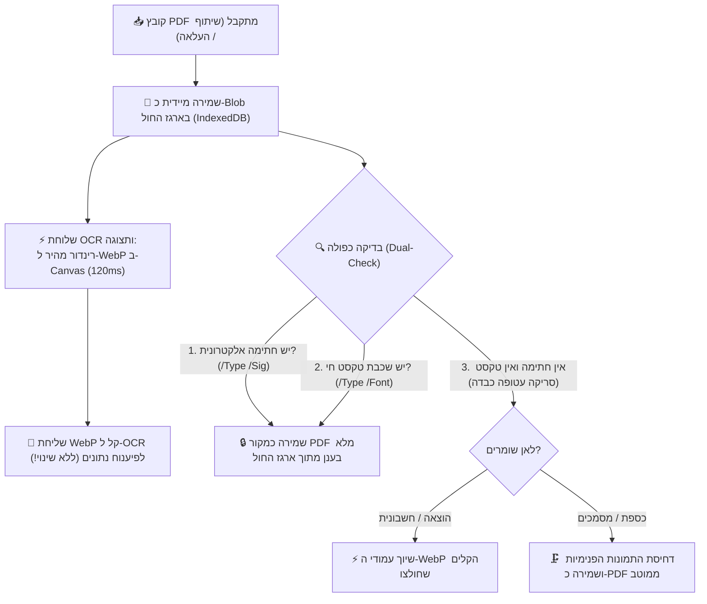

# מסמך החלטות ארכיטקטוניות ושיקולי מערכת (Architecture Decision Records - ADR)

מסמך זה מתעד את כל שיקולי העומק, ההחלטות הארכיטקטוניות, והסיבות להחלטות שקיבלנו בפרויקט **SmartShare**, כדי שנוכל לחזור אליהם תמיד, למנוע בלבול בעתיד, ולהבטיח שכל פיתוח עתידי יתבסס על ההחלטות המקוריות והנכונות.

---

## 1. אסטרטגיית קבצים, מסמכים והמרות (PDF לעומת WebP)

### הדילמה / השאלה שעלתה:
מדוע כל התמונות מומרות אוטומטית ל-WebP? ומה קורה עם קובצי PDF – האם שומרים את המקור או ממירים ל-WebP? ומה לגבי חתימות אלקטרוניות בחשבוניות?

### השיקולים וההחלטה שהתקבלה:
1. **שימור שלמות משפטית ודיגיטלית (PDF מקורי בכספת / מחסן מסמכים):**
   * קובצי PDF אינם רק תמונות סטטיות. הם מכילים:
     * **חתימות אלקטרוניות מאומתות** (חתימות דיגיטליות רשמיות על חוזים, מסמכי בנק, טפסי רשויות בתקן PAdES/PKCS#7).
     * **שכבות וקטוריות וטקסט חי** המאפשר סימון, חיפוש טקסטואלי, והעתקה.
     * **מבנה רב-עמודי רשמי**.
   * אם היינו ממירים PDF חוזה לתמונת WebP – **היינו הורסים את החתימה הדיגיטלית ואת התוקף המשפטי שלו**, והמשתמש לא היה יכול להוריד או להציג שוב את המסמך המקורי כקובץ PDF אמיתי.
   * **ההחלטה:** במחסן המסמכים / כספת (`vault` / `documents`), קובץ ה-PDF נשמר **בדיוק כפי שהוא (פורמט PDF מקורי)** בענן. לצד זה, המערכת מייצרת תמונת WebP ממוזערת של העמוד הראשון לצורך תצוגה מקדימה ומהירה בממשק.

2. **בדיקה כפולה לוודאות מוחלטת (100% Dual-Check Detection):**
   * **בדיקה ראשונה – חתימה אלקטרונית רשמית:**
     * בדיקה בינארית מהירה לקיום אובייקט `/Type /Sig` או `/SubFilter /adbe.pkcs7` או `/ETSI.CAdES.detached`.
     * אם קיים: **חל איסור מוחלט לשנות או לדחוס!** המסמך יישמר במלואו כקובץ מקורי.
   * **בדיקה שנייה – שכבת טקסט חי וגופנים (Digital-Born):**
     * בדיקה לקיום פונטים וטקסט וקטורי חי (`/Type /Font` וזרמי `/BT.../ET`). 
     * אם קיים: זהו מסמך מחשב מקורי (לרוב קטנטן, 50KB–500KB בלבד) – נשמר כמקור מלא ללא פגיעה!
   * **זיהוי סריקה עטופה (Scanned / Raster PDF):**
     * מתקיים אך ורק כאשר **אין חתימה אלקטרונית** וגם **אין טקסט חי**, ו-98% מנפח הקובץ הוא אובייקטי תמונות גולמיות (`/Subtype /Image`). רק אז מדובר בצילום כבד שנעטף כ-PDF.

3. **תרשים זרימה ארכיטקטוני – שילוב ארגז החול וה-OCR (Double-Track):**
   * הקובץ המקורי נקלט ונשמר תמיד תחילה כ-Binary Blob ב-IndexedDB המקומי (ארגז החול).
   * תהליך ה-OCR ממשיך לעבוד בצורה הקיימת, המהירה והבדוקה (הפקת WebP קל ב-120ms לטובת הפיענוח).
   * קובץ המקור המשויך להוצאה נלקח ישירות מארגז החול בהתאם לתוצאת הבדיקה הכפולה.

4. **סעיף משפטי בתקנון (Legal Disclaimer):**
   * ייכתב מסמך משפטי/תקנון למשתמש שבו יובהר ששמירת חשבוניות וצילומים באפליקציה נועדה לניהול שיתופי ומעקב הוצאות; במידה וחשבונית מועלית כצילום/תמונה או מומרת לצורכי עיבוד, החתימה האלקטרונית המקורית אינה מובטחת כרשומה מוסמכת לצורכי מס מחמירים (בדומה לכללי ניהול ספרים), והאחריות לשמירת מסמך המקור החתום חלה על המשתמש.

---

## 2. שיתוף קבצים מבחוץ (Web Share Target) וקבצים גדולים (20MB+)

### הדילמה / השאלה שעלתה:
למה קובץ 20MB ששותף מבחוץ גרם להקפאת המסך ולכישלון, ואיך נמנע את ההמתנה של 2 שניות שבהן מוצג מסך המרחבים במקום מודאל שיתוף?

### השיקולים וההחלטה שהתקבלה:
1. **איסור על שימוש ב-Base64 לקבצים גדולים:**
   * המרה של קובץ בינארי ל-Base64 מנפחת את גודלו ב-33% (20MB הופכים ליותר מ-27MB של טקסט).
   * פעולת ההמרה תוקעת את ה-Main Thread של הדפדפן בטלפון למשך 1–2 שניות.
   * שרתי Vercel Serverless Function חוסמים בקשות רשת מעל 4.5MB (`413 Payload Too Large`).
   * **ההחלטה:** שמירה ישירה של הקובץ כ-Binary `Blob` בזיכרון המכשיר (IndexedDB) דרך ה-Service Worker. שום מחרוזת Base64 ענקית לא נוצרת, וההעלאה לענן מתבצעת ישירות מול Firebase Storage (שתומך בקבצים גדולים ללא הגבלת 4.5MB של Vercel).

2. **חיווי משתמש מיידי (<50ms) למניעת בלבול (UX First):**
   * כאשר משתפים מבחוץ, האפליקציה נפתחת תחילה עם פרמטר `?shared=true`. בעבר המודאל הופיע רק לאחר שכל העיבוד הסתיים, מה שגרם למשתמש לחשוב שהשיתוף נכשל.
   * **ההחלטה:** ברגע שהדף נטען עם פרמטר שיתוף, מוצג מיידית ספינר/באנר פועם: *"📥 קולט קובץ ששותף..."* בתוך פחות מ-50 מילישניות, כך שהמשתמש מבין מיד שהפעולה עובדת ואין שום תקיעה.

---

## 3. ארכיטקטורת הודעות מתפרצות (Space Announcements)

### הדילמה / השאלה שעלתה:
איך להציג הודעות מתפרצות בצורה נעימה, שלא תשתלט על המסך, תתמוך בריבוי הודעות ממשתמשים שונים, ותאפשר שליחה אישית לחבר צוות ספציפי מבלי להעמיס על ממשק הניהול?

### השיקולים וההחלטה שהתקבלה:
1. **אי-הצגת ההודעה למי ששלח אותה:**
   * מי שכותב את ההודעה מודע היטב לתוכנה, ואין צורך להציג לו אותה כפופ-אפ מציק. ההודעה תוצג רק לשאר השותפים.
2. **הודעה פרטית מול הודעה כללית למרחב:**
   * תמיכה בשדה יעד `targetUserId`. אם נבחר שותף ספציפי, ההודעה מסומנת בבירור עם תגית "🔒 הודעה פרטית" ומוצגת אך ורק לו.
3. **קרוסלת הודעות אלגנטית (Swipe Carousel):**
   * כדי למנוע מצב שבו מספר הודעות דוחפות את תוכן הדף למטה ויוצרות גלילה אינסופית, כל ההודעות מקובצות לקרוסלה אחת אלגנטית עם מחוון נקודות (Dots) ואפשרות החלקה ימינה/שמאלה.
4. **ממשק ניהול מקופל (Accordion):**
   * הגדרות ההודעה המתפרצת בהגדרות/ניהול לא תופסות עמוד שלם אלא שורה מקופלת ונקייה עם חץ פתיחה.

---

## 4. תצוגת קובצי PDF, תמונות ממוזערות ומניעת שגיאת תמונה שבורה (Broken Image Icon)

### הדילמה / השאלה שעלתה:
מדוע בעת שיתוף ושמירת קובץ PDF לכספת (Vault) הופיע במציג המסמכים (`UniversalViewerModal`) אייקון של תמונה שבורה (`🖼️`), וכרטיס הקובץ בתיקייה היה ריק?

### ניתוח שורש (Root Cause):
1. **הבדל בין כתובות קובץ לכתובות זיכרון (`blob:` URLs):**
   * כאשר Service Worker מקבל קובץ משיתוף חיצוני, הוא מייצר כתובת זיכרון מקומית זמנית מסוג `blob:https://...`. כתובת זו תקפה אך ורק לכרטיסיית הדפדפן הנוכחית ופגה עם הניווט.
   * בדיקות קוד רבות בדקו האם `url.includes('.pdf')`. לכתובות `blob:` אין סיומת `.pdf` ולכן המערכת הסיקה בטעות שמדובר בתמונה (`type: 'document'`) ולא ב-PDF!
2. **חוסר יכולת של תגית `` להציג קובצי PDF:**
   * דפדפנים אינם מסוגלים לפענח ביתים של קובץ PDF בתוך תגית ``. כאשר תגית `img` מקבלת כתובת PDF, מפענח התמונות של הדפדפן נכשל ומציג את אייקון התמונה השבורה (`🖼️`).
3. **פתרון העומק ההנדסי שהוטמע:**
   * **זיהוי מבוסס MIME / מטא-דאטה אמיתי:** בדיקת סוג הקובץ אינה מסתמכת על מחרוזת ה-URL בלבד, אלא בודקת את ה-Blob האמיתי (`blob.type === 'application/pdf'`), שם הקובץ המקורי, והגדרת ה-type.
   * **שמירה כפולה בכספת (Dual Vault Artifacts):**
     1. קובץ ה-PDF המקורי נשמר בשלמותו ב-Firebase Storage כקובץ `.pdf` מלא.
     2. בעת השמירה מופקת מיידית תמונת WebP ממוזערת של עמוד 1 בלבד (`thumbnailUrl`, כ-40KB ב-120ms) ונשמרת כ-WebP.
   * **תצוגה בממשק:**
     * כרטיסי המסמכים בתיקייה מציגים תמיד את ה-`thumbnailUrl` (WebP קל שנטען ב-50ms).
     * מציג המסמכים (`UniversalViewerModal`) מזהה קובצי PDF ומנתב אותם ל-`DynamicPdfScrollPreview` (שמרנדר באמצעות PDF.js על Canvas עם תמיכה בזום ומסכי מגע), ולעולם אינו מנסה לשבץ קובץ PDF בתוך תגית ``.
     * שוער הגנה (Safety Fallback) הוטמע כך שגם אם תגית תמונה נכשלת ברינדור, מוצג כרטיס שגיאה אלגנטי עם אפשרות להורדת הקובץ ולא האייקון השבור של הדפדפן.
