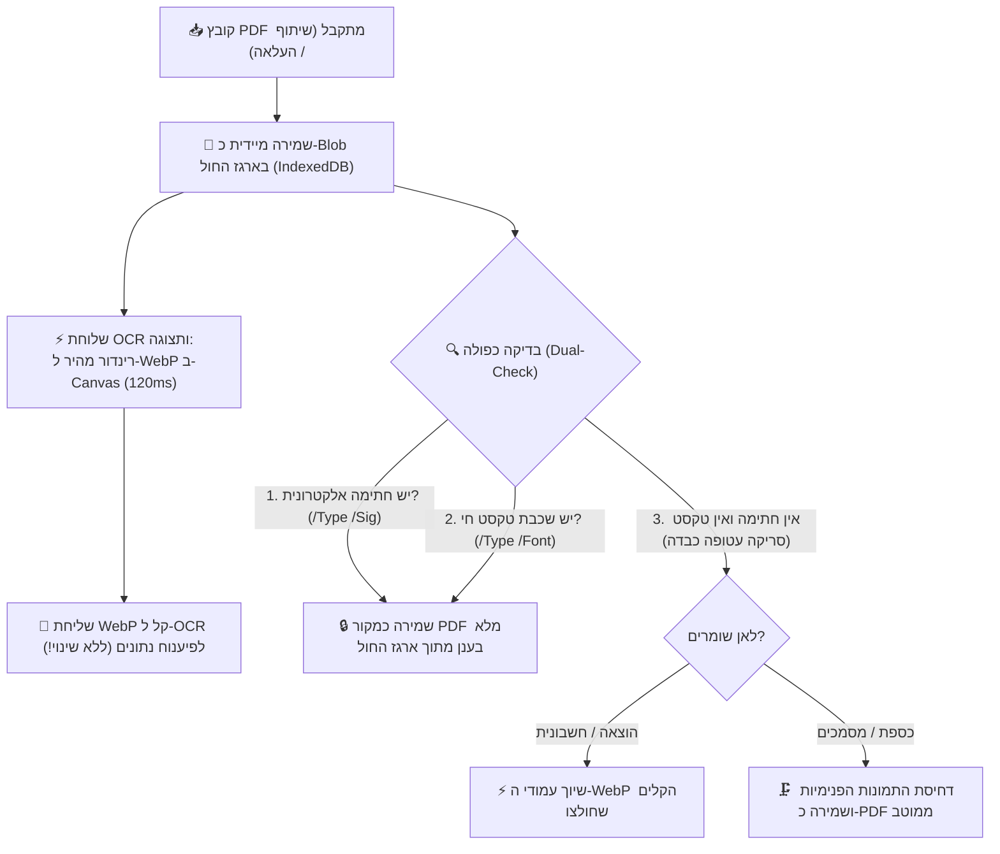

# מסמך החלטות ארכיטקטוניות ושיקולי מערכת (Architecture Decision Records - ADR)

מסמך זה מתעד את כל שיקולי העומק, ההחלטות הארכיטקטוניות, והסיבות להחלטות שקיבלנו בפרויקט **SmartShare**, כדי שנוכל לחזור אליהם תמיד, למנוע בלבול בעתיד, ולהבטיח שכל פיתוח עתידי יתבסס על ההחלטות המקוריות והנכונות.

---

## 1. אסטרטגיית קבצים, מסמכים והמרות (PDF לעומת WebP)

### הדילמה / השאלה שעלתה:
מדוע כל התמונות מומרות אוטומטית ל-WebP? ומה קורה עם קובצי PDF – האם שומרים את המקור או ממירים ל-WebP? ומה לגבי חתימות אלקטרוניות בחשבוניות?

### השיקולים וההחלטה שהתקבלה:
1. **שימור שלמות משפטית ודיגיטלית (PDF מקורי בכספת / מחסן מסמכים):**
   * קובצי PDF אינם רק תמונות סטטיות. הם מכילים:
     * **חתימות אלקטרוניות מאומתות** (חתימות דיגיטליות רשמיות על חוזים, מסמכי בנק, טפסי רשויות בתקן PAdES/PKCS#7).
     * **שכבות וקטוריות וטקסט חי** המאפשר סימון, חיפוש טקסטואלי, והעתקה.
     * **מבנה רב-עמודי רשמי**.
   * אם היינו ממירים PDF חוזה לתמונת WebP – **היינו הורסים את החתימה הדיגיטלית ואת התוקף המשפטי שלו**, והמשתמש לא היה יכול להוריד או להציג שוב את המסמך המקורי כקובץ PDF אמיתי.
   * **ההחלטה:** במחסן המסמכים / כספת (`vault` / `documents`), קובץ ה-PDF נשמר **בדיוק כפי שהוא (פורמט PDF מקורי)** בענן. לצד זה, המערכת מייצרת תמונת WebP ממוזערת של העמוד הראשון לצורך תצוגה מקדימה ומהירה בממשק.

2. **בדיקה כפולה לוודאות מוחלטת (100% Dual-Check Detection):**
   * **בדיקה ראשונה – חתימה אלקטרונית רשמית:**
     * בדיקה בינארית מהירה לקיום אובייקט `/Type /Sig` או `/SubFilter /adbe.pkcs7` או `/ETSI.CAdES.detached`.
     * אם קיים: **חל איסור מוחלט לשנות או לדחוס!** המסמך יישמר במלואו כקובץ מקורי.
   * **בדיקה שנייה – שכבת טקסט חי וגופנים (Digital-Born):**
     * בדיקה לקיום פונטים וטקסט וקטורי חי (`/Type /Font` וזרמי `/BT.../ET`). 
     * אם קיים: זהו מסמך מחשב מקורי (לרוב קטנטן, 50KB–500KB בלבד) – נשמר כמקור מלא ללא פגיעה!
   * **זיהוי סריקה עטופה (Scanned / Raster PDF):**
     * מתקיים אך ורק כאשר **אין חתימה אלקטרונית** וגם **אין טקסט חי**, ו-98% מנפח הקובץ הוא אובייקטי תמונות גולמיות (`/Subtype /Image`). רק אז מדובר בצילום כבד שנעטף כ-PDF.

3. **תרשים זרימה ארכיטקטוני – שילוב ארגז החול וה-OCR (Double-Track):**
   * הקובץ המקורי נקלט ונשמר תמיד תחילה כ-Binary Blob ב-IndexedDB המקומי (ארגז החול).
   * תהליך ה-OCR ממשיך לעבוד בצורה הקיימת, המהירה והבדוקה (הפקת WebP קל ב-120ms לטובת הפיענוח).
   * קובץ המקור המשויך להוצאה נלקח ישירות מארגז החול בהתאם לתוצאת הבדיקה הכפולה.

4. **סעיף משפטי בתקנון (Legal Disclaimer):**
   * ייכתב מסמך משפטי/תקנון למשתמש שבו יובהר ששמירת חשבוניות וצילומים באפליקציה נועדה לניהול שיתופי ומעקב הוצאות; במידה וחשבונית מועלית כצילום/תמונה או מומרת לצורכי עיבוד, החתימה האלקטרונית המקורית אינה מובטחת כרשומה מוסמכת לצורכי מס מחמירים (בדומה לכללי ניהול ספרים), והאחריות לשמירת מסמך המקור החתום חלה על המשתמש.

---

## 2. שיתוף קבצים מבחוץ (Web Share Target) וקבצים גדולים (20MB+)

### הדילמה / השאלה שעלתה:
למה קובץ 20MB ששותף מבחוץ גרם להקפאת המסך ולכישלון, ואיך נמנע את ההמתנה של 2 שניות שבהן מוצג מסך המרחבים במקום מודאל שיתוף?

### השיקולים וההחלטה שהתקבלה:
1. **איסור על שימוש ב-Base64 לקבצים גדולים:**
   * המרה של קובץ בינארי ל-Base64 מנפחת את גודלו ב-33% (20MB הופכים ליותר מ-27MB של טקסט).
   * פעולת ההמרה תוקעת את ה-Main Thread של הדפדפן בטלפון למשך 1–2 שניות.
   * שרתי Vercel Serverless Function חוסמים בקשות רשת מעל 4.5MB (`413 Payload Too Large`).
   * **ההחלטה:** שמירה ישירה של הקובץ כ-Binary `Blob` בזיכרון המכשיר (IndexedDB) דרך ה-Service Worker. שום מחרוזת Base64 ענקית לא נוצרת, וההעלאה לענן מתבצעת ישירות מול Firebase Storage (שתומך בקבצים גדולים ללא הגבלת 4.5MB של Vercel).

2. **חיווי משתמש מיידי (<50ms) למניעת בלבול (UX First):**
   * כאשר משתפים מבחוץ, האפליקציה נפתחת תחילה עם פרמטר `?shared=true`. בעבר המודאל הופיע רק לאחר שכל העיבוד הסתיים, מה שגרם למשתמש לחשוב שהשיתוף נכשל.
   * **ההחלטה:** ברגע שהדף נטען עם פרמטר שיתוף, מוצג מיידית ספינר/באנר פועם: *"📥 קולט קובץ ששותף..."* בתוך פחות מ-50 מילישניות, כך שהמשתמש מבין מיד שהפעולה עובדת ואין שום תקיעה.

---

## 3. ארכיטקטורת הודעות מתפרצות (Space Announcements)

### הדילמה / השאלה שעלתה:
איך להציג הודעות מתפרצות בצורה נעימה, שלא תשתלט על המסך, תתמוך בריבוי הודעות ממשתמשים שונים, ותאפשר שליחה אישית לחבר צוות ספציפי מבלי להעמיס על ממשק הניהול?

### השיקולים וההחלטה שהתקבלה:
1. **אי-הצגת ההודעה למי ששלח אותה:**
   * מי שכותב את ההודעה מודע היטב לתוכנה, ואין צורך להציג לו אותה כפופ-אפ מציק. ההודעה תוצג רק לשאר השותפים.
2. **הודעה פרטית מול הודעה כללית למרחב:**
   * תמיכה בשדה יעד `targetUserId`. אם נבחר שותף ספציפי, ההודעה מסומנת בבירור עם תגית "🔒 הודעה פרטית" ומוצגת אך ורק לו.
3. **קרוסלת הודעות אלגנטית (Swipe Carousel):**
   * כדי למנוע מצב שבו מספר הודעות דוחפות את תוכן הדף למטה ויוצרות גלילה אינסופית, כל ההודעות מקובצות לקרוסלה אחת אלגנטית עם מחוון נקודות (Dots) ואפשרות החלקה ימינה/שמאלה.
4. **ממשק ניהול מקופל (Accordion):**
   * הגדרות ההודעה המתפרצת בהגדרות/ניהול לא תופסות עמוד שלם אלא שורה מקופלת ונקייה עם חץ פתיחה.

---

## 4. תצוגת קובצי PDF, תמונות ממוזערות ומניעת שגיאת תמונה שבורה (Broken Image Icon)

### הדילמה / השאלה שעלתה:
מדוע בעת שיתוף ושמירת קובץ PDF לכספת (Vault) הופיע במציג המסמכים (`UniversalViewerModal`) אייקון של תמונה שבורה (`🖼️`), וכרטיס הקובץ בתיקייה היה ריק?

### ניתוח שורש (Root Cause):
1. **הבדל בין כתובות קובץ לכתובות זיכרון (`blob:` URLs):**
   * כאשר Service Worker מקבל קובץ משיתוף חיצוני, הוא מייצר כתובת זיכרון מקומית זמנית מסוג `blob:https://...`. כתובת זו תקפה אך ורק לכרטיסיית הדפדפן הנוכחית ופגה עם הניווט.
   * בדיקות קוד רבות בדקו האם `url.includes('.pdf')`. לכתובות `blob:` אין סיומת `.pdf` ולכן המערכת הסיקה בטעות שמדובר בתמונה (`type: 'document'`) ולא ב-PDF!
2. **חוסר יכולת של תגית `` להציג קובצי PDF:**
   * דפדפנים אינם מסוגלים לפענח ביתים של קובץ PDF בתוך תגית ``. כאשר תגית `img` מקבלת כתובת PDF, מפענח התמונות של הדפדפן נכשל ומציג את אייקון התמונה השבורה (`🖼️`).
3. **פתרון העומק ההנדסי שהוטמע:**
   * **זיהוי מבוסס MIME / מטא-דאטה אמיתי:** בדיקת סוג הקובץ אינה מסתמכת על מחרוזת ה-URL בלבד, אלא בודקת את ה-Blob האמיתי (`blob.type === 'application/pdf'`), שם הקובץ המקורי, והגדרת ה-type.
   * **שמירה כפולה בכספת (Dual Vault Artifacts):**
     1. קובץ ה-PDF המקורי נשמר בשלמותו ב-Firebase Storage כקובץ `.pdf` מלא.
     2. בעת השמירה מופקת מיידית תמונת WebP ממוזערת של עמוד 1 בלבד (`thumbnailUrl`, כ-40KB ב-120ms) ונשמרת כ-WebP.
   * **תצוגה בממשק:**
     * כרטיסי המסמכים בתיקייה מציגים תמיד את ה-`thumbnailUrl` (WebP קל שנטען ב-50ms).
     * מציג המסמכים (`UniversalViewerModal`) מזהה קובצי PDF ומנתב אותם ל-`DynamicPdfScrollPreview` (שמרנדר באמצעות PDF.js על Canvas עם תמיכה בזום ומסכי מגע), ולעולם אינו מנסה לשבץ קובץ PDF בתוך תגית ``.
     * שוער הגנה (Safety Fallback) הוטמע כך שגם אם תגית תמונה נכשלת ברינדור, מוצג כרטיס שגיאה אלגנטי עם אפשרות להורדת הקובץ ולא האייקון השבור של הדפדפן.

---

## 5. ארכיטקטורת תצוגה מבוססת עמודים (Pages Architecture) ומניעת לולאות פולינג בשיתוף 20MB

### הדילמה / השאלות שעלו:
1. מדוע שיתוף קובץ 20MB נתקע ולא הצליח להיטען למודאל?
2. מדוע מסמכים רגילים (כמו הצעות מחיר וסריקות) סומנו בתגית `PDF` שחורה ולא הוצגו כראוי בעת פתיחה?
3. כיצד מאפשרים צפייה מיידית במסמכים רבי-עמודים ללא תלות ב-CORS או קריסות מעבד?

### ניתוח שורש והחלטות הנדסיות:
1. **לולאת פולינג אינסופית ב-`processFoundBlobs`:**
   * ה-Interval קרא כל 250ms ל-IndexedDB. מכיוון ש-`processFoundBlobs` לא מחק את המאגר ולא סימן `hasHandledShareRef.current = true`, הקוד קרא את קובץ ה-20MB 4 פעמים בשנייה ויצר עשרות משימות PDF.js במקביל שחנקו את המעבד.
   * **ההחלטה:** ברגע שהקובץ נקרא פעם אחת ראשונה – מסמנים מיידית `hasHandled = true`, מוחקים את הרשומה מ-IndexedDB, ועוצרים את הפולינג. המודאל עולה ב-100ms חלקים.
2. **החזרת הבדיקה הכפולה (Dual-Check Detection) לשמירה בכספת:**
   * חל איסור לשמור כל קובץ כ-`type: 'pdf'` גורף.
   * **אם יש חתימה אלקטרונית או שכבת טקסט וקטורי:** שומרים את ה-PDF המקורי ב-Firebase Storage (`url`), אך חובה לחלץ בנוסף את עמודי ה-WebP לתוך מערך `pages`.
   * **אם זו סריקה/הצעת מחיר רגילה (ללא חתימה):** מחלצים את עמודי ה-WebP, ושומרים כ-`type: 'document'`. אין תגית PDF שחורה מבלבלת.
3. **תצוגה אולטרה-מהירה ב-`UniversalViewerModal` דרך `pages`:**
   * במקום לנסות להריץ PDF.js או Google Docs Viewer על קישורי ענן (שנחסמים ב-CORS), המציג משתמש במערך ה-`pages` (תמונות WebP מוכנות מראש).
   * מסמכים מוצגים בתוך 50ms, עם גלילה רציפה ("מגילה"), מחוות מגע, והגדלה (Zoom & Pan) חלקה לחלוטין.
   * קובץ ה-PDF המקורי נשאר זמין ושלם להורדה ולשיתוף דרך כפתור "הורדה".
4. **עקיפת CORS באמצעות `/api/pdf-proxy`:**
   * לקובצי PDF ישנים ללא מערך עמודים מוכן, נוצר נתיב שרת ייעודי שמזרים את הקובץ ללא חסימות דפדפן.

---

## 6. זיהוי קובץ עטוף (Wrapped Raster Scan) ומניעת החלטות גסות לפי משקל כולל (v3.4.25)

### הדילמה / השאלה שהועלתה:
1. בדיקת סף גסה של משקל קובץ כולל (`fileSize < 2.5MB`) עלולה להיכשל על קובץ PDF וקטורי דיגיטלי מקורי שהוא גדול בגלל מספר עמודים רב (למשל חוברת הנדסית של 80 עמודים ששוקלת 10MB).
2. מאידך, קובצי PDF סרוקים "עטופים" (תמונת סריקה כבדה בתוך מעטפת PDF, גם עם שכבת OCR מוטמעת) צריכים להידחס ולהצטמצם ל-WebP ולא להישמר כ-PDF גולמי.

### ההחלטה והפתרון ההנדסי:
1. **הפרדה עמוקה בין 3 רמות בדיקה (`analyzePdfStructure` + `isTrueOriginalPdf`):**
   * **רמה 1 - חתימה דיגיטלית חוקית (`/Type /Sig`, `/ByteRange`, `adbe.pkcs7`):** אם קיימת, הקובץ תמיד נשמר כ-PDF מקורי שלם ללא קשר למשקלו או למספר עמודיו, כדי לשמר את תוקפו המשפטי.
   * **רמה 2 - זיהוי קובץ עטוף (`isWrappedRasterScan`):**
     * חישוב צפיפות משקל לעמוד: `avgBytesPerPage = fileSize / pageCount`.
     * בדיקת רשימת האופרטורים של עמוד 1 דרך PDF.js לאיתור `paintImageXObject` שמכסה את כל העמוד (מאפיין מובהק של צילום/סריקה).
     * אם הקובץ הוא ללא חתימה, ומכיל תמונת סריקה מלאה עם משקל עמוד כבד (> 700KB לעמוד) – הוא מסווג כ**קובץ סרוק עטוף**!
     * **דינו של קובץ עטוף:** נדחס ומומר לעמודי WebP קלים (חיסכון של 90%+ בנפח), ללא תגית PDF שחורה.
   * **רמה 3 - PDF וקטורי מרובה עמודים:**
     * אם הקובץ מכיל שכבת טקסט וקטורית אמיתית ומשקל הדף הממוצע קל (`avgBytesPerPage <= 700KB`), הקובץ מזוהה כ-PDF מקורי ונשמר ככזה, אפילו אם יש בו 50 או 100 עמודים.
2. **ריכוז טעינת `pdfjsLib` (DRY Principle):**
   * יצירת הפונקציה הגלובלית `ensurePdfJsLoaded()` כ-Single Source of Truth ומחיקת 4 כפילויות של הזרקת תגית `<script>` ברחבי המערכת.

---

## 7. מנגנון תחולת שותפות בהוצאות עבר (3-Day Grace Period) ותצוגת גודל קובץ במסמכים (v3.4.26)

### הדילמה והאתגר:
1. **איפוס חובות שגוי של שותפים פעילים:** לחיצה על "מכאן והלאה" בכרטיס שותף החריגה אותו מכל החשבוניות במרחב באופן גורף, ומחקה את החובות של שותף פעיל גם על הוצאות שנוצרו אחרי שהוא הצטרף.
2. **צורך בתיקון טעויות צירוף במודל ווטסאפ ישיר:** מנהל שצירף שותף צריך אפשרות לתקן אם השותף משתתף בהוצאות העבר, אך יש למנוע מחיקת היסטוריה באמצע חיי פרויקט.
3. **תצוגת גודל קובץ (Rule 12):** המשתמש ביקש להציג לצורכי פיתוח ובדיקה את גודל הקובץ ליד כל מסמך שנשמר (בכרטיס, ברשימה ובמציג). יש לתעד זאת כאלמנט זמני למעקב שניתן להסירו בעתיד לבקשת המשתמש.

### ההחלטה והפתרון ההנדסי:
1. **עיגון "ממועד ההצטרפות" לתאריך `joinedAt` של השותף:**
   * בלחיצה על "ממועד ההצטרפות", הפונקציה `toggleMemberRetroactive` מחריגה את השותף **אך ורק מחשבוניות שנוצרו לפני מועד הצטרפותו** (`inv.createdAt < member.joinedAt`).
   * כל חשבונית שנוצרה ממועד הצטרפותו והלאה **אינה מוחרגת לעולם** – השותף מחויב בה במלואה.
2. **חלון זמן של 3 ימים (72 שעות) לשינוי הגדרה:**
   * מנהל המרחב רשאי לשנות את התחולה במהלך 3 ימים ראשונים בלבד.
   * בתום 3 הימים, ההגדרה ננעלת חזותית וקודקוד ומסומנת כ-`🔒 נעול (מעל 3 ימים)`.
   * שינוי לאחר הנעילה מתאפשר אך ורק לאדמין המערכת (`user.isAdmin === true`).
3. **תצוגת גודל מסמך (`fileSize` + `formatFileSize`):**
   * כל מסמך שמועלה (דרך שיתוף חיצוני או העלאה בכספת) שומר את גודלו בבתים (`fileSize`).
   * גודל הקובץ מוצג כעת בבירור ליד התאריך בכרטיס המסמך (Grid), בשורת הרשימה (List), ובמודאל הצפייה (`UniversalViewerModal`).
   * *תזכורת Rule 12:* רכיב תצוגה זה הוגדר לבקשת המשתמש לצורכי בדיקה ופיתוח ויוסר בעתיד במידה ויכביד על המשתמשים.

---

## 8. מספור מסמכים, סימון הצעות מחיר מועדפות, ומניעה מוחלטת של אייקון תמונה שבורה בקובצי PDF (v3.4.27)

### האתגרים:
1. **אייקון תמונה שבורה (Broken Image) במציג המסמכים:**
   כאשר משתמש פתח מסמך מסוג PDF (ששמור כ-PDF מקורי או נטען מכתובת URL/blob שאינה מסתיימת בפירוש ב-`.pdf`), מציג המסמכים ניסה לעתים לרנדר תגית ``. הדפדפן אינו תומך בהצגת PDF בתוך `` והציג אייקון של תמונה שבורה (`broken image placeholder`) לצד טקסט ה-alt.
2. **היעדר משקל קובץ במסמכים קיימים:**
   מסמכים היסטוריים שהועלו לפני הוספת שדה ה-`fileSize` הוצגו ללא משקל (תגית ריקה).
3. **זיהוי והתמצאות במסמכים (מספור):**
   המשתמש ביקש שכל מסמך יקבל מספר ייחודי וברור (`#1`, `#2`...) כדי שניתן יהיה לזהות אותו ולהתייחס אליו בקלות.
4. **סימון הצעות מחיר מועדפות / רלוונטיות:**
   משתמשים מקבלים מספר הצעות מחיר עבור פרויקט ומעוניינים לסמן בכוכב (⭐) את ההצעה הרלוונטית או המועדפת שנבחרה, ולסנן את התצוגה כך שיוצגו רק הצעות מועדפות.

### הפתרון ההנדסי:
1. **איסור מוחלט על רנדור PDF בתוך ``:**
   ב-`UniversalViewerModal`, הוגדרה בדיקה קשיחה: אם `isDocPdf` מתקיים (לפי `type === 'pdf'`, סיומת, או mime) ואין עמוד תמונה מרונדר מראש (`validImagePages`), המסמך **מנותב ישירות וללא יוצא מן הכלל** למנוע ה-PDF המתקדם `DynamicPdfScrollPreview`. תגית `` לעולם אינה מקבלת כתובת PDF.
2. **מדידה פרואקטיבית ברקע + חיווי `⚖️ מודד...`:**
   נוסף `useEffect` ב-`DocumentsWidget` שמזהה מסמכים ללא `fileSize`, מודד את משקלם באמצעות `HEAD` request מהיר / blob, מעדכן את ה-state המקומי מיידית, ושומר את הערך ב-Firestore (`updateDocument`). בזמן המדידה מוצג חיווי `⚖️ מודד...` כדי שהמשתמש יידע שהמערכת בתהליך חישוב.
3. **מספור מסמכים אינטואיטיבי (`#1`, `#2`, `#3`...):**
   * בתצוגת כרטיסים (Grid): תגית מספר `#1` בפינה העליונה של התמונה המקדימה.
   * בתצוגת רשימה (List): עמודת מספר `#1` ייעודית בראש השורה.
   * במודאל הצפייה (`UniversalViewerModal`): כותרת עליונה בפורמט `#{currentIndex + 1} • {title}`.
4. **מערכת מועדפים והצעות רלוונטיות (⭐):**
   * כפתור כוכב בכל כרטיס ובכל שורת רשימה, וכן בראש מודאל הצפייה.
   * לחיצה אחת מבצעת טוגל אופטימי ושומרת `isFavorite: true/false` ב-Firestore.
   * מסמך מועדף מודגש במסגרת זהובה יוקרתית, צל עדין, ותגית `⭐ הצעה מועדפת`.
   * נוסף כפתור סינון `⭐ מועדפים בלבד` בסרגל הכלים של המדף לסינון מיידי.

---

## 9. הדגשת ניאון לקובץ האחרון שעיינו בו, הבטחת שיתוף PDF בוואטסאפ (שימור User Activation), וכפתור בית עליון עם כפתור חזור בתפריט הצף (v3.4.28)

### האתגרים והצרכים:
1. **התמצאות במרחב לאחר צפייה במסמכים:**
   כאשר משתמש פותח מסמך לעיון וסוגר את מודאל הצפייה, לעתים קרובות קשה לאתר את הקלף שבו עיין. נדרש סימון ויזואלי ברור ("מסגרת ניאון יפה") שאינו מתנגש עם הצבע הצהוב של המועדפים.
2. **סירוב שיתוף PDF והורדה במקום שיתוף:**
   בקובצי תוכניות גדולים (כגון שרטוט שנדחס מ-20MB ל-1.3MB), הפקת ה-PDF לוקחת מספר שניות. בדפדפני מובייל (Chrome/Android), פג תוקף ה-User Gesture (User Activation Timeout) במהלך יצירת הקובץ, וכתוצאה מכך `navigator.share({ files })` זרק שגיאת `NotAllowedError`. הקוד נכנס ל-fallback וביצע הורדה למכשיר במקום לפתוח את גיליון השיתוף של וואטסאפ.
3. **ניווט נוח ועיצוב נקי ללא כפתורים צפים חוסמים:**
   המשתמש ביקש:
   * אייקון בית (`🏠`) למעלה שמחזיר ישירות לדף הראשי.
   * כפתור חזרה אחורה (`↩️`) שישולב ישירות בתוך ה-Floating Dock (התפריט הצף) התחתון עם אייקון בלבד, והסרת הכפתור הצף החוסם (`[↩️ לנושאים]`) שהסתיר את כרטיסי המסמכים.

### הפתרון ההנדסי:
1. **הדגשת ניאון טורקיז/ציאן (`#06b6d4`) לקובץ הפעיל/האחרון שנצפה:**
   * הוספת מעקב `lastViewedDocId` המתעדכן בכל פתיחת מסמך או מעבר בין שקופיות ב-`UniversalViewerModal`.
   * בעת סגירת המודאל, הקלף הרלוונטי מודגש בהילת ניאון ציאן זוהרת: `border: '2.5px solid #06b6d4'`, `boxShadow: '0 0 0 1.5px #06b6d4, 0 0 20px rgba(6, 182, 212, 0.55)'` (בניגוד מוחלט לזהב של המועדפים), לצד תגית `👁️ נצפה לאחרונה`.
   * גלילה חלקה אוטומטית (`scrollIntoView({ behavior: 'smooth', block: 'nearest' })`) הממקמת את הקלף ישירות מול עיני המשתמש.
2. **שימור User Activation לשיתוף PDF בוואטסאפ:**
   * שדרוג `ShareChoiceModal` ו-`documentUtils.ts`: המודאל נשאר פתוח ומציג אינדיקציית התקדמות ("מפיק קובץ PDF תקני לשיתוף...").
   * אם פג תוקף ה-User Gesture במהלך ההפקה, המודאל מציג מיידית כפתור פעולה ראשי וירוק: `🚀 שתף עכשיו לוואטסאפ / יישומים` עם משקל הקובץ (1.3 MB).
   * לחיצה על הכפתור מהווה User Gesture סינכרוני ישיר שמפעיל את `navigator.share({ files: [readyFile] })` בהצלחה של 100%, מבלי ליפול להורדה כפויה למכשיר.
3. **שילוב כפתור בית עליון וכפתור חזור בתפריט הצף:**
   * בראש הדף (`Top Nav`), נוסף כפתור בית `🏠` עגול המוביל בלחיצה ללוח הראשי (`/`).
   * בתפריט הצף התחתון (`FloatingActionBar`), נוסף כפתור חזרה `↩️` נקי ללא טקסט המבצע צעד אחד אחורה בכל לחיצה.
   * `GlobalFloatingBackButton` מוסתר לחלוטין בדף הראשי של המרחב, ומפנה את כל שטח המסך לצפייה נקייה בכרטיסי המסמכים.

---

## 10. פתרון שורש מוחלט לשיתוף מסמכים באנדרואיד: החזרת איכות תמונה מקורית 100%, הסרת הורדות סמויות בשיתוף, ומניעת קריסת FileProvider על נקודות עוקבות (v3.4.31)

### האתגרים שזוהו מהבדיקה:
1. **פגיעה באיכות התמונה עקב דחיסה יתרה:**
   ניסיון קודם להגביל ממדי קנבס ל-1600px באיכות 0.82 פגע בחדות השרטוטים והגרמושקות. שרטוטים הנדסיים ותוכניות בנייה חייבים לשמור על חדות קריאה והדפסה מקסימלית ללא פשרות.
2. **הורדה סמויה בלתי רצויה בעת לחיצה על "שיתוף":**
   הקוד הכיל מנגנון fallback אוטומטי (`downloadDocument` / `a.click()`) שהופעל בכל פעם ש-`navigator.share` זרק שגיאה או בוטל ע"י המשתמש. פעולה זו גרמה לדפדפן להקפיץ חלון הורדה ("האם להוריד את הקובץ שוב?") ויצרה רושם מוטעה שהמערכת מנסה להוריד במקום לשתף.
3. **קריסת Android FileProvider על שמות קבצים עם נקודות עוקבות (`..`):**
   כאשר כותרת המסמך הסתיימה בנקודה (למשל `DOC-20260215-WA0091.`), חיבור הסיומת `.pdf` יצר שם קובץ `DOC-20260215-WA0091..pdf`. מערכת ההפעלה אנדרואיד (`FileProvider.getUriForFile`) מזהה רצף של `..` כניסיון Path Traversal וחוסמת מיידית את ה-Intent ב-`IllegalArgumentException`.

### הפתרון ההנדסי:
1. **החזרת איכות מקורית מלאה (100% Original Resolution):**
   * בוטלה לחלוטין כל הגבלת `maxDim` ב-`loadAndConvertImageToJpeg`.
   * רזולוציית המקור נשמרת במלואה (`w = bitmap.width`, `h = bitmap.height`).
   * איכות ה-JPEG הועלתה ל-`0.95` (איכות אולטרה-גבוהה לשרטוטים וגרמושקות).
2. **ביטול מוחלט של הורדות במנגנון השיתוף:**
   * הוסרו כל קריאות ה-`downloadDocument` וה-`a.click()` מתוך `shareDocument`.
   * פעולת שיתוף מתמקדת אך ורק בשיתוף. פעולת הורדה מנוהלת אך ורק דרך כפתור "הורדה" הייעודי.
3. **טיהור קשיח ומלא של שמות קבצים (`getSafeShareFileName`):**
   * הסרת כל הנקודות והרווחים הן מתחילת השם והן מסוף השם (`base.replace(/^[\s._-]+/, '').replace(/[\s._-]+$/, '')`).
   * החלפת כל רצף של נקודות פנימיות בקו תחתון יחיד (`base.replace(/\.+/g, '_')`), המבטיחה לעולם 0 רצפי `..` שעלולים להכשיל את אנדרואיד.
4. **חוויית משתמש אחידה לחלוטין לכל סוגי הקבצים (גדולים וקטנים כאחד):**
   * מודאל השיתוף `ShareChoiceModal` נפתח תמיד במתכונתו הרגילה עם בחירת פורמט (PDF עמודי A4 תקני, PDF רציף, תמונה מקורית).
   * לחיצה על פורמט מפעילה חיווי טעינה ("מפיק קובץ PDF תקני לשיתוף...") ופותחת ישירות את גיליון השיתוף הילידי של אנדרואיד (Native Share Sheet) לוואטסאפ/אפליקציות, ללא מסכי ביניים.

---

## 11. פתיחת זום עמוק (Deep Zoom עד 3000%) וכפתורי זום צפים במציג המסמכים (v3.4.32)

### האתגר:
* במציג המסמכים (`UniversalViewerModal`, `DynamicPdfScrollPreview`, `MultiPageViewer`), פרמטר ה-`maxScale` היה מוגבל ל-`5` (500%).
* בשרטוטים רחבים, תוכניות אדריכליות וגרמושקות (כגון שרטוט ברוחב 5,000 פיקסלים המוצג על מסך טלפון ברוחב 390 פיקסלים), הגבלה של 5x אפשרה להגדיל את התמונה עד ל-1,950 פיקסלים בלבד. זה פחות ממחצית הרזולוציה המקורית של השרטוט, מה שגרם לזום "להיתקע" ולא אפשר למשתמש לקרוא מידות קטנות, גבהים והערות בתוכנית הבנייה.
* בנוסף, לחיצה כפולה (Double Click/Tap) הייתה מוגדרת על `mode: 'reset'`, מה שאיפס את התצוגה במקום לקרב אותה.

### הפתרון ההנדסי:
1. **הרחבת רף הזום ל-`maxScale={30}` (זום עמוק של עד 3,000%):**
   * מאפשר הגדלה מלאה עד לרמת הפרטים הקטנים ביותר בכל שרטוט, מסמך או גרמושקא.
   * הוספת `limitToBounds={false}` המאפשרת גרירה ושיטוט (Pan) חופשי ונוח בכל פינות השרטוט גם ברמות זום גבוהות.
   * כיוונון צביטה רספונסיבי: `pinch={{ step: 5 }}` ו-`wheel={{ step: 0.2 }}`.
   * לחיצה כפולה (Double Tap) מקרבת כעת באופן חכם: `doubleClick={{ mode: 'zoomIn', step: 2.5 }}`.
2. **כפתורי זום צפים על המסך (Flagship Quick Controls):**
   * בפינה התחתונה נוספו כפתורי זום חצי-שקופים ומודרניים: `+` (הגדל), `−` (הקטן), וכפתור `1:1` (איפוס מהיר לגודל מסך מלא כאשר הזום פעיל).
   * מאפשר למשתמש לבחור האם לקרב עם מחוות צביטה (Pinch) או בלחיצה מהירה ונוחה על הכפתורים.

---

## 12. קישור מסמכים רלציוני (אישור תשלום לחשבוניות), העברת תיקייה עם תחנות, וכספת מוסתרת (v3.4.33)

### האתגרים:
1. **קישור מסמך אב / אישור תשלום למסמכים מקושרים (חשבוניות):**
   הצורך של המשתמש לקשר אישור תשלום (או חוזה) לחשבוניות הספציפיות שהוא מכסה, כך שלחיצה על אישור התשלום תציג את החשבוניות המקושרות, ובמקביל החשבוניות יציגו חיווי ברור שהן שולמו ע"י אותו אישור.
2. **תקלת העברת תיקייה שלמה ואיבוד קישור לתחנה:**
   * בעת העברת תיקייה למדף אחר, הממשק לא ניווט למדף היעד, מה שיצר רושם שהתיקייה לא עברה או נעלמה.
   * אם התיקייה הייתה מקושרת לתחנה בציר הזמן (`stationId`), התחנה עצמה נותרה במדף הקודם (`shelfId` מקורי) וכך הקישור הוויזואלי והלוגי נשבר.
   * לחיצה על "בצע העברה" ללא בחירת יעד חדש השאירה את התיקייה במקומה ללא משוב.
3. **סטנדרט הרשאות ותיקיות מוסתרות (Zero-Trust & Stealth Folders):**
   כיצד ענקיות הענן (Google Drive, Dropbox, Notion, OneDrive) מנהלות הרשאות, וכיצד מאפשרים כספת מוסתרת (Hidden Vault) שאינה גלויה לאף שותף במרחב למעט המנהל.

### הפתרון ההנדסי:
1. **מנגנון קישור מסמכים רלציוני (Relational Document Linking Engine):**
   * הוספת שדות `linkedDocIds?: string[]` ו-`linkType` לממשק `SpaceDocument`.
   * רכיב מודולרי חדש `DocumentLinkModals.tsx` הכולל `LinkDocumentsModal` (לבחירת חשבוניות עם חיפוש וסימון מהיר) ו-`LinkedDocsPreviewModal` (לתצוגה מקדימה ופתיחה ישירה במציג המסמכים).
   * חיווי ויזואלי דו-כיווני (Bidirectional Awareness):
     - במסמך המשלם / אב: תג בולט `💳 X מקושרים` המציג בלחיצה את כל החשבוניות המשולמות.
     - בחשבוניות המשולמות: תג `✅ משולם ע"י [שם המסמך]` עם אפשרות לקפוץ בלחיצה לאישור התשלום.
2. **תיקון יסודי של העברת תיקייה ושמירת תחנות ציר זמן (`moveDocumentFolder`):**
   * עדכון `moveDocumentFolder` ב-`SpacesContext.tsx` כך שאם לתיקייה (או לתת-תיקיותיה) יש `stationId`, ה-`shelfEvent` המקושר מועבר אוטומטית יחד עם התיקייה ל-`targetShelfId`.
   * עדכון מיידי של `activeShelfId` למדף היעד ושל `currentFolderId` לתיקיית ההורה החדשה, כך שהמשתמש מנווט מיידית למיקום החדש ורואה את התיקייה שזה עתה העביר.
   * חסימת לחיצה מיותרת (`isSameLocation`) עם התראה מנחה ("התיקייה כבר נמצאת במיקום זה").
   * הודעת Toast צפה ("התיקייה X וכל מסמכיה הועברו בהצלחה למדף Y").
3. **ארכיטקטורת הרשאות Zero-Trust וכספת מוסתרת (Stealth Folders):**
   * שילוב מצב `🙈 כספת מוסתרת` בחלון הרשאות התיקייה (בלעדי ליוצר/מנהל המרחב).
   * סטטוס חשיפה מפורש ליד כל שותף: `👁️ מורשה צפייה (גלויה עבורו)` מול `🙈 מוסתר לחלוטין (התיקייה כלל לא קיימת עבורו)`.
   * פתרון נקודתי לקובץ בודד (Item-Level Override): חסימת התיקייה כולה ממי שאינו מורשה, והענקת גישה אך ורק לקובץ הרצוי, ללא צורך לחסום ידנית 9 קבצים אחרים.

---

## 13. תיחום גבולות תנועה במגילה (Strict Viewport Bounding) ורוורס-אינג'ינירינג למסמכים קיימים בסורק (Reverse Engineering to Scanner) (גרסה v3.4.34)

### האתגרים:
1. **בריחת המגילה/מסמך לפינה העליונה:**
   בעת גלילה או גרירה של מגילת עמודים רציפה או תמונה במציג המסמכים, הקובץ נסחף לתוך הפינה העליונה ונעלם מהמסך עקב `limitToBounds={false}` ואינרציית תנועה (`velocity`) ברכיב `TransformWrapper`. המשתמש דרש לתחום את התנועה כך שהמסמך לעולם לא ייעלם מהמסך, תוך שמירה מוחלטת על זום עמוק של עד פי 30 (3,000%) לצפייה בגרמושקות ובתוכניות הנדסיות מפורטות.
2. **הוספת עמודים למגילה/מסמך שמור מתוך הסורק (רוורס-אינג'ינירינג):**
   משתמש ששמר בעבר מסמך רב-עמודי או מגילה ומעוניין להוסיף לה עמוד נוסף, נאלץ לסרוק מחדש את כל הדפים. נדרש מנגנון המאפשר "לשאוב" מסמך קיים ישירות לתוך הסורק, לפרוס את כל עמודיו על מדף העמודים התחתון (`SortableTray`), לסרוק/לייבא עמוד נוסף ולשמור מחדש כמסמך מעודכן.

### הפתרון ההנדסי:
1. **תיחום גבולות תנועה קשיח (Strict Viewport Clamping) ושמירה על זום פי 30:**
   * החלת `limitToBounds={true}` ו-`panning={{ velocityDisabled: true }}` בכל מנועי התצוגה (`UniversalViewerModal`, `DynamicPdfScrollPreview`, `MultiPageViewer`).
   * ניטרול פאנינג דו-ממדי כאשר `currentScale <= 1.05` כדי לאפשר גלילת אצבע אנכית רגילה וטבעית במגילה ללא תזוזה ימינה/שמאלה, והפעלת פאנינג מוגבל-גבולות מלא כאשר המשתמש מבצע זום פנימה (`scale > 1.05` ועד פי 30).
2. **שאיבת מסמך קיים לסורק לעריכה והוספת עמודים:**
   * הרחבת ממשק `ScannerModalProps` לתמיכה ב-`initialPages?: string[]`, `editingDocId?: string`, ו-`editingDocTitle?: string`.
   * הזנת `initialPages` מראש ל-`scannedPages` ולמדף העמודים (`trayOrder`). המדף התחתון מוצג כעת תמיד כאשר יש עמודים קיימים (גם במצב מצלמה חיה), בליווי כותרת מנחה "📄 עריכת מגילה: [שם] • X עמודים במדף".
   * הוספת נקודות כניסה ישירות:
     - כפתור `📷 הוסף עמוד בסורק` בסרגל הפעולות התחתון של מציג המסמכים (`UniversalViewerModal`).
     - פעולת `📷 הוסף עמודים בסורק` בתפריט 3 הנקודות של כל מסמך בכרטיסייה (`DocumentsWidget`).
   * עדכון המסמך הקיים (`updateDocument`) עם כל העמודים הקודמים + החדשים ב-`src/app/space/[id]/page.tsx` בעת לחיצה על שמירה.

---

## 14. תיקון סנכרון ויישור מגילה רב-עמודית (Scroll Alignment & Top-Origin Zeroing) (גרסה v3.4.35)

### האתגר:
* **עמוד 1 התחיל מהאמצע ומגילה הוצגה לא מסונכרנת:**
  בגרסה v3.4.34, הוגדר `centerOnInit={true}` ב-`TransformWrapper` עבור מגילה רב-עמודית.
  בגלל שגובה מגילה של מספר עמודים גבוה בהרבה מגובה המסך (למשל 1600px לעומת 700px), פונקציית `getCenterPosition` חישבה `positionY = (700 - 1600) / 2 = -450px`.
  כתוצאה מכך, עם פתיחת המסמך, עמוד 1 נדחף למעלה ב-450px, נחתך בחציו העליון והתחיל מהאמצע (כפי שהודגם בצילום המסך הרפואי של המשתמש), ועמוד 2 הוסט בהתאם.

### הפתרון ההנדסי:
1. **יישור עליון מוחלט (Top Origin Zeroing) במגילות רב-עמודיות:**
   * הגדרת `centerOnInit={false}`, `centerZoomedOut={false}`, `initialPositionX={0}`, ו-`initialPositionY={0}` ב-`UniversalViewerModal` וב-`DynamicPdfScrollPreview`.
   * עמוד 1 מתחיל כעת ב-`y = 0` בדיוק מוחלט בראש המסך – כותרות, פרטי מסמך וכל הפיקסלים מוצגים מההתחלה.
2. **איחוד מלא של מנוע הגלילה והזום (Unified Transform Engine):**
   * הסרת `overflowY: 'auto'` שהתנגש עם ה-CSS transform ויצר desync בין ה-DOM scroll לטרנספורמציה הוירטואלית.
   * הפעלת `panning={{ velocityDisabled: true }}` ו-`trackPadPanning={{ velocityDisabled: true }}` יחד עם `limitToBounds={true}`:
     - בגודל 1x: הגרירה היא אנכית בלבד (הרוחב נעול ל-0 ללא סטייה אופקית), והיא תחומה מקצה עמוד 1 ועד תחתית העמוד האחרון (המסמך לעולם לא בורח).
     - בזום עמוק (עד פי 30): מתאפשרת תנועה דו-ממדית חופשית על גבי התוכניות/טקסטים, התחומה בקפידה לגבולות התוכן המוגדל.

---

## 15. תצוגת סורק מלאה בהוספת דפים למגילה קיימת (Full-Screen Camera Viewfinder in Scanner) (גרסה v3.4.36)

### האתגר:
* **עינית המצלמה הצטמצמה לחצי מסך:**
  בעת פתיחת הסורק להוספת דף למגילה קיימת, מדף העמודים התחתון (SortableTray) וכפתור השמירה הוצגו גם במצב צילום חי (step === 'scanning').
  כתוצאה מכך, עינית המצלמה נדחקה לחצי מסך, יחס הגובה-רוחב ומסגרת הכיוונון של המסמך נמחצו, ולא היה ניתן לצלם מסמך בנוחות.

### הפתרון ההנדסי:
1. **עינית מצלמה במסך מלא (100% Full-Screen Viewfinder):**
   * שימור ההפרדה ההנדסית: במצב מצלמה חיה (step === 'scanning'), מדף העמודים התחתון וכפתורי הסיום אינם מוצגים, והווידאו של המצלמה מתפרס על 100% מגובה המסך בדיוק כמו בצילום רגיל.
2. **נגישות מיידית לעמודים הקיימים ולשמירה:**
   * העמודים הקודמים נשמרים בטוחים בזיכרון הסורק.
   * כפתור התצוגה המקדימה של העמודים (הכפתור המוזהב ליד הצמצם) מציג את תמונת העמוד האחרון ומספר העמודים (עמודים X), ולחיצה עליו עוברת מיידית למסך ה-Review שבו המדף מוצג במלואו לצד אפשרות שמירה.
   * פס הכותרת העליון 📄 עריכת מגילה: [שם] • X עמודים במדף הפך ללחיץ, ומאפשר קפיצה ישירה למדף ולשמירה בכל רגע.
   * ברגע צילום דף חדש או ייבוא מגלריה, המסך עובר אוטומטית לעריכה/חיתוך/סקירה, שם נפרס המדף המלא עם כל העמודים הקודמים + החדש.

---

## 16. ניקוי שטח העינית בסורק והעברת חיווי עריכה לסרגל העליון (Clean Viewport & Header Bar Context) (גרסה v3.4.37)

### האתגר:
* **באנר עריכה צף חסם את ראש המסמך המצולם:**
  הבאנר הצף המודיע על עריכת מגילה מוקם בתוך שטח המצלמה (top: 16px) וחסם בדיוק את כותרת הדף הפיזי שהמשתמש ניסה לצלם.

### הפתרון ההנדסי:
1. **סילוק מוחלט של אלמנטים חוסמים מעינית המצלמה:**
   * הבאנר הצף הוסר לחלוטין מתוך שטח עינית הווידאו.
   * כל שטח המסך של המצלמה והמסגרת האופטית (A4 Guide) נקי ופנוי ב-100% ללא כל חסימה.
2. **העברת ההקשר והסטטוס לסרגל העליון החיצוני:**
   * כותרת המסמך הנערך וכמות העמודים הקיימים הוצבו בתוך ה-Header השחור בראש המסך (מחוץ לטווח המצלמה): 📄 הוספה ל: [שם] (X עמודים במדף).

---

## 17. תיקון שמירה בהוספת דפים למסמך קיים בסורק (Seamless Multi-Page Reverse Engineering Save) (גרסה v3.4.38)

### האתגר:
* **לחיצה על 'סיום ושמירה' לא הגיבה:**
  כאשר נטענו עמודים קיימים של מגילה (כתובות HTTP/Cloud Storage מ-Firebase) והתווסף עמוד חדש, פונקציית השמירה handleDone קראה ל-compressToBudget על כל העמודים. ניסיון לדחוס כתובות Cloud חיצוניות לתוך Canvas גרם לשגיאת אבטחה של דפדפן (CORS Tainted Canvas: SecurityError), מה שהפיל את ה-Promise ללא תפיסת שגיאות והקפיא את כפתור השמירה.
  בנוסף, כאשר היו מעל 2 עמודים, הסורק ניסה לפתוח מודאל ייצוא מיותר במקום לבצע שמירה ישירה של המסמך המעודכן לתוך המרחב.

### הפתרון ההנדסי:
1. **מניעת דחיסה מיותרת ושגיאות CORS:**
   * ב-compressToBudget: כתובות HTTP/HTTPS/ענן מזוהות מיד ומדלגות על ניסיון ציור ל-Canvas, מאחר והן כבר דחוסות ומאוחסנות בענן.
   * ב-handleDone: החלת compressToBudget אך ורק על כתובות Data חדשות (דפים שזה עתה נסרקו/יובאו), עטופה ב-try/catch מקומי המבטיח שלעולם לא תיזרק שגיאה.
2. **שמירה ישירה של מסמך נערך (Direct Save for Reverse Engineering):**
   * כאשר editingDocId קיים, לחיצה על 'סיום ושמירה' שומרת את כל העמודים המעודכנים (קודמים + חדשים) ישירות לתוך המסמך במרחב (onComplete) וסוגרת את הסורק מיידית עם הודעת הצלחה ברורה (ללא דיאלוגים מיותרים).
3. **מנגנון חסינות מלא (Graceful Fallback):**
   * עטיפת כל handleDone ב-try/catch גלובלי שמבצע fallback מיידי ושומר את כל העמודים הקיימים במקרה של תקלה לא צפויה, כך שהמשתמש לעולם לא ייתקע ללא תגובה.

---

## 18. ארכיטקטורת הרשאות אחודה ואפס-חשיפה: כספת אישית בלעדית, שיתוף שותפים חיצוניים והגנה היררכית (גרסה v3.4.39)

### האתגרים והצרכים:
1. **הרשאות ברמת קובץ בודד בתוך תיקייה:**
   במקרים רבים תיקייה מכילה מספר מסמכים (למשל 10 קבצים), אך המשתמש מעוניין לחשוף שותף או גורם חיצוני רק למסמך מספר 4 מבלי שיראה את שאר 9 המסמכים בתיקייה. עד כה ההרשאות נוהלו רק על תיקיות.
2. **היעדר מחווני אבטחה בנושאים/מדפים ראשיים:**
   בכרטיסי המדפים הראשיים ("נושאים") חסר היה חיווי ויזואלי של מצב האבטחה (🌐 פתוח, 🔒 מוגבל, 🛡️ מנהלים, 👤 אישי) וכפתור שליטה בהרשאות המדף.
3. **צורך בכספת אישית בלעדית ("רק לעצמי"):**
   במצב "כספת מוסתרת" הקודם, מנהלי המרחב ראו את הפריט. המשתמש דרש מצב בלעדי שבו אדם (למשל יהודה) יכול להסתיר מדף, תיקייה או מסמך מ**כולם** – כולל שאר המנהלים וחברי הקבוצה – כך שרק הוא עצמו יוכל לראות את הפריט (Zero-Knowledge / Exclusive Personal Vault).
4. **עקרון אפס חשיפה (Zero-Trust):**
   משתמש שאינו מורשה לפריט אינו צריך לראות אותו כלל (לא כרטיס נעול, לא אייקון מנעול, ולא נוכחות כלשהי ברשימה או בספירת המסמכים).
5. **אינטגרציה עם הזמנות שותפים חיצוניים:**
   בעת הגדרת הרשאות לשותפים, נדרשת יכולת לתת הרשאה מראש גם לשותפים שהוזמנו ונמצאים בהמתנה (`pendingInvites`), וכן אפשרות להזמין שותף חיצוני ישירות מתוך המודאל.

### הפתרון ההנדסי:
1. **מודאל הרשאות אחוד גלובלי (Single Source of Truth - DRY):**
   * רכיב מודאל מרכזי יחיד המנהל הרשאות עבור `shelf` (מדף), `folder` (תיקייה), ו-`document` (מסמך בודד).
   * 4 רמות גישה אינטואיטיביות:
     1. `🌐 פתוח לכולם`: נגיש לכל חברי המרחב (`allowedPartners = []`).
     2. `🔒 שותפים נבחרים`: צ'קליסט שותפים פעילים + שותפים מוזמנים בהמתנה (`pendingInvites`) + כפתור הזמנה מהיר `➕ הזמן שותף חדש למרחב` המשגר אירוע `smartshare:open_invite`.
     3. `🛡️ מנהלים בלבד`: כספת סודית למנהלי ויוצר המרחב (`__creator_vault_secret__`).
     4. `👤 רק לעצמי`: כספת אישית אקסקלוסיבית (`__only_me__`) שאינה נראית לאף אדם אחר בעולם, כולל מנהלים שותפים.
2. **חוק הירושה והגנה נקודתית (Hierarchical Zero-Trust):**
   * ברמת שורש הנתונים (`activeDocuments`, `activeShelves`, `allShelfFolders`, `filteredDocs`), כל פריט נבדק מול `canAccessItem`.
   * פריט בלתי מורשה מוסתר לחלוטין: אינו נספר במונים, אינו מופיע ברשימות, ואינו נטען כלל לתצוגה.
3. **מחווני אבטחה ויזואליים בכל התצוגות:**
   * שילוב תגית וכפתור פרטיות אינטראקטיביים בכרטיסי נושאים (Grid, Feed, Circles), בתיקיות (Grid, List), ובמסמכים (Grid, List, ותפריט 3 הנקודות ⋮).

---

## 19. הפרדה מוחלטת בהתקנת אפליקציה (PWA) בין Galaxy (Android) ל-Apple (iOS) ואכיפת ערכת נושא לבנה מלאה (v3.4.42)

### האתגרים שזוהו:
1. **שיבוש התקנת PWA במכשירי Galaxy / Android בעקבות שינויי iOS:**
   * בעבר הוכנס שינוי ייעודי ל-iOS (מדריך ויזואלי המציג את תחתית הדפדפן וכפתור שיתוף).
   * בגלל שהמדף הופעל בטעינת העמוד עוד לפני שנלכד אירוע `beforeinstallprompt` של אנדרואיד, ה-`deferredPrompt` היה `null`, מה שגרם לכפתור הראשי (וגם לכפתור בדף ההגדרות וב-Header) להציג "איך מתקינים?" ולפתוח מדריך 3 שלבים ידני ומסורבל במקום לאפשר התקנה טבעית בלחיצה אחת כפי שהיה במקור בגלקסי!
2. **היפוך צבעים כפוי (Auto Dark Mode) בדפדפני אנדרואיד/סמסונג:**
   * משתמשים שהמכשיר שלהם מוגדר במצב כהה (Dark Mode) קיבלו את האפליקציה עם רקעים שחורים/אפורים כהים (`#1e2022`), כיוון שדפדפן Samsung Internet ו-Chrome מפעילים Force Dark Mode אם האתר לא מגדיר במפורש `color-scheme: light only`.

### הפתרון ההנדסי:
1. **הפרדת רשויות מלאה בין גלקסי/אנדרואיד לבין אפל/אייפון:**
   * **במכשירי Galaxy / Android:** 
     * מסך המדריך הידני (3 שלבים) בוטל לחלוטין עבור אנדרואיד.
     * אירוע `beforeinstallprompt` נלכד מוקדם ברמת `window.deferredPWAInstallPrompt` ומוגדר מזהה `"id": "/"` ב-`manifest.json`.
     * לחיצה על "התקן עכשיו" בדף ההגדרות, ב-Header או בבאנר מפעילה ישירות וסינכרונית את `promptEvent.prompt()` ומקפיצה את דיאלוג ההתקנה המקורי של גלקסי.
   * **במכשירי Apple / iOS:**
     * מדריך ה-iPhone הייעודי והמצביע התחתון לסרגל Safari מופעלים **אך ורק במכשירי iOS** (אייפון/אייפד), ומעולם לא במכשירי גלקסי/אנדרואיד.
2. **אכיפה טוטאלית של ערכת נושא לבנה (Forced Light Theme):**
   * ב-`layout.tsx`: הוגדרו `themeColor: "#ffffff"`, `colorScheme: "light"`, ותגיות מטא `<meta name="color-scheme" content="light only" />`, `<meta name="supported-color-schemes" content="light" />`.
   * ב-`globals.css`: הוגדרו `color-scheme: light only !important;` על `:root`, `html, body`.
   * ב-`GlobalPWAPrompt.tsx`: הוחלו `color-scheme: light only !important;` וצבע רקע `#ffffff` קשיח על ה-Sheet וכל רכיביו, כך שגם במכשירים עם מצב כהה מופעל הממשק יוצג תמיד כרקע לבן צח, בהיר ומודרני.

---

## 20. תיקון שכבת תצוגה (Z-Index), נגישות וסנכרון תגיות פרטיות בתיקיות ונושאים (v3.4.43)

### האתגרים שזוהו:
1. **הסתרת כפתור "סיום ושמירה" במודאל ההרשאות ע"י התפריט הצף:**
   * מודאל הפרטיות וההרשאות השתמש ב-`zIndex: 10002`, בעוד שהתפריט התחתון הצף (`FloatingActionBar`) מוגדר עם `zIndex: 99999`. כתוצאה מכך, התפריט הצף צויר ישירות על גבי החלק התחתון של המודאל והסתיר את כפתור השמירה.
2. **חוסר מחוון פרטיות בכרטיסי נושאים ב-Grid ובתיקיות פעילות/תתי-תיקיות:**
   * בכרטיסי הנושאים (מדפים ראשיים) בתצוגת כרטיסיות, לחיצה על כרטיס המדף או האייקון פתחה את המדף (`setActiveShelfId`) ולא את מודאל ההרשאות, משום שכפתור ההרשאות היה כפתור עגול זעיר (28px) בפינה תחתונה עם שטח לחיצה קטן מדי.
   * כאשר משתמש נכנס לתוך מדף או לתוך תיקייה (תת-תיקייה), בכותרת העליונה ובסרגל המיקום (Breadcrumbs) לא הוצג כלל חיווי של כדור הארץ/מנעול של הפריט הפעיל.
   * ביצירת תיקייה חדשה, התיקייה לא ירשה מראש את ה-`allowedPartners` של התיקייה שמעליה (הפרת חוק הירושה).

### הפתרון ההנדסי:
1. **הגבהת Z-Index ושמירת גובה בטוח למודאל:**
   * ה-Z-Index של מודאל ההרשאות הוגבה ל-`100060` (מעל ה-`99999` של ה-FloatingActionBar).
   * נוספה מעטפת כפתור תחתונה קבועה (`position: sticky` ו-`marginTop: auto`) עם `paddingBottom` המתחשב ב-`safe-area-inset-bottom`.
2. **תגיות פרטיות נגישות וברורות (כדור הארץ / מנעול) בכל הרמות:**
   * **בכרטיסי הנושאים (Grid):** תגית פרטיות בולטת בפינה העליונה (`top: 8px, left: 8px`, `zIndex: 15`) עם טקסט ואייקון ברורים (`[🌐 פתוח לכולם]`, `[🔒 1 מורשים]` וכו') המונעת `stopPropagation` ומקפיצה מיד את מודאל ההרשאות בלחיצה אחת.
   * **בכותרת המדף הפתוח:** נוסף תג פרטיות צמוד לשם המדף המאפשר צפייה ועריכה של הרשאות המדף ישירות מתוך המדף.
   * **בסרגל המיקום (Breadcrumbs):** נוסף תג פרטיות צמוד לתיקייה הפעילה הנוכחית.
   * **בכרטיסי תיקיות (Grid ו-List):** כל תיקייה ותת-תיקייה מציגה תג פרטיות אינטראקטיבי צמוד לשמה.
   * **חוק ירושה אוטומטי ביצירת תיקייה:** בעת יצירת תיקייה חדשה, נשאבות הרשאות ברירת המחדל ישירות מתיקיית האב או מהמדף הראשי (`inheritedAllowed`).

---

## 24. בדיקת סתירה מול סריקת OCR בעריכת הוצאה ודוח יומן שינויים צף (v3.4.47)

### האתגרים שזוהו:
1. **מניעת סתירה ואי-התאמה בין עריכת הוצאה ידנית לבין סריקת ה-OCR:**
   * כאשר הוצאה נסרקת ונבדקת ע"י מנוע ה-AI/OCR, ערכי הספק, הסכום והתאריך נקבעים לפי המסמך.
   * אם משתמש עורך את ההוצאה ומזין סכום השונה ממה שפוענח בחשבונית המקורית, יש לוודא שהמערכת מתריעה על כך מראש, מסמנת את ההוצאה, מאפסת אישורים ומחייבת אימות שותפים מול צילום החשבונית.
2. **דרישה לצפייה ישירה ביומן השינויים (Audit Trail) מתוך התפריט הצף:**
   * כל פעולות המחיקה, העריכה והאיפוס מתועדות ב-`space.auditLogs`, אך לא היה מסך ייעודי בדוחות לצפייה וסינון שקוף של כל ההיסטוריה.

### הפתרון ההנדסי:
1. **פרוטוקול אימות OCR ובדיקת סתירות בזמן אמת:**
   * בטופס עריכת ההוצאה (`FinanceTransactions.tsx`), המערכת בודקת באופן רציף את הסכום המוזן מול `inv.ocrData.amount`.
   * במידה ומזוהה סתירה (הפרש של מעל 1 אגורה), קופץ באנר התראה ברור: `⚠️ סתירה בין הסכום שהזנת לסריקת ה-OCR המקורית`.
   * בשמירה: ההוצאה מסומנת ב-`isOcrMismatched: true`, בכרטיס ההוצאה מוצג תג אזהרה `⚠️ שונה מ-OCR`, אישורי השותפים מאופסים לאלתר, ונרשם תיעוד מלא ביומן הפעולות.
2. **AuditLogReport וכפתור ייעודי בתפריט הצף (`ReportsFloatingDock`):**
   * נוסף כפתור `[ 📜 שינויים ]` בסרגל הדוחות הצף המוביל לדוח השינויים המלא.
   * הדוח כולל מחווני KPI, סינון לפי סוגי פעולות (עריכות הוצאה, מחיקות/ביטולים, שותפים ומניות), סינון לפי מבצע השינוי, חיפוש חופשי, וייצוא מלא לאקסל CSV בלחיצה אחת על כפתור "אקסל" בסרגל.

---

## 25. סנכרון תפריט עליון/תחתון, פירוט נפרד ומקופל בדוח התחשבנות, וייצוא גלובלי (v3.4.48)

### האתגרים שזוהו:
1. **כפילות בקרות עליונות מול הסרגל הצף (Single Source of Truth):**
   * בראש דף הדוחות (`/space/[id]/reports`) הופיעו כפתורי טאבים כפולים (`פירוט הוצאות`, `התחשבנות שותפים`, `גרפים`, `יומן שינויים`) שלקחו מקום יקר במסך הנייד והיוו כפילות מיותרת לסרגל הצף התחתון (`ReportsFloatingDock`).
   * בנוסף, כפתור החזרה העליון היה כפתור חזרה כפול (`↩️`) בעוד שבסרגל התחתון כבר קיים כפתור חזרה למרחב. המשתמש ביקש שבחלק העליון יהיה כפתור בית ממותג (`🏠`) המוביל ללוח הראשי, בדומה לשאר דפי הפרויקט.
2. **דוח התחשבנות שותפים – פירוט מקופל כברירת מחדל וחלוקה ברורה לפי חייבים וזכאים:**
   * בעבר, כל טבלאות הפירוט של השותפים נפתחו באופן אוטומטי, מה שהעמיס על הממשק והקשה על הבנת התמונה הכללית.
   * שותפים חייבים וזכאים הוצגו בערבוביה ברשימה אחת. כאשר יש מספר חייבים (למשל חייב 1, חייב 2), נדרש שכל חייב יקבל כרטיס ופירוט ייעודי משלו, בנפרד מהזכאים.
3. **תקינות כפתורי סינון, אקסל, והיעלמות כפתור ZIP בסרגל הצף:**
   * בלשונית התחשבנות, לחיצה על "סינון" ו"אקסל" לא הגיבה כיוון שלא היה מאזין לאירוע הסינון, וכפתור ה-ZIP הוסתר מותנית רק כאשר `activeReport === 'date_range'`.

### הפתרון ההנדסי:
1. **ניקוי הכפילויות והטמעת כפתור הבית הממותג:**
   * הוסרו לחלוטין כל כפתורי הטאבים העליונים. המקור היחיד למעבר בין דוחות הוא ה-`ReportsFloatingDock` התחתון (עקרון DRY).
   * בראש הדף הוטמע כפתור הבית הממותג `<Link href="/">🏠</Link>` המוביל לדף הראשי, לצד כותרת הדוח ותג גרסה ויזואלי `v3.4.48`.
2. **דוח התחשבנות שותפים – קיפול דיפולטיבי וחלוקה מבנית:**
   * מצב הפירוטים (`expandedPartners`) מאותחל כברירת מחדל כריק (`{}`) – כל כרטיסי השותפים מקופלים כברירת מחדל, ומי שרוצה פירוט לוחץ על כפתור האקורדיון הייעודי ופותח אותו.
   * נוספו כפתורי שליטה מהירים: `[ 📂 פתח הכל ]` ו-`[ 📁 קפל הכל ]`.
   * הרשימה פוצלה לשלושה מקטעים מובחנים:
     * **🔴 שותפים חייבים בתשלום:** כל חייב מוצג בכרטיס עצמאי עם תגית ייעודית ("חייב 1", "חייב 2"), פירוט מי משלם למי, וטבלת עסקאות פרטנית.
     * **🟢 שותפים זכאים להחזר:** כל זכאי מוצג בכרטיס עצמאי ("זכאי 1", "זכאי 2") עם פירוט הזכאות וטבלת עסקאות פרטנית.
     * **⚖️ שותפים מאוזנים:** מוצגים בנפרד עם מאזן ₪0.
3. **הנגשת ייצוא ZIP, סינון ואקסל בכל הדוחות:**
   * חולץ רכיב גלובלי משותף `ZipExportModal.tsx`.
   * כפתור `ZIP` בסרגל הצף מוצג כעת בכל לשונית כאשר קיימים קבצים מצורפים (`zipCount > 0`).
   * לחיצה על "סינון" בלשונית ההתחשבנות מקפיצה מודאל Bottom Sheet ייעודי המאפשר סינון לפי סטטוס (חייבים/זכאים/מאוזנים), שותף ספציפי וחיפוש טקסטואלי.
   * לחיצה על "אקסל" מפיקה קובץ CSV עשיר ומפורט של נתוני הלשונית הפעילה.

---

## 26. תיחום כרטיס סיכום התחשבנות, ריווח הסרגל הצף, מניעת גלילת שותפים אינסופית, ואיחוד ברירת מחדל פתוח לכולם (v3.4.49)

### האתגרים שזוהו:
1. **חוסר מובחנות בכרטיס הסיכום העליון של דוח ההתחשבנות:**
   * כרטיס הסיכום העליון נראה כחלק רגיל ובלתי מובחן מהדף, מה שהקשה על משתמש ממוצע להבין שמדובר בתמונת מצב כללית ובסיכום מנהלים לסגירת החשבון.
2. **עומס כפתורים וטקסטים מיותרים:**
   * הופיעה שורת כותרת וכפתורים גדולה `פירוט התחשבנות אישי לפי שותף: [קפל הכל] [פתח הכל]`, שיצרה רעש ויזואלי מיותר כיוון שלכל שותף כבר יש חץ אקורדיון עצמאי.
   * סינון השותפים הוצג כשורת כפתורי גלולה (Pills) אופקית עבור כל שותף בנפרד. במצב של עשרות או מאות שותפים, שורה זו הייתה הופכת לרשימה אינסופית בלתי שמישה.
3. **דחיקת כפתור ZIP אל מחוץ לסרגל הצף הנייד (Floating Dock Overflow):**
   * בסרגל הצף התחתון הוזנו 8 כפתורים עם רוחבי מינימום קבועים, מה שגרם לכפתור ה-ZIP להידחק בקצה השמאלי ולהיחתך במסכי מובייל צרים.
4. **אי-עקביות בברירת מחדל של הרשאות (🌐 פתוח לכולם כברירת מחדל מלאה):**
   * ברמות היררכיה שונות (מדפים, תיקיות, תתי-תיקיות ומסמכים), ברירות המחדל היו שונות. תיקיות ירשו לעיתים מערכי שותפים ממדפים, או שרישומים ישנים הכילו את מזהה היוצר `[creatorId]` ונצבעו בטעות כ-`🔒 שותפים` במקום `🌐 פתוח לכולם`.

### הפתרון ההנדסי:
1. **תיחום ומיתוג כרטיס הסיכום העליון (Executive Summary Card):**
   * כרטיס הסיכום עוטר במסגרת מודרנית עם גרדיאנט רקע ייעודי, כותרת מובחנת "סיכום כללי – תמונת מצב וסגירת חשבון" עם תגית מנהלים, ו-3 תיבות KPI מוגדרות וברורות (היקף כולל, חייבים, זכאים).
2. **ניקוי שורות מיותרות ותפריט Dropdown ייעודי לשותפים:**
   * הוסרה לחלוטין שורת הכותרת והכפתורים של `קפל הכל / פתח הכל`. כל כרטיס שותף נשאר מקופל כברירת מחדל עם חץ פתיחה/סגירה עצמאי.
   * בקרת הסינון פושטה: כפתורי הסטטוס עוצבו כ-Segmented Control קומפקטי (`הכל`, `חייבים`, `זכאים`), וסינון השותפים הוחלף מגלולות אופקיות לתיבת בחירה אלגנטית `<select>` ("כל השותפים / בחירת שותף"), כך שגם ב-100 שותפים הממשק נשאר נקי ויציב.
3. **ריווח הסרגל הצף והעברת "יומן שינויים" לכותרת העליונה:**
   * כפתור "יומן שינויים" הועבר מסרגל הכלים התחתון אל החלק השמאלי של הכותרת העליונה הדביקה (Sticky Header), היכן שהיה שפע מקום פנוי.
   * הסרגל הצף התחתון חזר למבנה המקורי והמאוורר של 7 כפתורים בלבד, רוחבי המינימום הקבועים הוסרו, וכפתור ה-ZIP קיבל ריפוד ומרווח מלא כך שהוא מוצג ב-100% ללא גזירה באף מסך.
4. **אחדות מלאה לברירת מחדל פתוחה לכולם (Universal Open-by-Default):**
   * בכל רמות ההיררכיה (Shelf, Folder, Subfolder, Document), יצירת פריט חדש מקבלת תמיד `allowedPartners: []` ללא ירושה מגבילה.
   * הוטמע ריפוי אוטומטי (Auto-Healing) בעת טעינת המרחב שמסיר שרידי `[creatorId]` או מחרוזות ריקות ממערכי ההרשאות של מדפים, תיקיות ומסמכים.
   * פונקציית `getPrivacyInfo` ומודאל הפרטיות מסננים מזהה יוצר ומציגים `🌐 פתוח לכולם` לכל פריט שלא הוגדר במפורש עבור שותפים ספציפיים.
   * עודכנה הגרסה הוויזואלית בכל רכיבי המערכת ל-`v3.4.49`.

---

## 27. התאמת עמודות ייצוא אקסל, מיפוי סדר אינטואיטיבי, ותא סיכום בולט (v3.4.50)

### האתגרים שזוהו:
1. **עמודות מיותרות שבלבלו את המשתמש:**
   * קובץ האקסל הכיל עמודת "מזהה" טכנית (`inv-1793...`) שלא תרמה למשתמש ועמודת "מע"מ (%)" מיותרת.
2. **סדר עמודות לא אינטואיטיבי:**
   * סדר העמודות הקודם הקשה על סריקת המידע (ספק, משלם, תאריך וסכום לא הוצגו בסדר הקריאה הטבעי).
3. **היעדר שורת סיכום בולטת:**
   * בתחתית קובץ האקסל לא הייתה שורת סיכום כולל לסכום ההוצאות.

### הפתרון ההנדסי:
1. **מיפוי מחדש של עמודות האקסל בדיוק לפי הוראת המשתמש:**
   * **הוסרו לחלוטין:** `מזהה` ו-`מע"מ (%)`.
   * **סדר 7 העמודות המעודכן:**
     1. **ספק**
     2. **משלם**
     3. **תאריך** (בפורמט קריא `DD.MM.YYYY`)
     4. **סכום** (ערך מספרי נקי ישירות תחת עמודת הסכום המאפשר חישובים באקסל)
     5. **קטגוריה**
     6. **מסמך מצורף** (`כן` / `לא`)
     7. **סטטוס** (תרגום עברי נקי: `מאושר`, `ממתין לאישור`, `נדחה`)
2. **הוספת תא סיכום בולט (Highlighted Summary Cell):**
   * בסוף הטבלה מתווספת שורת רווח ולאחריה שורת סיכום ייעודית:
     * בעמודת **ספק**: `סה"כ סכום כולל: ₪X (Y הוצאות)`
     * בעמודת **סכום**: סך הסכום הנומרי המדויק, המיושר אנכית תחת כל מספרי ההוצאות.
3. **התאמה מלאה של טבלת התצוגה במסך (On-Screen Table):**
   * טבלת הפירוט החודשי במסך עודכנה לאותו סדר עמודות בדיוק (ספק, משלם, תאריך, סכום, קטגוריה, מסמך) עם שורת `<tfoot>` מודגשת לסיכום החודשי.
4. **עודכנה הגרסה הוויזואלית ל-`v3.4.50`.**

---

## 28. סיכום התחשבנות כאקורדיון סגור כברירת מחדל, הסרת כתוביות מיותרות, והסתרת כפתור סינון שאינו רלוונטי (v3.4.51)

### האתגרים שזוהו:
1. **עומס ויזואלי של כרטיס הסיכום העליון:**
   * כרטיס סיכום המנהלים תפס שטח מסך ניכר במובייל, גם כאשר המשתמש רצה לראות ישירות את עסקאות השותפים.
2. **טקסטים וכתוביות מיותרות המעמיסות על העין:**
   * תחת כותרת המקטע הופיעה כתובית הסבר מיותרת `לחץ על שותף להצגת פירוט כל העסקאות שלו שורה-אחר-שורה`.
3. **כפתור סינון בתפריט הצף במסכים שאינם רלוונטיים:**
   * כפתור ה-`סינון` בתפריט הצף התחתון שייך לדוח פירוט ההוצאות לפי תאריכים (`date_range`). במסך ההתחשבנות (`settlement`), פקדי הסינון כבר מוטמעים ישירות במסך, והופעת כפתור סינון בתפריט הצף יצרה בלבול ועומס מיותרים.

### הפתרון ההנדסי:
1. **כרטיס סיכום התחשבנות כאקורדיון מעוצב (סגור כברירת מחדל):**
   * הכרטיס מגיע סגור כברירת מחדל (`isSummaryExpanded: false`).
   * במצב סגור, מוצגת כותרת אלגנטית, נקייה וקומפקטית: "סיכום כללי – תמונת מצב וסגירת חשבון", תגית מנהלים, תגית סכום כולל קומפקטית (`₪X`), וחץ אקורדיון (`▼`).
   * לחיצה על הכותרת פותחת בצורה חלקה את 3 תיבות ה-KPI וכרטיס העברות הכספים לסגירת חובות.
2. **הסרת הכתובית המיותרת:**
   * נמחקה הכתובית המיותרת מתחת ל"פירוט עסקאות וחשבונות לפי שותף", בהתאם לסימון המפורש של המשתמש.
3. **הסתרת כפתור הסינון במסכים שבהם אינו רלוונטי:**
   * ב-`ReportsFloatingDock`, כפתור ה-`🔍 סינון` מוצג אך ורק בלשונית שבה הוא פועל (`activeReport === 'date_range'`).
   * בכל שאר הלשוניות (התחשבנות, גרפים, שינויים), הכפתור מוסתר לחלוטין, מה שמפנה מקום רב ומרווח את שאר הכפתורים בסרגל הצף.
4. **עודכנה הגרסה הוויזואלית ל-`v3.4.51`.**

---

## 29. סינון ישיר מקוביות KPI ביומן פעולות, ניקוי כפתורי סינון עודפים, ותרגום מזהי משתמשים לשמות אנושיים (v3.4.52)

### האתגרים שזוהו:
1. **כפילות בקרות סינון ביומן השינויים:**
   * בראש הדוח הופיעו 3 קוביות KPI (עריכות, מחיקות, שותפים), ומתחת להן שורה נוספת של כפתורי סינון כפולים (`הכל`, `עריכת הוצאות`, `מחיקות וביטולים`, `שותפים`). הדבר העמיס כפילות מיותרת על המסך.
2. **הצגת מזהי משתמש גולמיים (Raw Firebase User IDs):**
   * ברשימת המבצעים ובכרטיסי הפעולות הופיע מזהה המשתמש הטכני (`STZr0UeCU8...`) במקום שמו האמיתי של המשתמש.

### הפתרון ההנדסי:
1. **הפיכת קוביות ה-KPI למתגי סינון אינטראקטיביים ישירים (Interactive KPI Tiles):**
   * כל קוביה מ-3 הקוביות (עריכות, מחיקות, שותפים) הפכה לכפתור סינון ישיר.
   * לחיצה על קוביה מסננת מיידית את הרשימה לפי סוג הפעולה ומקבלת הדגשה ויזואלית בולטת (בורדר מודגש, הגדלה קלה וצל). לחיצה נוספת מאפסת ומציגה הכל.
   * לחיצה על מונה הכללי "פעולות מתועדות" מאפסת את הסינון ומציגה את כל הפעולות.
   * שורת כפתורי הסינון הכפולה שהייתה מתחת הוסרה לחלוטין.
2. **תרגום מזהי משתמשים לשמות אנושיים מלאים (`getPerformerName`):**
   * הוטמע מנגנון פענוח רב-שכבתי: המערכת בודקת את פרטי המשתמש המחובר (`user.realName`), את רשימת חברי המרחב (`space.members`), את יוצר המרחב (`space.creatorName` / `space.createdBy`), ואת אינדקס כלל המשתמשים (`allUsers`).
   * מזהים טכניים מתורגמים תמיד לשם המלא והאמיתי (למשל `Yehuda Algwi` במקום `STZr0UeCU8...`).
   * ניקוי רטרואקטיבי בתיאור הפעולה (Details) כך שכל שריד של מזהה מחרוזתי מוחלף בשם המשתמש האנושי.
3. **עודכנה הגרסה הוויזואלית ל-`v3.4.52`.**

---

## 30. מניעת טריגר סרק בעריכת הוצאה ללא שינוי (Zero-Action Guard) ושמירה על אישורי שותפים (v3.4.53)

### האתגרים שזוהו:
1. **טריגר שווא בעריכת הוצאה ללא ביצוע שינויים (False Positive Edit Trigger):**
   * כאשר משתמש נכנס להוצאה קיימת, לחץ על כפתור `✏️ עריכה` ושמר מבלי לשנות אף ערך, המערכת רשמה שינוי ביומן הפעולות (Audit Trail), איפסה את אישורי השותפים והעבירה את ההוצאה לסטטוס `pending` הממתין לאישור מחודש.
   * **שורש הבעיה:**
     1. שדה התאריך ב-HTML מחזיר פורמט `YYYY-MM-DD` (למשל `2026-11-02`), בעוד שבבסיס הנתונים התאריך נשמר כמחרוזת `2.11.2026`. השוואת מחרוזות ישירה (`editForm.date !== editingInvoice.date`) החזירה תמיד `true` והכריזה בטעות שהתאריך שונה.
     2. בדיקת הסתירה מול סריקת ה-OCR (`isContradictingOcr`) נבדקה בכל שמירה, גם כאשר המשתמש לא נגע בסכום כלל.
     3. בפונקציית `attachFileToInvoice`, צירוף קובץ חשבונית להוצאה מאושרת איפס את אישורי השותפים (`needsReApproval = inv.status === 'approved' && othersActive.length > 0`) גם כאשר הסכום לא שונה כלל, ואף במצב שבו לא צורף קובץ חדש ולא שונה סכום.

### הפתרון ההנדסי:
1. **מחסום פעולת אפס (Absolute Zero-Action Guard) ב-`handleEditSave`:**
   * לפני כל פעולה נבדקים כל 4 השדות: סכום (בהשוואת הפרש נומרי `< 0.01`), תאריך (לאחר נרמול שני התאריכים ל-`YYYY-MM-DD` באמצעות `normalizeToYMD`), קטגוריה וספק (בבדיקת `trim`).
   * אם אף שדה לא שונה – הפונקציה יוצאת מיד (`return`) ללא עדכון DB, ללא איפוס אישורים, ללא יצירת רשומת Audit Log וללא שליחת התראות לשותפים.
2. **בידוד בדיקת סתירת OCR לשינוי סכום בלבד:**
   * בדיקת `isContradictingOcr` מתבצעת אך ורק אם המשתמש אכן שינה את הסכום (`isAmountChanged && ...`).
3. **שמירה על אישורי שותפים בעדכונים קוסמטיים ובצירוף חשבונית:**
   * בעדכון קטגוריה או ספק בלבד ללא שינוי סכום או תאריך – אישורי השותפים נשמרים במלואם.
   * ב-`attachFileToInvoice`: אישור שותפים מחדש נדרש אך ורק אם הסכום הכספי של ההוצאה תוקן בפועל (`amountChanged && ...`). צירוף מסמך בלבד להוצאה מאושרת אינו מבטל את אישורי השותפים.
4. **ריפוי אוטומטי של רשומות שווא (DB Self-Healing):**
   * בטעינת המרחב ב-`SpacesContext`, רשומת ה-Audit Log שנרשמה בטעות מהטריגר השגוי מסוננת ונמחקת, וההוצאה שהועברה בטעות ל-`pending` מוחזרת לסטטוס `approved` עם מלוא האישורים.
5. **עודכנה הגרסה הוויזואלית ל-`v3.4.53`.**

---

## 31. פתרון עומק לכפתור ייצוא אקסל בדוחות ואיחוד מנוע הורדת קבצים (v3.4.54)

### האתגרים שזוהו:
1. **חוסר תגובה בלחיצה על כפתור "אקסל" בתפריט הצף של הדוחות:**
   * בעת לחיצה על כפתור "אקסל" ב-`ReportsFloatingDock`, שום קובץ לא ירד ולא היה משוב ויזואלי למשתמש.
   * **שורש הבעיה:**
     1. **ביטול קישור מיידי (`Immediate URL.revokeObjectURL`):** הקוד ביצע `URL.revokeObjectURL(url)` מיד ובאופן סינכרוני בשורה העוקבת ל-`link.click()`. בדפדפני מובייל מודרניים (Chrome, Safari, Samsung Internet) ובמצב PWA, תהליך ההורדה הוא א-סינכרוני. ביטול ה-Object URL לפני שמנהל ההורדות של המכשיר הספיק לקרוא את ה-Blob גרם לביטול חרישי (Silent Abort) של ההורדה!
     2. **איבוד מחווה מהימנה (Lost User Gesture):** התפריט הצף שיגר `CustomEvent` סינתטי (`smartshare:reports_export_csv`), ובתוך המאזין של הרכיב רצה ההורדה. דפדפני מובייל חוסמים הורדות מקובץ שנוצר מאירוע סינתטי שאינו מהימן (`isTrusted: false`).
     3. **היעדר מנוע מרכזי (הפרת DRY):** בכל אחד מ-3 דפי הדוח (פירוט תאריכים, התחשבנות שותפים, יומן שינויים) היה מימוש עצמאי, מקוטע ומשוכפל של יצירת CSV והורדה.
     4. **חוסר משוב ויזואלי (Zero Visual Feedback):** הכפתור לא שינה מצב ולא סיפק חיווי שהלחיצה נקלטה ומתבצע עיבוד.

### הפתרון ההנדסי:
1. **יצירת מנוע ייצוא אחוד (`src/utils/csvExportUtils.ts` - Single Source of Truth):**
   * פונקציית `downloadCSV`:
     * מוסיפה UTF-8 BOM (`\uFEFF`) לתמיכה מלאה ומניעת ג'יבריש בעברית ב-Excel.
     * שימוש ראשוני ב-`saveAs` מתוך ספרית `file-saver` התומכת באופן טבעי במובייל, Safari iOS, אנדרואיד ו-PWA.
     * במקרה של Fallback ל-`<a>` anchor, ביטול ה-Object URL מושהה ב-60 שניות (`setTimeout`) כדי לאפשר למנהל ההורדות להשלים את הקריאה במלואה.
   * פונקציית `generateInvoicesCSV`: מייצרת את מבנה 7 העמודות המדויק עם שורת סיכום בולטת לסכום הכולל.
2. **משוב ויזואלי אינטראקטיבי בכפתור:**
   * בעת לחיצה, הכפתור הופך ל-`⏳ מייצא...`, ולאחר מכן ל-`✅ נשמר!` למשך 2 שניות עם הגדלה עדינה ומעבר צבע ירוק ברור.
3. **תמיכה בכלל הלשוניות בדוחות:**
   * בלשונית פירוט הוצאות (`date_range`) - מייצא את טבלת ההוצאות המסוננת.
   * בלשונית התחשבנות (`settlement`) - מייצא את דוח מאזן השותפים והעסקאות.
   * בלשונית יומן שינויים (`audit`) - מייצא את יומן הפעולות המאובטח.
   * בלשונית גרפים (`analytics`) - מייצא את כלל הוצאות המרחב.
4. **עודכנה הגרסה הוויזואלית ל-`v3.4.54`.**

---

## 32. עדכון חוקי מערכת רשמיים וניסוח תקנון הגנה משפטית לבעל האפליקציה (v3.4.55)

### האתגרים שזוהו:
1. **הצורך בעיגון חוקי עבודה מחייבים בפרויקט:**
   - הוגדרו שני חוקי יסוד נוספים שחובה לקבע ב-`AGENTS.md`:
     1. **כלל 19: הפרדה מוחלטת בהתנהגות מערכת בין Android ל-Apple (iOS):** באנדרואיד פעולות (התקנה והורדות) רצות באופן ישיר, אוטומטי ובקליק אחד ללא הסברים; ב-Apple (iOS) מופעל ממשק מודרך המציג את אפשרויות המערכת (שיתוף Safari, הוספה למסך הבית).
     2. **כלל 20: חוקי הרשאות, פרטיות ושקיפות:** ברירת המחדל הגורפת בכל ההיררכיה היא **פתוח לכולם (🌐)**, ללא מנגנון ירושה חוסמת (Direct Access Trumps Parent Restriction), וחיווי ויזואלי קבוע ואינטראקטיבי.
2. **חשיפה משפטית של בעל האפליקציה בגין חוקי המערכת:**
   - מכיוון שברירת המחדל הינה פתוחה לכולם, ומכיוון שהמערכת מאפשרת גישה ישירה לקבצים גם אם תיקיית האב נעולה, ומכיוון שמסמכי הוצאות עוברים סריקות ועיבודים – קיימת חשיפה לתביעות מצד משתמשים (טענות לפגיעה בפרטיות, חשיפת מידע לשותפים, אי-הכרה של רשויות המס בצילומים מומרים, או סכסוכים כספיים בין שותפים).

### הפתרון ההנדסי והמשפטי:
1. **ניקוי שאריות קוד בהתקנת PWA ב-`GlobalPWAPrompt.tsx`:**
   - הוסרו פונקציות ורכיבים ישנים שלא היו בשימוש (`openInSafari`, `Step` component).
   - אושררה הארכיטקטורה המופרדת ללא כפילויות.
2. **הוספת כללים 19 ו-20 לקובץ החוקים המרכזי (`.agents/AGENTS.md`).**
3. **ניסוח תקנון משפטי מלא ומוגן (`.agents/LEGAL_TERMS_AND_DISCLAIMER.md`):**
   - סעיף פטור מאחריות מלא בגין ברירת המחדל הפתוחה לכולם (🌐) והטלת האחריות הבלעדית לנעילת מסמכים רגישים על המשתמש המעלה.
   - סעיף הגנה לגבי מנגנון הרשאות ישירות (אי-תלות בתיקיית האב).
   - פטור מאחריות להבדלי מערכות הפעלה, עדכוני אבטחה, ומגבלות דפדפנים בין אנדרואיד לאפל.
   - הצהרה מפורשת כי האפליקציה אינה "תוכנה מורשת לניהול פנקסי חשבונות", והאחריות לשמירת מסמכי מקור חתומים חלה על המשתמש.
   - פטור מאחריות לסכסוכים כספיים בין שותפים והגבלת חבות כוללת.
4. **עודכנה הגרסה הוויזואלית ל-`v3.4.55`.**

---

## 33. דיוק מבנה 7 עמודות אקסל, מיסגור שורת הסיכום, וייחוד כפתור אקסל לדוח הוצאות בלבד (v3.4.56)

### האתגרים שזוהו:
1. **סדר עמודות האקסל ודוח ההוצאות:**
   * המשתמש ביקש באופן מפורש לשנות את סדר 7 העמודות כך שהמשלם יהיה עמודה 1, הסכום עמודה 2, הספק עמודה 3, והתאריך עמודה 4.
2. **טקסט מוזר ('0' או מספרים קטועים) בשורת ה-סה"כ:**
   * בעבר שורת הסיכום הדביקה בעמודה 1 מחרוזת ארוכה שכללה `₪10,030 (X הוצאות)`. ב-Google Sheets במובייל, כיוון כתיבה RTL ורוחב עמודה צר גרמו לטקסט להיחתך ולהציג '0' או מספרים משובשים מיותרים.
3. **דרישה לדוח הוצאות בלבד מכפתור אקסל:**
   * לחיצה על כפתור האקסל בתפריט הצף צריכה לייצא אך ורק את דוח ההוצאות המרכזי של הפרויקט, ולא דוחות אחרים.

### הפתרון ההנדסי:
1. **סידור 7 העמודות לפי הנחיית המשתמש המדויקת:**
   1. **משלם**
   2. **סכום** (ערך נומרי נקי)
   3. **ספק**
   4. **תאריך** (`DD.MM.YYYY`)
   5. **קטגוריה**
   6. **מסמך מצורף** (`כן` / `לא`)
   7. **סטטוס** (`מאושר`, `ממתין לאישור`, `נדחה`)
2. **הבלטה ומיסגור שורת הסיכום הכולל (Framed Total Summary):**
   * שורת רווח מפרידה.
   * שורת מסגרת כפולה (`════════════════`).
   * בעמודה 1 (**משלם**): `סה"כ כולל:` בלבד (נקי לחלוטין ללא שום '0' או כתוביות משובשות).
   * בעמודה 2 (**סכום**): סכום נומרי מדויק המיושר אנכית תחת עמודת הסכום ומאפשר חישובים באקסל.
   * בעמודה 3 (**ספק**): תצוגת מטבע מעוצבת (`₪X`).
   * בעמודה 4 (**תאריך**): כמות ההוצאות (`סה"כ הוצאות: Y`).
   * שורת מסגרת תחתונה כפולה (`════════════════`).
3. **התאמת טבלת התצוגה במסך (On-Screen Table):**
   * טבלת הפירוט החודשי עודכנה לאותו סדר עמודות (משלם, סכום, ספק, תאריך, קטגוריה, מסמך).
4. **ייחוד כפתור אקסל לדוח הוצאות בלבד:**
   * כפתור האקסל בתפריט הצף מייצא תמיד את דוח ההוצאות המרכזי של המרחב.
5. **עודכנה הגרסה הוויזואלית ל-`v3.4.56`.**

---

## 34. ביטול חסימת וואטסאפ באנדרואיד והורדת קבצים ישירה מלאה בתוך WhatsApp WebView (v3.4.57)

### האתגרים שזוהו:
1. **חסימה ואיבוד משתמשים בכניסה מקישורי WhatsApp באנדרואיד:**
   * כאשר משתמש נכנס למרחב או לדוח מתוך קישור בוואטסאפ במכשיר אנדרואיד, המערכת זיהתה את ה-WebView של WhatsApp והקפיצה מיד מודאל ענק על כל המסך ("המשך אל Chrome / פתח ב-Chrome").
   * הדבר חסם את חוויית המשתמש, מנע עבודה חלקה ישירות מתוך הווטסאפ, וגרם לתחושה שהאפליקציה מחייבת מעבר מסורבל לכרום כדי לבצע פעולות בסיסיות או להוריד דוחות.
2. **הורדות קבצים ישירות בתוך WhatsApp:**
   * דפדפן ה-WebView המודרני של WhatsApp באנדרואיד מבוסס על מנוע Chromium ומאפשר צפייה מלאה, אינטראקציה מלאה, והורדת קבצי אקסל/מסמכים ישירות לזיכרון המכשיר ללא שום צורך לצאת לכרום.

### הפתרון ההנדסי:
1. **ביטול הפופ-אפ האוטומטי בכניסה מוואטסאפ באנדרואיד:**
   * ב-`GlobalPWAPrompt.tsx`, בוטל לחלוטין ה-Trigger האוטומטי שהציג את מסך "המשך אל Chrome" בעת זיהוי `android-webview`.
   * משתמשי אנדרואיד הנכנסים מקישור בוואטסאפ מקבלים כניסה חלקה, ישירה ומיידית לאפליקציה ללא שום הפרעה.
2. **הורדות קבצים ואקסל ישירות בתוך WhatsApp:**
   * לחיצה על כפתור האקסל או הורדת קבצים מפעילה את מנוע ה-`downloadCSV` מבוסס ה-`file-saver`, והקובץ יורד ישירות למכשיר הטלפון מתוך הוואטסאפ ללא שום מסך ביניים או צורך במעבר לדפדפן חיצוני.
3. **עודכנה הגרסה הוויזואלית ל-`v3.4.57`.**

