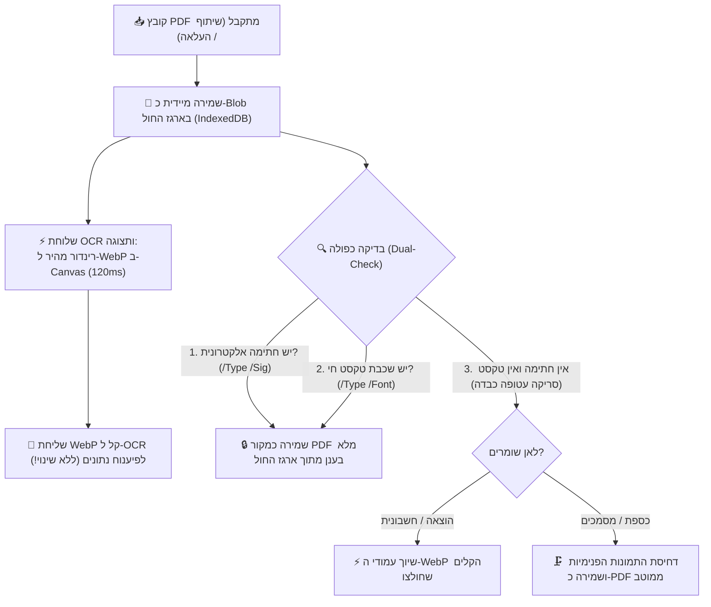

# מסמך החלטות ארכיטקטוניות ושיקולי מערכת (Architecture Decision Records - ADR)

מסמך זה מתעד את כל שיקולי העומק, ההחלטות הארכיטקטוניות, והסיבות להחלטות שקיבלנו בפרויקט **SmartShare**, כדי שנוכל לחזור אליהם תמיד, למנוע בלבול בעתיד, ולהבטיח שכל פיתוח עתידי יתבסס על ההחלטות המקוריות והנכונות.

---

## 1. אסטרטגיית קבצים, מסמכים והמרות (PDF לעומת WebP)

### הדילמה / השאלה שעלתה:
מדוע כל התמונות מומרות אוטומטית ל-WebP? ומה קורה עם קובצי PDF – האם שומרים את המקור או ממירים ל-WebP? ומה לגבי חתימות אלקטרוניות בחשבוניות?

### השיקולים וההחלטה שהתקבלה:
1. **שימור שלמות משפטית ודיגיטלית (PDF מקורי בכספת / מחסן מסמכים):**
   * קובצי PDF אינם רק תמונות סטטיות. הם מכילים:
     * **חתימות אלקטרוניות מאומתות** (חתימות דיגיטליות רשמיות על חוזים, מסמכי בנק, טפסי רשויות בתקן PAdES/PKCS#7).
     * **שכבות וקטוריות וטקסט חי** המאפשר סימון, חיפוש טקסטואלי, והעתקה.
     * **מבנה רב-עמודי רשמי**.
   * אם היינו ממירים PDF חוזה לתמונת WebP – **היינו הורסים את החתימה הדיגיטלית ואת התוקף המשפטי שלו**, והמשתמש לא היה יכול להוריד או להציג שוב את המסמך המקורי כקובץ PDF אמיתי.
   * **ההחלטה:** במחסן המסמכים / כספת (`vault` / `documents`), קובץ ה-PDF נשמר **בדיוק כפי שהוא (פורמט PDF מקורי)** בענן. לצד זה, המערכת מייצרת תמונת WebP ממוזערת של העמוד הראשון לצורך תצוגה מקדימה ומהירה בממשק.

2. **בדיקה כפולה לוודאות מוחלטת (100% Dual-Check Detection):**
   * **בדיקה ראשונה – חתימה אלקטרונית רשמית:**
     * בדיקה בינארית מהירה לקיום אובייקט `/Type /Sig` או `/SubFilter /adbe.pkcs7` או `/ETSI.CAdES.detached`.
     * אם קיים: **חל איסור מוחלט לשנות או לדחוס!** המסמך יישמר במלואו כקובץ מקורי.
   * **בדיקה שנייה – שכבת טקסט חי וגופנים (Digital-Born):**
     * בדיקה לקיום פונטים וטקסט וקטורי חי (`/Type /Font` וזרמי `/BT.../ET`). 
     * אם קיים: זהו מסמך מחשב מקורי (לרוב קטנטן, 50KB–500KB בלבד) – נשמר כמקור מלא ללא פגיעה!
   * **זיהוי סריקה עטופה (Scanned / Raster PDF):**
     * מתקיים אך ורק כאשר **אין חתימה אלקטרונית** וגם **אין טקסט חי**, ו-98% מנפח הקובץ הוא אובייקטי תמונות גולמיות (`/Subtype /Image`). רק אז מדובר בצילום כבד שנעטף כ-PDF.

3. **תרשים זרימה ארכיטקטוני – שילוב ארגז החול וה-OCR (Double-Track):**
   * הקובץ המקורי נקלט ונשמר תמיד תחילה כ-Binary Blob ב-IndexedDB המקומי (ארגז החול).
   * תהליך ה-OCR ממשיך לעבוד בצורה הקיימת, המהירה והבדוקה (הפקת WebP קל ב-120ms לטובת הפיענוח).
   * קובץ המקור המשויך להוצאה נלקח ישירות מארגז החול בהתאם לתוצאת הבדיקה הכפולה.

4. **סעיף משפטי בתקנון (Legal Disclaimer):**
   * ייכתב מסמך משפטי/תקנון למשתמש שבו יובהר ששמירת חשבוניות וצילומים באפליקציה נועדה לניהול שיתופי ומעקב הוצאות; במידה וחשבונית מועלית כצילום/תמונה או מומרת לצורכי עיבוד, החתימה האלקטרונית המקורית אינה מובטחת כרשומה מוסמכת לצורכי מס מחמירים (בדומה לכללי ניהול ספרים), והאחריות לשמירת מסמך המקור החתום חלה על המשתמש.

---

## 2. שיתוף קבצים מבחוץ (Web Share Target) וקבצים גדולים (20MB+)

### הדילמה / השאלה שעלתה:
למה קובץ 20MB ששותף מבחוץ גרם להקפאת המסך ולכישלון, ואיך נמנע את ההמתנה של 2 שניות שבהן מוצג מסך המרחבים במקום מודאל שיתוף?

### השיקולים וההחלטה שהתקבלה:
1. **איסור על שימוש ב-Base64 לקבצים גדולים:**
   * המרה של קובץ בינארי ל-Base64 מנפחת את גודלו ב-33% (20MB הופכים ליותר מ-27MB של טקסט).
   * פעולת ההמרה תוקעת את ה-Main Thread של הדפדפן בטלפון למשך 1–2 שניות.
   * שרתי Vercel Serverless Function חוסמים בקשות רשת מעל 4.5MB (`413 Payload Too Large`).
   * **ההחלטה:** שמירה ישירה של הקובץ כ-Binary `Blob` בזיכרון המכשיר (IndexedDB) דרך ה-Service Worker. שום מחרוזת Base64 ענקית לא נוצרת, וההעלאה לענן מתבצעת ישירות מול Firebase Storage (שתומך בקבצים גדולים ללא הגבלת 4.5MB של Vercel).

2. **חיווי משתמש מיידי (<50ms) למניעת בלבול (UX First):**
   * כאשר משתפים מבחוץ, האפליקציה נפתחת תחילה עם פרמטר `?shared=true`. בעבר המודאל הופיע רק לאחר שכל העיבוד הסתיים, מה שגרם למשתמש לחשוב שהשיתוף נכשל.
   * **ההחלטה:** ברגע שהדף נטען עם פרמטר שיתוף, מוצג מיידית ספינר/באנר פועם: *"📥 קולט קובץ ששותף..."* בתוך פחות מ-50 מילישניות, כך שהמשתמש מבין מיד שהפעולה עובדת ואין שום תקיעה.

---

## 3. ארכיטקטורת הודעות מתפרצות (Space Announcements)

### הדילמה / השאלה שעלתה:
איך להציג הודעות מתפרצות בצורה נעימה, שלא תשתלט על המסך, תתמוך בריבוי הודעות ממשתמשים שונים, ותאפשר שליחה אישית לחבר צוות ספציפי מבלי להעמיס על ממשק הניהול?

### השיקולים וההחלטה שהתקבלה:
1. **אי-הצגת ההודעה למי ששלח אותה:**
   * מי שכותב את ההודעה מודע היטב לתוכנה, ואין צורך להציג לו אותה כפופ-אפ מציק. ההודעה תוצג רק לשאר השותפים.
2. **הודעה פרטית מול הודעה כללית למרחב:**
   * תמיכה בשדה יעד `targetUserId`. אם נבחר שותף ספציפי, ההודעה מסומנת בבירור עם תגית "🔒 הודעה פרטית" ומוצגת אך ורק לו.
3. **קרוסלת הודעות אלגנטית (Swipe Carousel):**
   * כדי למנוע מצב שבו מספר הודעות דוחפות את תוכן הדף למטה ויוצרות גלילה אינסופית, כל ההודעות מקובצות לקרוסלה אחת אלגנטית עם מחוון נקודות (Dots) ואפשרות החלקה ימינה/שמאלה.
4. **ממשק ניהול מקופל (Accordion):**
   * הגדרות ההודעה המתפרצת בהגדרות/ניהול לא תופסות עמוד שלם אלא שורה מקופלת ונקייה עם חץ פתיחה.

---

## 4. תצוגת קובצי PDF, תמונות ממוזערות ומניעת שגיאת תמונה שבורה (Broken Image Icon)

### הדילמה / השאלה שעלתה:
מדוע בעת שיתוף ושמירת קובץ PDF לכספת (Vault) הופיע במציג המסמכים (`UniversalViewerModal`) אייקון של תמונה שבורה (`🖼️`), וכרטיס הקובץ בתיקייה היה ריק?

### ניתוח שורש (Root Cause):
1. **הבדל בין כתובות קובץ לכתובות זיכרון (`blob:` URLs):**
   * כאשר Service Worker מקבל קובץ משיתוף חיצוני, הוא מייצר כתובת זיכרון מקומית זמנית מסוג `blob:https://...`. כתובת זו תקפה אך ורק לכרטיסיית הדפדפן הנוכחית ופגה עם הניווט.
   * בדיקות קוד רבות בדקו האם `url.includes('.pdf')`. לכתובות `blob:` אין סיומת `.pdf` ולכן המערכת הסיקה בטעות שמדובר בתמונה (`type: 'document'`) ולא ב-PDF!
2. **חוסר יכולת של תגית `` להציג קובצי PDF:**
   * דפדפנים אינם מסוגלים לפענח ביתים של קובץ PDF בתוך תגית ``. כאשר תגית `img` מקבלת כתובת PDF, מפענח התמונות של הדפדפן נכשל ומציג את אייקון התמונה השבורה (`🖼️`).
3. **פתרון העומק ההנדסי שהוטמע:**
   * **זיהוי מבוסס MIME / מטא-דאטה אמיתי:** בדיקת סוג הקובץ אינה מסתמכת על מחרוזת ה-URL בלבד, אלא בודקת את ה-Blob האמיתי (`blob.type === 'application/pdf'`), שם הקובץ המקורי, והגדרת ה-type.
   * **שמירה כפולה בכספת (Dual Vault Artifacts):**
     1. קובץ ה-PDF המקורי נשמר בשלמותו ב-Firebase Storage כקובץ `.pdf` מלא.
     2. בעת השמירה מופקת מיידית תמונת WebP ממוזערת של עמוד 1 בלבד (`thumbnailUrl`, כ-40KB ב-120ms) ונשמרת כ-WebP.
   * **תצוגה בממשק:**
     * כרטיסי המסמכים בתיקייה מציגים תמיד את ה-`thumbnailUrl` (WebP קל שנטען ב-50ms).
     * מציג המסמכים (`UniversalViewerModal`) מזהה קובצי PDF ומנתב אותם ל-`DynamicPdfScrollPreview` (שמרנדר באמצעות PDF.js על Canvas עם תמיכה בזום ומסכי מגע), ולעולם אינו מנסה לשבץ קובץ PDF בתוך תגית ``.
     * שוער הגנה (Safety Fallback) הוטמע כך שגם אם תגית תמונה נכשלת ברינדור, מוצג כרטיס שגיאה אלגנטי עם אפשרות להורדת הקובץ ולא האייקון השבור של הדפדפן.

---

## 5. ארכיטקטורת תצוגה מבוססת עמודים (Pages Architecture) ומניעת לולאות פולינג בשיתוף 20MB

### הדילמה / השאלות שעלו:
1. מדוע שיתוף קובץ 20MB נתקע ולא הצליח להיטען למודאל?
2. מדוע מסמכים רגילים (כמו הצעות מחיר וסריקות) סומנו בתגית `PDF` שחורה ולא הוצגו כראוי בעת פתיחה?
3. כיצד מאפשרים צפייה מיידית במסמכים רבי-עמודים ללא תלות ב-CORS או קריסות מעבד?

### ניתוח שורש והחלטות הנדסיות:
1. **לולאת פולינג אינסופית ב-`processFoundBlobs`:**
   * ה-Interval קרא כל 250ms ל-IndexedDB. מכיוון ש-`processFoundBlobs` לא מחק את המאגר ולא סימן `hasHandledShareRef.current = true`, הקוד קרא את קובץ ה-20MB 4 פעמים בשנייה ויצר עשרות משימות PDF.js במקביל שחנקו את המעבד.
   * **ההחלטה:** ברגע שהקובץ נקרא פעם אחת ראשונה – מסמנים מיידית `hasHandled = true`, מוחקים את הרשומה מ-IndexedDB, ועוצרים את הפולינג. המודאל עולה ב-100ms חלקים.
2. **החזרת הבדיקה הכפולה (Dual-Check Detection) לשמירה בכספת:**
   * חל איסור לשמור כל קובץ כ-`type: 'pdf'` גורף.
   * **אם יש חתימה אלקטרונית או שכבת טקסט וקטורי:** שומרים את ה-PDF המקורי ב-Firebase Storage (`url`), אך חובה לחלץ בנוסף את עמודי ה-WebP לתוך מערך `pages`.
   * **אם זו סריקה/הצעת מחיר רגילה (ללא חתימה):** מחלצים את עמודי ה-WebP, ושומרים כ-`type: 'document'`. אין תגית PDF שחורה מבלבלת.
3. **תצוגה אולטרה-מהירה ב-`UniversalViewerModal` דרך `pages`:**
   * במקום לנסות להריץ PDF.js או Google Docs Viewer על קישורי ענן (שנחסמים ב-CORS), המציג משתמש במערך ה-`pages` (תמונות WebP מוכנות מראש).
   * מסמכים מוצגים בתוך 50ms, עם גלילה רציפה ("מגילה"), מחוות מגע, והגדלה (Zoom & Pan) חלקה לחלוטין.
   * קובץ ה-PDF המקורי נשאר זמין ושלם להורדה ולשיתוף דרך כפתור "הורדה".
4. **עקיפת CORS באמצעות `/api/pdf-proxy`:**
   * לקובצי PDF ישנים ללא מערך עמודים מוכן, נוצר נתיב שרת ייעודי שמזרים את הקובץ ללא חסימות דפדפן.

---

## 6. זיהוי קובץ עטוף (Wrapped Raster Scan) ומניעת החלטות גסות לפי משקל כולל (v3.4.25)

### הדילמה / השאלה שהועלתה:
1. בדיקת סף גסה של משקל קובץ כולל (`fileSize < 2.5MB`) עלולה להיכשל על קובץ PDF וקטורי דיגיטלי מקורי שהוא גדול בגלל מספר עמודים רב (למשל חוברת הנדסית של 80 עמודים ששוקלת 10MB).
2. מאידך, קובצי PDF סרוקים "עטופים" (תמונת סריקה כבדה בתוך מעטפת PDF, גם עם שכבת OCR מוטמעת) צריכים להידחס ולהצטמצם ל-WebP ולא להישמר כ-PDF גולמי.

### ההחלטה והפתרון ההנדסי:
1. **הפרדה עמוקה בין 3 רמות בדיקה (`analyzePdfStructure` + `isTrueOriginalPdf`):**
   * **רמה 1 - חתימה דיגיטלית חוקית (`/Type /Sig`, `/ByteRange`, `adbe.pkcs7`):** אם קיימת, הקובץ תמיד נשמר כ-PDF מקורי שלם ללא קשר למשקלו או למספר עמודיו, כדי לשמר את תוקפו המשפטי.
   * **רמה 2 - זיהוי קובץ עטוף (`isWrappedRasterScan`):**
     * חישוב צפיפות משקל לעמוד: `avgBytesPerPage = fileSize / pageCount`.
     * בדיקת רשימת האופרטורים של עמוד 1 דרך PDF.js לאיתור `paintImageXObject` שמכסה את כל העמוד (מאפיין מובהק של צילום/סריקה).
     * אם הקובץ הוא ללא חתימה, ומכיל תמונת סריקה מלאה עם משקל עמוד כבד (> 700KB לעמוד) – הוא מסווג כ**קובץ סרוק עטוף**!
     * **דינו של קובץ עטוף:** נדחס ומומר לעמודי WebP קלים (חיסכון של 90%+ בנפח), ללא תגית PDF שחורה.
   * **רמה 3 - PDF וקטורי מרובה עמודים:**
     * אם הקובץ מכיל שכבת טקסט וקטורית אמיתית ומשקל הדף הממוצע קל (`avgBytesPerPage <= 700KB`), הקובץ מזוהה כ-PDF מקורי ונשמר ככזה, אפילו אם יש בו 50 או 100 עמודים.
2. **ריכוז טעינת `pdfjsLib` (DRY Principle):**
   * יצירת הפונקציה הגלובלית `ensurePdfJsLoaded()` כ-Single Source of Truth ומחיקת 4 כפילויות של הזרקת תגית `<script>` ברחבי המערכת.

---

## 7. מנגנון תחולת שותפות בהוצאות עבר (3-Day Grace Period) ותצוגת גודל קובץ במסמכים (v3.4.26)

### הדילמה והאתגר:
1. **איפוס חובות שגוי של שותפים פעילים:** לחיצה על "מכאן והלאה" בכרטיס שותף החריגה אותו מכל החשבוניות במרחב באופן גורף, ומחקה את החובות של שותף פעיל גם על הוצאות שנוצרו אחרי שהוא הצטרף.
2. **צורך בתיקון טעויות צירוף במודל ווטסאפ ישיר:** מנהל שצירף שותף צריך אפשרות לתקן אם השותף משתתף בהוצאות העבר, אך יש למנוע מחיקת היסטוריה באמצע חיי פרויקט.
3. **תצוגת גודל קובץ (Rule 12):** המשתמש ביקש להציג לצורכי פיתוח ובדיקה את גודל הקובץ ליד כל מסמך שנשמר (בכרטיס, ברשימה ובמציג). יש לתעד זאת כאלמנט זמני למעקב שניתן להסירו בעתיד לבקשת המשתמש.

### ההחלטה והפתרון ההנדסי:
1. **עיגון "ממועד ההצטרפות" לתאריך `joinedAt` של השותף:**
   * בלחיצה על "ממועד ההצטרפות", הפונקציה `toggleMemberRetroactive` מחריגה את השותף **אך ורק מחשבוניות שנוצרו לפני מועד הצטרפותו** (`inv.createdAt < member.joinedAt`).
   * כל חשבונית שנוצרה ממועד הצטרפותו והלאה **אינה מוחרגת לעולם** – השותף מחויב בה במלואה.
2. **חלון זמן של 3 ימים (72 שעות) לשינוי הגדרה:**
   * מנהל המרחב רשאי לשנות את התחולה במהלך 3 ימים ראשונים בלבד.
   * בתום 3 הימים, ההגדרה ננעלת חזותית וקודקוד ומסומנת כ-`🔒 נעול (מעל 3 ימים)`.
   * שינוי לאחר הנעילה מתאפשר אך ורק לאדמין המערכת (`user.isAdmin === true`).
3. **תצוגת גודל מסמך (`fileSize` + `formatFileSize`):**
   * כל מסמך שמועלה (דרך שיתוף חיצוני או העלאה בכספת) שומר את גודלו בבתים (`fileSize`).
   * גודל הקובץ מוצג כעת בבירור ליד התאריך בכרטיס המסמך (Grid), בשורת הרשימה (List), ובמודאל הצפייה (`UniversalViewerModal`).
   * *תזכורת Rule 12:* רכיב תצוגה זה הוגדר לבקשת המשתמש לצורכי בדיקה ופיתוח ויוסר בעתיד במידה ויכביד על המשתמשים.

---

## 8. מספור מסמכים, סימון הצעות מחיר מועדפות, ומניעה מוחלטת של אייקון תמונה שבורה בקובצי PDF (v3.4.27)

### האתגרים:
1. **אייקון תמונה שבורה (Broken Image) במציג המסמכים:**
   כאשר משתמש פתח מסמך מסוג PDF (ששמור כ-PDF מקורי או נטען מכתובת URL/blob שאינה מסתיימת בפירוש ב-`.pdf`), מציג המסמכים ניסה לעתים לרנדר תגית ``. הדפדפן אינו תומך בהצגת PDF בתוך `` והציג אייקון של תמונה שבורה (`broken image placeholder`) לצד טקסט ה-alt.
2. **היעדר משקל קובץ במסמכים קיימים:**
   מסמכים היסטוריים שהועלו לפני הוספת שדה ה-`fileSize` הוצגו ללא משקל (תגית ריקה).
3. **זיהוי והתמצאות במסמכים (מספור):**
   המשתמש ביקש שכל מסמך יקבל מספר ייחודי וברור (`#1`, `#2`...) כדי שניתן יהיה לזהות אותו ולהתייחס אליו בקלות.
4. **סימון הצעות מחיר מועדפות / רלוונטיות:**
   משתמשים מקבלים מספר הצעות מחיר עבור פרויקט ומעוניינים לסמן בכוכב (⭐) את ההצעה הרלוונטית או המועדפת שנבחרה, ולסנן את התצוגה כך שיוצגו רק הצעות מועדפות.

### הפתרון ההנדסי:
1. **איסור מוחלט על רנדור PDF בתוך ``:**
   ב-`UniversalViewerModal`, הוגדרה בדיקה קשיחה: אם `isDocPdf` מתקיים (לפי `type === 'pdf'`, סיומת, או mime) ואין עמוד תמונה מרונדר מראש (`validImagePages`), המסמך **מנותב ישירות וללא יוצא מן הכלל** למנוע ה-PDF המתקדם `DynamicPdfScrollPreview`. תגית `` לעולם אינה מקבלת כתובת PDF.
2. **מדידה פרואקטיבית ברקע + חיווי `⚖️ מודד...`:**
   נוסף `useEffect` ב-`DocumentsWidget` שמזהה מסמכים ללא `fileSize`, מודד את משקלם באמצעות `HEAD` request מהיר / blob, מעדכן את ה-state המקומי מיידית, ושומר את הערך ב-Firestore (`updateDocument`). בזמן המדידה מוצג חיווי `⚖️ מודד...` כדי שהמשתמש יידע שהמערכת בתהליך חישוב.
3. **מספור מסמכים אינטואיטיבי (`#1`, `#2`, `#3`...):**
   * בתצוגת כרטיסים (Grid): תגית מספר `#1` בפינה העליונה של התמונה המקדימה.
   * בתצוגת רשימה (List): עמודת מספר `#1` ייעודית בראש השורה.
   * במודאל הצפייה (`UniversalViewerModal`): כותרת עליונה בפורמט `#{currentIndex + 1} • {title}`.
4. **מערכת מועדפים והצעות רלוונטיות (⭐):**
   * כפתור כוכב בכל כרטיס ובכל שורת רשימה, וכן בראש מודאל הצפייה.
   * לחיצה אחת מבצעת טוגל אופטימי ושומרת `isFavorite: true/false` ב-Firestore.
   * מסמך מועדף מודגש במסגרת זהובה יוקרתית, צל עדין, ותגית `⭐ הצעה מועדפת`.
   * נוסף כפתור סינון `⭐ מועדפים בלבד` בסרגל הכלים של המדף לסינון מיידי.
